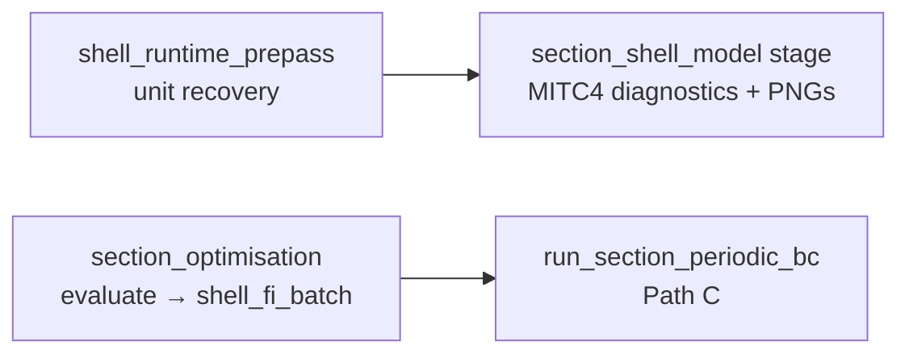

# section_shell_model — performance optimisation report

Status/review document for computational-efficiency work on `blade_precompute/section_shell_model` and its orchestration / optimisation call paths. For methodology and element formulation see [SHELL_MODEL.md](SHELL_MODEL.md). For a well-optimised sibling package to emulate, see [section_geometry/docs/PERFORMANCE_WORK_SUMMARY.md](../../section_geometry/docs/PERFORMANCE_WORK_SUMMARY.md).

## Goal

Reduce wall-clock time for MITC4 / HSDT shell section solves (assembly, periodic homogenisation, stress recovery, and Hashin FI) without changing numerical parity. The dominant cost today is **Python-level per-element work** inside the production periodic Path C, multiplied by station count and design-iteration count.

## Implementation status

| # | Finding | Status |
|---|---------|--------|
| 1 | Periodic Path C full clamped solve on zero loads | **Done** — Path C uses assembly-only `assemble_global_shell`; no solve/recovery on the zero-load pre-pass |
| 2 | Pure-Python Gauss integration in element stiffness | **Done** — `_KE_TEMPLATE_CACHE` memo + vectorised `einsum` Gauss integration on first build (`mitc4_stiffness`) |
| 3 | Repeated `abd_stack` per panel within a solve | **Done** — panel ABD threaded via assembly 8-tuple + `_PERIODIC_K6_CACHE`; pre-solve `collect_panel_abd_stack` on HSDT/legacy paths |
| 4 | COO global assembly via Python `list.append` | **Done** — global assembly vectorised; panel-local path uses preallocated COO buffers |
| 5 | Optimiser hot path: no station-level FE cache | **Done** — Path C uses `api/periodic.py` assembly/K6 caches; load-only re-eval skips re-assembly |
| 6 | Duplicate sparse reduction for traction superposition | **Done** — `_KRR_FACTOR_CACHE` reuses `splu` factor in `periodic_traction_superposition.py` |
| 7 | Duplicate edge-traction diagnostics in recovery | **Done** — gated by `SECTION_SHELL_EDGE_TRACTION_DIAG` (default on; set `0` on hot paths) |
| 8 | Cusp traction penalty: 20 unit-load integrations | **Closed-deferred** — spine deleted with R3; analytical ∂Tx/∂d research only |
| 9 | Legacy panel-local BC via LIL row zeroing | **Closed-obsolete** — `panel_mitc4_model` deleted with Path B |
| 10 | Duplicate `lib/` vs `engine/` assembly modules | **Done** — `lib/` tree deleted; `engine/global_shell_assembly.py` is the single assembly implementation |
| 11 | Serial orchestration of per-station shell stages | **Done** — v2 station loop + prepass parallelised via `shell_runtime.run_v2_shell_station_loop` |
| 12 | Periodic `(K6, u_modes)` cache + laminate fingerprint | **Done** — see finding #12 section below |
| 13 | Batched CLPT Hashin | **Done** — `hashin_fi_per_ply_from_rows_batch` + `materials/clpt_recovery.py` |

## Problem sizes (typical production)

| Quantity | Typical range | Where set |
|----------|---------------|-----------|
| Panels per section | ~8–12 (twin-web layouts) | Topology from `build_section_v2` / Pipeline B |
| Elements per panel | **Default 10**; optim **4**; examples **6–12** | `engine/shell_solve_registry.py`, `main_precompute.py` mesh knobs |
| Chord-based meshing | target element length ≈ **1.2% chord** | `core/section_strip_mesh.py` (`TARGET_ELEMENT_LENGTH_FRAC = 0.012`) |
| Total strip elements | ~**50–150** | panels × n_elem |
| DOFs per node | **6** MITC4+ global; **5** panel-local; **8** HSDT | `core/fem_config.py`, `element_library/hsdt/hsdt_element_kernel.py` |
| Global DOFs | ~**500–2,000** | ≈ `n_global_nodes × 6` |
| Element stiffness | 24×24 (MITC4+); 32×32 (HSDT) | `element_library/mitc4/element.py` |
| Periodic K6 | 6×6 dense | `engine/homogenisation.py` |

## Pipeline touchpoints

| Caller | Frequency (default `N_STRUCTURAL=16`, `SECTION_PLOT_STATION_SPEC=all`) | Entry |
|--------|--------------------------------------------------------------------------|-------|
| `shell_runtime_prepass` | 16× per run (parallel when `section_solve_n_workers > 1`) | `orchestration/precompute/shell_runtime.py` |
| `section_shell_model` stage | 16× if enabled (parallel v2 loop) | `orchestration/precompute/stages_pkg/shell.py` |
| `shell_fi_batch` (optimiser) | **every `evaluate()`** × 16 stations (parallel pool) | `section_optimisation/engine/shell_fi_eval.py` |
| Iteration snapshots | 1× per snapshot when enabled (default off) | `main_precompute.py` `ITERATION_PIPELINE_SNAPSHOTS` |

Per-stage wall time is recorded in `<job>/runtime.json` (`section_shell_model_s`, `shell_runtime_prepass_s`, `section_optimisation_s`).

## What is already good

| Area | Detail |
|------|--------|
| Global stiffness | COO → CSR assembly; no dense global K |
| Linear solve | `scipy.sparse.linalg.spsolve` / `splu` on reduced systems |
| MPC / periodic reduction | Sparse constraint matrices `T`; 6×6 K6 solve is appropriately dense |
| Plotting / IO | No matplotlib or large JSON dumps inside `engine/` or `api/` (`periodic`, `pipeline_b`) hot paths |
| Geometry cache (optimiser) | `_PIPELINE_B_CACHE` in `shell_fi_eval.py` caches Pipeline B topology per station |
| Periodic FE cache (optimiser) | Path C assembly/K6 caches in `api/periodic.py`; load-only re-eval skips re-assembly |
| Worker pool warm-up | `ProcessPoolExecutor(initializer=_shell_fi_worker_init)` retains caches per worker |
| Laminate-level ABD memos | `materials/laminate.py` fingerprint caches reduce repeated CLT work at laminate access |
| `collect_panel_abd_stack` | Pre-solve batch for HSDT/legacy; FSDT periodic consumes cached ABD from K6 cache |

## Ranked findings

### 1. Periodic Path C runs a full clamped solve + recovery on zero loads, then discards the result

**Status:** **Done**

**Impact (before):** Critical — one sparse factorisation + full per-element recovery per station per evaluate, even though only `K_global`, `node_meta`, and `panel_maps` are needed for periodic homogenisation.

**Resolution:** `engine/section_assembly.assemble_section_from_panels` (wrapped by `assemble_global_shell`) returns `(K_global, f_global, node_meta, panel_maps, …)` **without** constraint build, MPC reduction, `spsolve`, or per-element recovery. Periodic solvers obtain assembly via `_cached_periodic_assembly` / `_cached_tapered_periodic_assembly`, then proceed via `compute_k6_periodic_bc` and secondary recovery on the assembled matrix.

The assembly cache (`_PERIODIC_ASSEMBLY_CACHE`) additionally memoises the assembled `(K_global, f, node_meta, panel_maps)` per `(panel topology, mesh spec, bc/interface mode)`, so repeated evaluates on unchanged geometry skip assembly entirely.

**Parity guard:** `tests/test_global_shell_assembly.py` and
`tests/test_formulation_cache_assembly_parity.py` lock the assembly-only
`K_global` / scatter-add path (the former full-solve matrix compare was removed
with `solve_global_coupled_shell` in R3, 2026-07-14).

**Pattern:** Same as section_geometry — **do not recompute downstream stages when upstream invariants are unchanged**.

---

### 2. Pure-Python Gauss integration in element stiffness kernels

**Status:** **Done**

**Impact (before):** Critical — dominant CPU in assembly; called once per element (~50–150× per solve).

**Resolution:** `element_library/mitc4/element.py` memoises the full element stiffness in `_KE_TEMPLATE_CACHE` and builds the first miss with vectorised `einsum` over batched Gauss points (`natural_coordinate_form` + `np.einsum("g,gai,ab,gbj->ij", ...)`). Strip meshes with uniform element length per panel hit the cache after the first element.

**Parity guard:** `element_library/mitc4/tests/test_mitc4_operator_stiffness.py::test_mitc4_stiffness_einsum_matches_legacy_gauss_loops`.

---

### 3. Repeated `abd_stack(p.lam.build_plies())` per panel within a single solve

**Status:** **Done**

**Impact (before):** High — laminate ABD loop-invariant per panel but recomputed in assembly, recovery, and post-solve consumers.

**Resolution:** FSDT periodic Path C stores panel ABD in `_PERIODIC_K6_CACHE` alongside `(K6, u_modes)`. `global_shell_assembly.assemble_global_shell` returns an 8-tuple including pre-built panel ABD stacks. HSDT periodic and legacy Path B call `collect_panel_abd_stack` once pre-solve (not post-solve). Batch Hashin uses `stiffness_bundle()` via `materials/laminate.py`.

---

### 4. COO global assembly via Python `list.append` per matrix entry

**Status:** **Done**

**Impact (before):** High on the legacy panel-local path — 576 Python appends per MITC4 element.

**Resolution:** Production global assembly uses vectorised `_coo_triplets_from_ke` / formulation-cache scatter-add (`engine/section_assembly.py`). The legacy panel-local path in `panel_mitc4_model.py` was removed with Path B (2026-07-14).

---

### 5. Optimiser hot path: no station-level FE cache; scalar CLPT Hashin per element

**Status:** **Done**

**Impact (before):** High in optimise mode — `shell_fi_batch` called `run_section_periodic_bc` every evaluate without reusing assembly/K6.

**Resolution:** Path C uses module-level `_PERIODIC_ASSEMBLY_CACHE` and `_PERIODIC_K6_CACHE` in `api/periodic.py`. Load-only re-eval with unchanged geometry hits K6 cache and skips `assemble_global_shell` (see `section_optimisation/tests/test_shell_fi_load_only_cache.py`). `_PIPELINE_B_CACHE` retains Pipeline B topology. Path B (`use_periodic_bc=False`) removed from optimiser; B-vs-C regression uses dedicated tests. Batched CLPT Hashin via `hashin_fi_per_ply_from_rows_batch`.

---

### 6. Duplicate sparse reduction / factorisation for traction superposition

**Status:** **Done**

**Impact (before):** Medium — second full MPC reduction + `spsolve` on the same `K_global` when surface traction is present.

**Resolution:** `engine/periodic_traction_superposition.py` maintains `_KRR_FACTOR_CACHE` (LRU, max 8 entries). `reduce_propagate_solve` accepts optional `K_rr_factor` and returns the factor for reuse on subsequent RHS (`engine/connected_assembly_core.py`).

---

### 7. Duplicate edge-traction diagnostics in recovery loop

**Status:** **Done**

**Impact (before):** Medium on diagnostic / Path B paths.

**Resolution:** `processing/diagnostics/equilibrium_checks.py` gates `check_cluster_equilibrium` behind `SECTION_SHELL_EDGE_TRACTION_DIAG` (default `"1"` for test parity; set `"0"` on hot orchestration paths).

---

### 8. Cusp traction penalty: 20 unit-load edge integrations per 2-way cluster

**Status:** **Closed-deferred** (2026-07-14) — diagnostic spine deleted with R3

**Impact:** Was low–medium only when `enforce_traction_balance_at_cusp=True` (never on the production periodic FI path).

**Where:** Formerly `engine/global_shell_assembly.py` (`_cusp_traction_penalty_modifier` + `solve_global_coupled_shell`); removed. Notes in [`DEFERRED_RESEARCH.md`](DEFERRED_RESEARCH.md).

**Research direction (not scheduled):** Analytical ∂Tx/∂d from edge B-matrices for Defect K.

---

### 9. Legacy panel-local BC application via LIL row zeroing

**Status:** **Closed-obsolete** (2026-07-14) — caller path deleted with Path B

**Impact:** Was low unless the legacy per-panel path was used heavily.

**Where:** Formerly `element_library/mitc4/utilities/panel_mitc4_model.py` (`_apply_bcs`).
That module and the clamped Path B FE entry were deleted; production uses
`reduce_propagate_solve` / `SectionLinearStaticRunner`. No further work.

---

### 10. Duplicate `lib/` vs `engine/` assembly modules

**Status:** **Done**

**Impact:** Maintenance / import overhead, not runtime per se.

**Resolution:** The `lib/` shim tree has been deleted. Production assembly is `assemble_section_from_panels` / `assemble_global_shell` / `assemble_for_periodic_k6`. The former full-solve spine `solve_global_coupled_shell` was deleted in R3 (2026-07-14); traction overlay and CCX use independent contour-support helpers. Former `api/thin_wall_bridge.py`, `api/recovery_adapter.py`, and `api/legacy_clamped.py` have been removed; callers import `engine/global_shell_assembly`, `api/periodic`, and `api/pipeline_b` directly.

---

### 12. Periodic `(K6, u_modes)` cache + laminate fingerprint on assembly key

**Status:** **Done**

**Impact:** High in optimisation loops when geometry/laminate/mesh are stable but beam resultants change each iteration.

**Where:** `api/periodic.py` — `_laminate_cache_fingerprint`, `_cached_periodic_k6`, extended `_periodic_assembly_cache_key`.

**Resolution:** Assembly cache keys now fingerprint full laminate stacks (not just `t/E/nu`). Homogenisation `(K6, u_modes, y_e, z_e)` is memoised alongside assembly; load-only solves reuse factorised modes and perform only the 6×6 `K6 @ q = f_beam` step.

---

### 13. Batched CLPT Hashin in `hashin_fi_per_ply_from_rows_batch`

**Status:** **Done**

**Impact:** Medium in `shell_fi_batch` hot path (many elements sharing one laminate).

**Where:** `api/fi_recovery.py` — single `abd_stack` + batched `np.linalg.solve` over trusted rows.

---

### 11. Serial orchestration of per-station shell stages

**Status:** **Done**

**Impact (before):** Medium at station count — shell prepass and v2 diagnostic stage ran serially.

**Resolution:** `orchestration/precompute/shell_runtime.py` exposes `run_v2_shell_station_loop` and parallel prepass with JSON sidecar reload (`section_shell_model/io/prepass_station_analysis_io.py`). `stages_pkg/shell.py` delegates to the parallel runtime when `section_solve_n_workers > 1`. Legacy FSDT loop was already parallel via `run_fsdt_shell_loop`.

**Production A/B (2026-07-07):** At `N_STRUCTURAL=16`, workers=1 vs 4, combined `shell_runtime_prepass_s + section_shell_model_s` speedup **2.02×** (52.6 s → 26.0 s). See [orchestration/docs/PERFORMANCE_MEASUREMENT_DEFERRED_OPTIMISATIONS.md](../../orchestration/docs/PERFORMANCE_MEASUREMENT_DEFERRED_OPTIMISATIONS.md) and `benchmarks/run_runtime_ab.py`.

---

## Explicit non-goals

| Item | Rationale |
|------|-----------|
| Numba / Cython element kernels | section_geometry deferred compiled code after NumPy + memoisation sufficed |
| Dense global K or dense global solve | Already sparse CSR; problem sizes (~2k DOF) appropriate for sparse direct solvers |
| Panel-buckling dense eigensolver changes | Off by default (`ENABLE_PANEL_BUCKLING=False`); uses dense subblocks intentionally for moderate n_dof |
| Geometric nonlinear Newton loop | **Out of scope** — will not feature; generalised section BVP is linear-only |
| 7th warping / bimoment mode (Path C) | **Out of scope** — will not feature in `section_shell_model` |

## Recommended measurement approach

1. **Pipeline-level:** Compare `<job>/runtime.json` stage seconds before/after changes (`section_shell_model_s`, `shell_runtime_prepass_s`, `section_optimisation_s`).
2. **Micro-benchmark:** cProfile one `run_section_periodic_bc` call and one `shell_fi_batch` worker task; count calls to `mitc4_stiffness`, `build_ABD`, `spsolve`.
3. **Regression:** Lock FI tensors and K6 matrices against existing tests (`tests/test_periodic_cluster_basis.py`, `section_optimisation/tests/test_shell_fi_*`); tolerance ~1e-10 for summation reordering (section_geometry SoA precedent).
4. **Optional harness:** Extend `examples/benchmark_shell_elements.py` with timed repeats and element-count sweep (8–24 elements/panel).

## Suggested implementation priority

1. ~~Assembly-only mode for periodic Path C (finding #1).~~ **Done**
2. ~~Thread panel-level ABD through assembly (finding #3).~~ **Done**
3. ~~Station-level FE cache in `shell_fi_eval` / periodic caches (finding #5).~~ **Done**
4. ~~Vectorise element stiffness Gauss loop (finding #2).~~ **Done**
5. ~~Preallocated COO scatter on panel-local path (finding #4).~~ **Done**
6. ~~Batch CLPT Hashin recovery (finding #13).~~ **Done**
7. ~~Reuse factorisations; gate diagnostics (findings #6–7).~~ **Done**
8. ~~Parallelise v2 orchestration shell loop (finding #11).~~ **Done**
9. Remaining research-only (not hot path): cusp penalty analytical ∂Tx/∂d (#8, gated on Defect K); HSDT element Gauss batching (lower priority). Finding #9 closed-obsolete.

## Related documents

- [SHELL_MODEL.md](SHELL_MODEL.md) — formulation and assembly modes
- [PERIODIC_CCX_HOMOGENIZATION.md](PERIODIC_CCX_HOMOGENIZATION.md) — CalculiX validation and recovery notes
- [DEFERRED_RESEARCH.md](DEFERRED_RESEARCH.md) — out-of-scope policy and deferred backlog
- [materials PERFORMANCE_OPTIMISATION_REPORT.md](../../materials/docs/PERFORMANCE_OPTIMISATION_REPORT.md) — laminate fingerprint memos
- [section_geometry PERFORMANCE_WORK_SUMMARY.md](../../section_geometry/docs/PERFORMANCE_WORK_SUMMARY.md) — optimisation patterns to adopt
