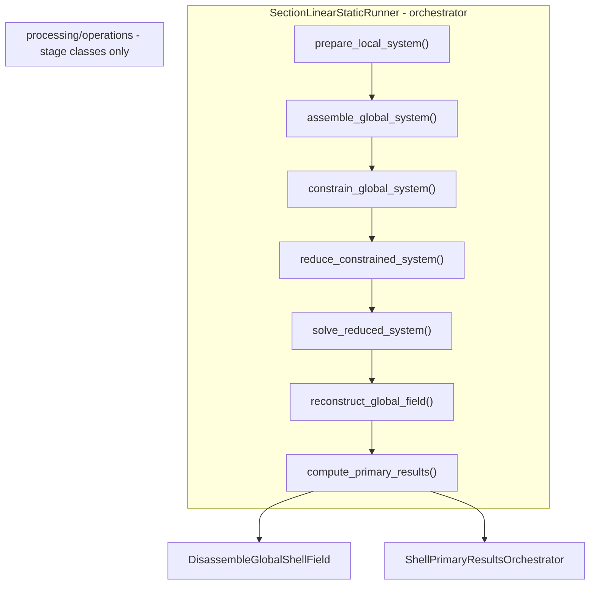

# Section solve — staged architecture and naming philosophy

**Status:** implemented. Stage classes live in `processing/operations/`; the `engine/section_solve/` re-export shim had zero inbound importers and was deleted (Phase 5 Wave A, see `PRE_PROCESSING_ARCHITECTURE_PROPOSAL.md`). Orchestration via `SectionLinearStaticRunner` in `simulation_runner/`.

## Why this philosophy

The section shell solve is a sequence of well-defined engineering transformations:
local element matrices are assembled into a global system, boundary conditions and
kinematic-compatibility constraints are imposed, the system is reduced to its independent
degrees of freedom, solved, and the solution is expanded back and recovered per element.

We deliberately follow the structural philosophy of the reference solver in
`1d-fem/processing/static/operations/`: **each substep of the engineering problem is a
discrete, single-responsibility stage, named for the transformation it performs and the
state of the system it produces.** Reading the stage names top-to-bottom should teach the
finite-element solve as a sequence of *system-state transitions*, not obscure it behind one
opaque function.

This is an educational-nomenclature choice as much as an architectural one: the names are
the documentation.

## System-state vocabulary (the teaching thread)

> **local system** (per-element `Ke`, `fe`)
> → **global system** (`K`, `f` assembled)
> → **constrained system** (supports + kinematic-compatibility MPCs imposed)
> → **reduced system** (`K_reduced = Tᵀ K T` on the independent DOFs)
> → **solved reduced system** (`q`)
> → **reconstructed global field** (`d_global = T q`)
> → **disassembled element results** (`U_e`, element residual)
> → **primary results** (support reactions, equilibrium residual)

Each arrow is one stage class. Each noun is one output dataclass.

## Stages

Stage classes live in `processing/operations/`; their frozen output dataclasses live in
`core/solve_states.py` (relocating to `processing/operations/solve_states.py`, Phase 5 Wave B/7 —
see `PRE_PROCESSING_ARCHITECTURE_PROPOSAL.md`). `engine/section_solve/` was a re-export shim for
backward compatibility; it had zero inbound importers and was deleted in Phase 5 Wave A.

| Stage class | Engineering step | Output system-state | 1d-fem analogue |
|-------------|------------------|---------------------|-----------------|
| `PrepareLocalShellSystem` | Validate each element `Ke` (square, finite) and `fe` (finite, dims match) before assembly | `LocalShellSystem` | `PrepareLocalSystem` |
| `AssembleGlobalShellSystem` | Scatter-add local contributions into global `K`, `f`; record symmetry / norm / nnz | `GlobalShellSystem` | `AssembleGlobalSystem` |
| `ConstrainGlobalShellSystem` | **Impose** supports (fixed DOFs) and kinematic-compatibility MPCs; propagate fixity; build DOF provenance | `ConstrainedShellSystem` | `ModifyGlobalSystem` |
| `ReduceConstrainedShellSystem` | **Reduce** to independent DOFs: build transform `T`, form `K_reduced = Tᵀ K T`, `f_reduced = Tᵀ f` | `ReducedShellSystem` | `CondenseModifiedSystem` |
| `SolveReducedShellSystem` | Factor `K_reduced` once; solve for one or many right-hand sides | `SolvedReducedShellSystem` | `SolveCondensedSystem` |
| `ReconstructGlobalShellField` | Expand reduced solution to the full DOF vector `d = T q`; NaN / fixed-DOF / energy checks | `ReconstructedShellField` | `ReconstructGlobalSystem` |
| `DisassembleGlobalShellField` | Scatter the global field back to per-panel `U_e`; per-panel residual norm | `DisassembledShellResults` | `DisassembleGlobalSystem` |
| `ShellPrimaryResultsOrchestrator` | Split masked support **reactions** (`K U − f` at fixed DOFs) from free-DOF **residual** (`f − K U`); expose **`r_full = K U − f`** | `PrimaryShellResults` | `PrimaryResultsOrchestrator` |

## Adaptations from the 1d-fem reference

The philosophy is faithful; three details are adapted to the shell section solve:

- **Elimination, not penalty + condensation.** 1d-fem imposes boundary conditions by the
  penalty method (`ModifyGlobalSystem`) then statically condenses (`CondenseModifiedSystem`).
  Blade eliminates through the master/reduced transform `T` (`K_reduced = Tᵀ K T`). The two
  stages are **kept separate** — imposing constraints and reducing the DOF space are distinct
  engineering steps — even though both are realised through `T`.
- **Factor-once / solve-many.** The periodic homogenisation solves the same `K_reduced`
  against many unit-load right-hand sides. `SolveReducedShellSystem` factors once and exposes
  `.solve(f_reduced)` per case, so periodic superposition never refactorises.
- **Direct solve only.** Section systems are small; a direct sparse factorisation (SuperLU)
  is correct and fast. The reference solver's iterative / ILU ladder and penalty BCs are **not**
  adopted.

## Design rules

1. **Lean stages, no I/O baggage.** Stage classes contain physics/algebra only — no
   per-stage logging, `pandas`, or CSV export. Diagnostics (norms, condition estimate, check
   flags) are returned as small dataclass fields; the orchestrator decides whether to emit them
   to `runtime.json` (opt-in). See [`docs/conventions/API_CONVENTION.md`](../../../docs/conventions/API_CONVENTION.md)
   § Known Inconsistencies.
2. **Typed outputs.** Every stage returns a frozen system-state dataclass; no bare tuples or
   dicts across stage boundaries.
3. **DOF provenance is a first-class output.** Each stage contributes to `ShellIndexMapSet`
   (`assembly_map`, `constraint_map`, `reduction_map`, `reconstruction_map`); opt-in dump via
   `SHELL_DOF_PROVENANCE_DUMP=1`.
4. **Element-agnostic.** Stages consume only `ShellFormulationCache` and topology; they never
   import `element_library.mitc4` / `hsdt`. This is enforced by the import-boundary test (Phase 0G).
5. **Runner-owned orchestration.** `SectionLinearStaticRunner` is the sole **linear** orchestrator
   (one method per stage, mirroring 1d-fem `LinearStaticSimulationRunner`). `processing/operations/`
   holds stage classes only — no orchestration module. Periodic unit-cell face traction uses
   `PeriodicReducedBVP` (same free set as K6), not a second contour-clamped runner path.
6. **No legacy solve adapter.** Callers use `SectionLinearStaticRunner.from_global(...).solve()`
   (or `from_cache`) directly; the former `reduce_propagate_solve` thin adapter was removed.
7. **Generalised section BVP.** Periodic unit-cell reduction
   (`PeriodicReducedBVP`) is formulation-agnostic: stages/kernels supply \(K\)/`f` on a
   shared free set. Nonlinear Newton is out of scope
   (`ShellAnalysisRegime.NONLINEAR` empty; not a scheduled milestone).

## Adding a new stage or kernel

- A new **kernel** (element theory) supplies element `Ke` / `fe` via the formulation cache;
  it does **not** touch the solve stages, which are formulation-agnostic.
- A new **solve stage** must: take a typed system-state input, return a typed system-state
  output, avoid direct I/O, and be independently unit-testable on a small hand-built system.

## References

- Element-object / formulation-cache layer: [ELEMENT_AGNOSTIC_ARCHITECTURE.md](ELEMENT_AGNOSTIC_ARCHITECTURE.md) (planned, Phase 0H).
- Package overview and solve paths: [SHELL_MODEL.md](SHELL_MODEL.md).
- Runner: [`simulation_runner/section_linear_static.py`](../simulation_runner/section_linear_static.py).
- Results taxonomy: [`processing/results/RESULTS_DESIGN.md`](../processing/results/RESULTS_DESIGN.md).
- Live alias inventory: [`DEPRECATED_ALIASES.md`](DEPRECATED_ALIASES.md).
- Reference solver philosophy: `1d-fem/processing/static/operations/` and `processing/static/results/RESULTS_DESIGN.md`.
- Roadmap: blade_precompute cleanup roadmap, Phase 0 (`0I`, `0I-bis`).
