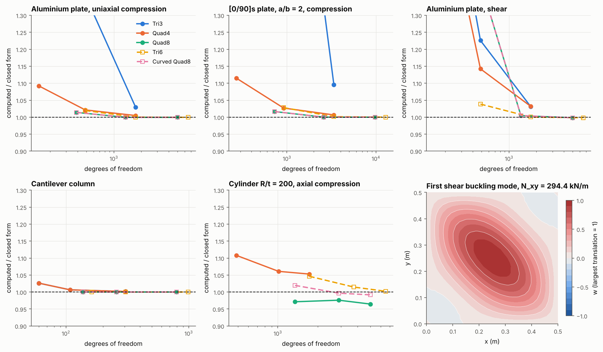

# 28 · Linear buckling

shell-fem finds buckling loads by linear (eigenvalue) buckling. It solves the
reference load case, builds the geometric stiffness K_g of the membrane prestress
N = [Nx, Ny, Nxy] that load causes, and solves

K_r φ = λ (−K_g,r) φ

on the same constraints as the static solve. λ is the factor on the whole reference
load at which the structure buckles, and φ is the mode shape. This example checks
every shell element against classical closed forms.



## The problems

| Problem | Model | Closed form |
|---|---|---|
| Plate in compression | simply supported a × b plate, b = 0.5 m, uniaxial N_x on one edge; 5 mm aluminium (b/t = 100), and a [0/90]s T300/5208 laminate at a/b = 2 | N = (π²/b²) min_m [D11 (mb/a)² + 2(D12 + 2 D66) + D22 (a/mb)²] (Jones 1999) |
| Plate in shear | square aluminium plate as above, pure shear N_xy on all four edges | N = 9.3245 π² D / b² |
| Heated plate | square aluminium plate as above, edges held in plane, uniform temperature rise | ΔT = 2π² D (1 − ν) / (b² E α t) |
| Column | cantilever aluminium strip, L = 1 m, 50 mm × 5 mm, ν = 0, axial tip load | P = π² E I / (4 L²) |
| Cylinder | simply supported aluminium cylinder, R = L = 0.5 m, t = 2.5 mm (R/t = 200), axial compression; one octant with symmetry | N = E t² / (R √(3(1 − ν²))) |

The plates are "hard" simply supported: w = 0, and no rotation about the edge
normal. The heated plate gets its prestress through the load case's hygrothermal
state, not through nodal loads, so this also checks that path.

The problems are in `shell_fem.verification.buckling_benchmarks`. Each one is a
function `problem(element, n)` that returns the critical load, the closed form and
their ratio:

```python
from shell_fem import LinearBucklingRunner
from shell_fem.verification.buckling_benchmarks import plate_shear

plate_shear("tri6", 8).ratio                                       # 1.0003
results = LinearBucklingRunner(mesh, bcs, load, n_modes=4).execute().get_results()
results.critical_load_factor, results[0].displacement_array()     # lowest λ, first mode
```

## Results

Computed over closed form, n elements along each plate edge (the cylinder's n is
along its quarter arc and its half length):

| Problem | Element | n = 4 | n = 8 | n = 16 |
|---|---|---|---|---|
| Aluminium plate, compression | Quad4 | 1.092 | 1.021 | 1.005 |
| | Quad8 / Curved Quad8 | 1.014 | 0.9995 | 0.9994 |
| | Tri6 | 1.020 | 1.0002 | 0.9995 |
| | Tri3 | 3.90 | 1.36 | 1.029 |
| [0/90]s plate, a/b = 2 | Quad4 | 1.115 | 1.027 | 1.007 |
| | Quad8 / Curved Quad8 | 1.017 | 1.0001 | 1.0000 |
| | Tri6 | 1.028 | 1.0015 | 1.0000 |
| Aluminium plate, shear | Quad4 | 1.79 | 1.142 | 1.032 |
| | Quad8 / Curved Quad8 | 1.48 | 1.005 | 0.998 |
| | Tri6 | 1.039 | 1.0003 | 0.998 |
| Heated plate | Quad8 | 1.014 | 0.9995 | 0.9994 |
| Column | Quad4 / Tri3 | 1.026 | 1.006 | 1.002 |
| | Quad8 / Tri6 | 1.0001 | 1.0000 | 1.0000 |

| Cylinder | n = 8 | n = 12 | n = 16 |
|---|---|---|---|
| Curved Quad8 | 1.020 | 0.997 | 0.992 |
| Tri6 | 1.046 | 1.015 | 1.002 |
| Quad4 | 1.108 | 1.061 | 1.053 |
| Quad8 (flat) | 0.971 | 0.976 | 0.965 |

What the numbers show:

- **The quadratic elements converge to the closed forms.** On the plates the limit
  is 0.9994 for aluminium. The closed forms are Kirchhoff results and the elements
  are Reissner-Mindlin, so transverse shear takes 0.06 % off at b/t = 100, which is
  exactly the gap.
- **Quad4 converges from above** and is within 1 % at 16 × 16 on compression, 3 %
  in shear (the shear mode has more waves across the plate). **Tri3** is far too stiff
  on coarse plate meshes and needs a fine mesh for buckling.
- **Flat and curved Quad8 are identical on flat plates**, as they should be.
- **The cylinder** is the hardest case. The classical value assumes a membrane
  prebuckling state, while the end supports here bend the shell near the ends, and
  many modes have nearly the same load. The curved elements land within 1 %; the
  flat Quad8 is 3 to 4 % low because faceting softens the shell, and Quad4 is 5 %
  high at this mesh.

## Limits

- **Linear buckling scales the whole reference load.** A load that should stay fixed
  (dead weight under a growing wind load, say) needs a two-step or nonlinear
  analysis, which shell-fem does not do yet.
- **Only the membrane prestress enters K_g.** Bending moments and transverse shear do
  not, which is the usual linear buckling model for thin shells.
- **Shells only.** A model with layered solid elements raises an error rather than
  buckle with part of its stiffness missing.
- **Signs.** By default only positive load factors (the load as applied) are
  returned. Pass `SolveBucklingEigenproblem(n, signs="both")` for loads, such as
  shear, that buckle in either direction.

References: S. P. Timoshenko and J. M. Gere, *Theory of Elastic Stability* (1961);
R. M. Jones, *Mechanics of Composite Materials* (1999). Timoshenko & Gere quote
9.34 for the shear coefficient; 9.3245 is the converged value of the series solution.

Run it with `python examples/28_linear_buckling/linear_buckling.py` (about two minutes).
