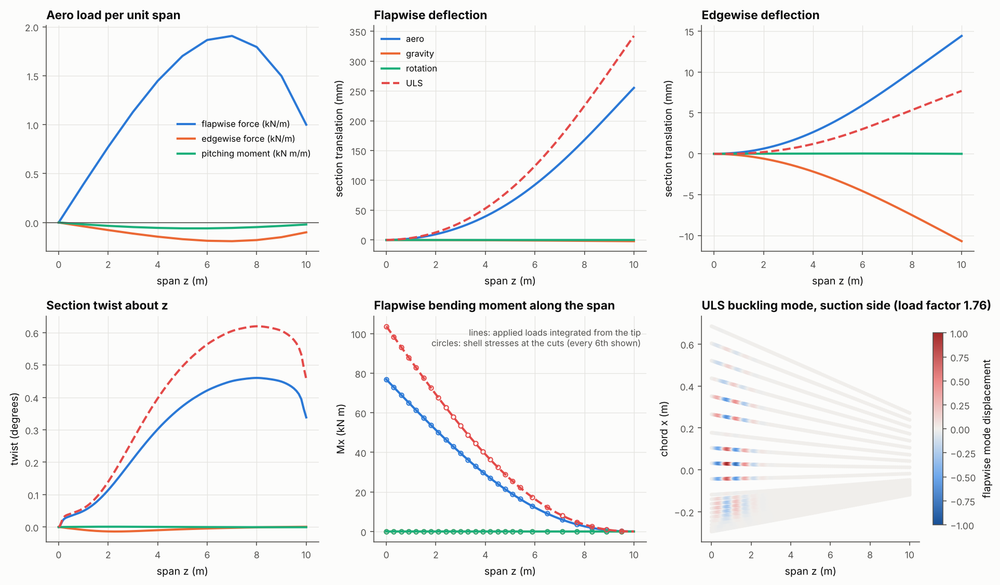

# 29 · Full-blade loading

A whole blade as one shell model, clamped at the root and loaded along its span.
The blade is built by implicit-geometry-kernel from public NACA 4-digit sections, so
it holds no reference-blade data:

- 10 m long, chord 1.0 m at the root to 0.4 m at the tip;
- NACA 0030 at the root to NACA 0015 at the tip, twisted 10° to 0°, pitch axis at 30 % chord;
- a box spar (layout `2D-F-LC-0R`): two 8 mm carbon caps, two 2 mm glass webs at 18 % and
  48 % chord, a 3 mm glass skin and a tip closure.

shell-fem meshes nothing itself. It takes the kernel's own shell mesh
(`kernel_mesh.shell_mesh(geometry, h=0.1)`, 7534 elements, 43188 DOFs) through
`BladeBuilder.from_shell_mesh`. Each cap and the skin it is bonded to form one
laminate on the skin mid-surface, offset by the kernel's eccentricity.



## Load cases

| Case | Load | How it is applied |
|---|---|---|
| aero | flapwise force 2500 sin(πs/2)(1 − 0.6 s⁴) N/m (s = z/L), edgewise drag of −0.1 × flap, nose-down pitching moment −0.05 × chord × flap | `add_sectional_force`, `add_sectional_torque` |
| gravity | blade horizontal, g = 9.81 m/s² edgewise (−x) | `LoadCase.add_body_load` |
| rotation | Ω = 2 rad/s about the rotor axis (y), 1 m inboard of the root | `LoadCase.add_centrifugal` |
| ULS | 1.35 aero + 1.1 gravity + 1.0 rotation | `LoadCombination` |

The aero distributions are illustrative, not the output of a rotor code. The script
builds them as `spanwise(z, values)` tables, which interpolate linearly and hold the end
values beyond the table.

```python
from shell_fem.pre_processing.load_library.blade_loads import add_sectional_force, add_sectional_torque, spanwise
from shell_fem.simulation_runner.blade import BladeStaticRunner

aero = add_sectional_torque(add_sectional_force(LoadCase("aero"), blade, force), blade, torque)
results = BladeStaticRunner(blade, [aero, gravity, rotation], [uls],
                            buckling_modes=1, buckling_cases=["ULS"]).execute().get_results()
results["ULS"].root_load, results["ULS"].tip_translation, results["ULS"].buckling.critical_load_factor
```

## How sectional loads reach the shell

A beam code gives loads per unit span at a reference axis. A shell has no axis, so
`blade_loads` spreads each one over the skin of a span bay, the strip between two
consecutive `BladeMesh.span_positions`:

- **Force per unit span f(z)** becomes a uniform traction f/P on the bay's skin, where P
  is the bay's skin perimeter (skin area / bay length). Its resultant over the bay is f
  times the bay length. It acts at the skin centroid, not at the shear centre or an
  aerodynamic centre.
- **Moment per unit span m(z)** about z becomes the shear flow of a thin closed section,
  a traction m/J · ẑ × (x − c) about the bay's skin centroid c, with J = ∮ r² ds over
  the skin. It adds no net force and a moment of exactly m per unit length.

So the force carries an extra moment, f × (skin centroid − reference axis), that a beam
model with the force on its reference axis would not see. In this blade the skin
centroid lies aft of the shear centre. That moment twists the blade nose-up by more
than the nose-down pitching moment, which is why the aero twist is positive. To put a
force at another point, add its moment about the skin centroid with
`add_sectional_torque`.

Gravity and rotation act on every element through its areal density ρ_A, from the
laminate. The centrifugal load ρ_A Ω² r⊥ uses each integration point's distance from
the rotation axis.

## Results

| Case | Root Mx (kN m) | Root My (kN m) | Root Fz (kN) | Tip flap v (mm) | Tip edge u (mm) | Tip twist (°) | Equilibrium residual |
|---|---|---|---|---|---|---|---|
| aero | 76.81 | 7.68 | 0.00 | 255.0 | 14.4 | 0.338 | 3.5e-11 |
| gravity | 0.00 | 5.93 | 0.00 | −2.0 | −10.7 | 0.001 | 2.4e-11 |
| rotation | 0.02 | 0.05 | −2.99 | 0.0 | 0.0 | −0.001 | 1.5e-13 |
| ULS | 103.71 | 16.94 | −2.99 | 342.1 | 7.7 | 0.457 | 3.5e-11 |

Root loads are the reactions of the clamped root nodes, as a resultant about the pitch
axis at the root. The residual is the largest component of (applied load + root
reaction) over the largest applied component: every case is in equilibrium to round-off.
ULS is solved as one combined load case (`LoadCase.combine`); being linear, its root
loads equal 1.35, 1.1 and 1.0 times those of the three cases.

Deflection and twist are those of a rigid section fitted to the nodes at each span
position. The twist peaks near 8 m and falls over the last metre. The likely cause is
the tip closure, which keeps the tip section from warping; this is not yet checked.

The ULS combination buckles at a load factor of 1.76. The mode sits in the suction-side
skin and spar cap over the first 2 m, where the flapwise bending compression is
largest and the panels between cap, webs and leading edge are widest.

## Section loads along the span

The runner also cuts the blade at every span position (`BladeCaseResult.section_loads`).
At each cut it takes two resultants about the pitch axis:

- **internal**: from the shell itself. At the cut nodes, the internal forces K_e u_e of
  the outboard elements, less their own distributed loads, are what the inboard part
  supplies. This is the load the section carries, from the element stresses.
- **applied**: every load on the outboard part, integrated from the tip in. This is what a
  beam code gets from V(z) = ∫_z^L f dζ and M(z) = ∫_z^L (ζ − z) × f dζ.

Each cut is a free body, so the two balance. In every case here the largest residual
over all the cuts is about 1e-10 of the largest section load; the bending-moment panel
plots both. At the root cut, internal equals the root reaction.

```python
cut = results["ULS"].section_loads
cut.stations, cut.internal[:, 3]   # flapwise bending moment Mx at every span position
cut.relative_residual              # ~1e-10
```

## Is the loading right?

`shell_fem.verification.blade_benchmarks` puts the same loads on a thin aluminium tube
(R = 0.5 m, t = 10 mm, L = 10 m) built as a `BladeMesh`, and compares its tip with beam
theory:

| Check | Beam theory | Quad4 | Quad8 (curved) | Tri6 |
|---|---|---|---|---|
| uniform force per span | fL⁴/8EI + fL²/(2κGA), κ = 0.5 | 1.028 | 0.9993 | 0.9975 |
| uniform torque per span | mL²/2GJ | 1.046 | 1.0000 | 0.9989 |
| rotation about an axis through the root | ρ_A P Ω² L³/(3EA) | 0.997 | 0.9981 | 0.9976 |

The section cuts of the tube match the beam integrals at every span position to 1e-6:
shear f(L − z), bending moment f(L − z)²/2, torque m(L − z) and axial force
ρ_A P Ω²(L² − z²)/2 (`tests/test_blade_loads.py`).

```python
from shell_fem.verification.blade_benchmarks import tube_bending
tube_bending("quad8_curved").ratio     # 0.9993
```

## Limits

- Tractions and centrifugal loads act on shells only; a traction listed on a solid raises,
  and a centrifugal load on a solid raises `NotImplementedError`.
- Sectional loads are spread over the skin only. The webs and ribs take them through the
  structure, not directly.
- The analysis is linear: no stress stiffening from rotation and no follower pressure.
  The buckling factor is a linear eigenvalue, with no imperfection or knock-down.

Run with `python examples/29_full_blade_loading/full_blade_loading.py` (about two
minutes; needs implicit-geometry-kernel v0.9.5).
