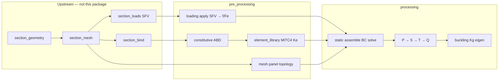
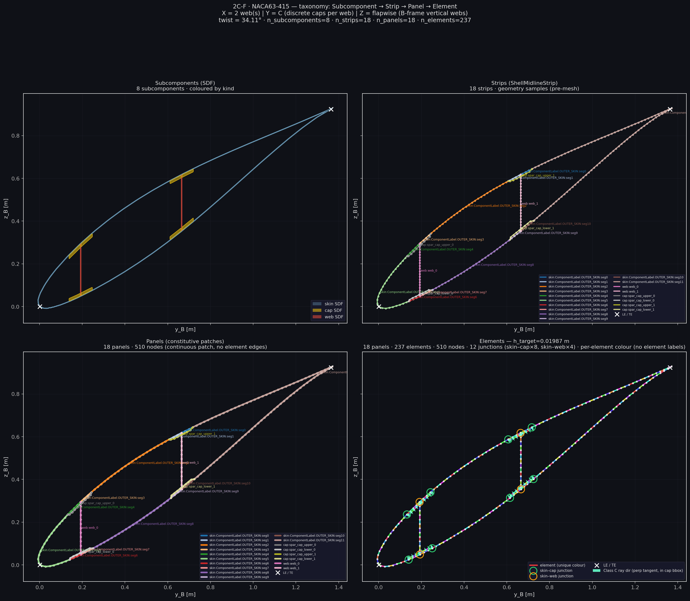
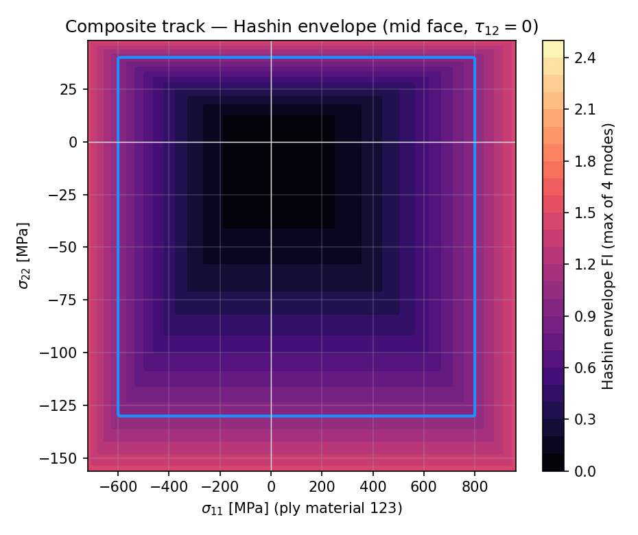
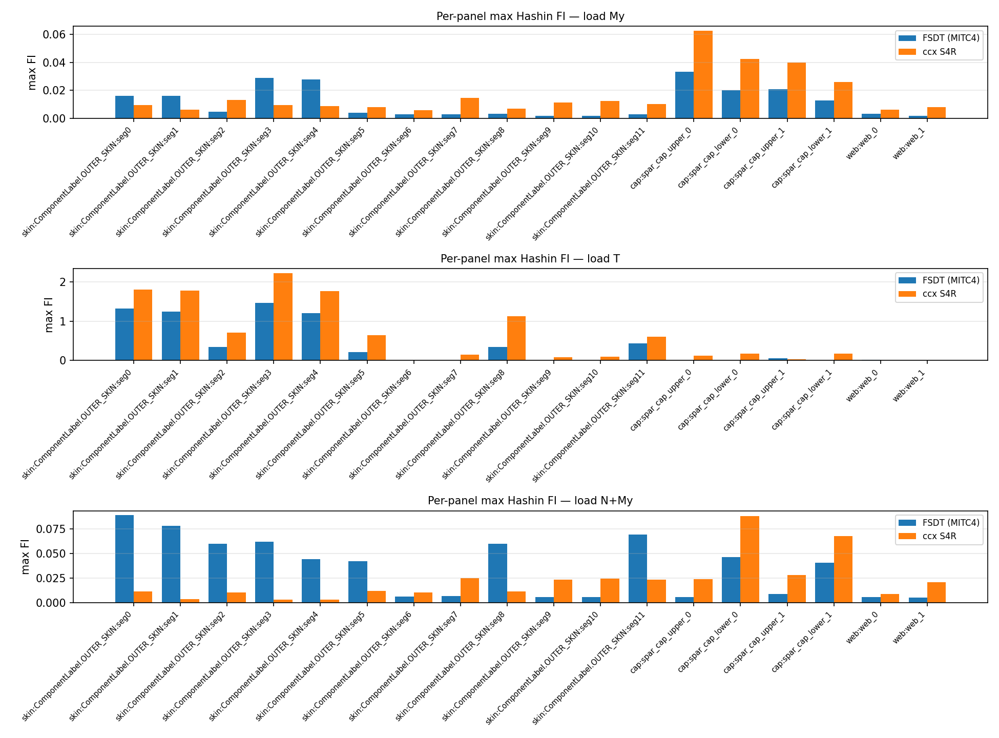

# `section_shell_fea` — FE worker

**Package:** `blade_structure_utilities.fem_utilities.section_shell_fea`  
**Role:** FE **worker** only — apply precomputed loads, assemble, solve, cascade.

Apply a precomputed `SectionForceVector` (SFV) to nodal loads, form MITC4
stiffness, assemble and solve the linear-static shell system, then recover the
P→S→T→Q cascade (plus diagnostics). Failure evaluation is capability-driven:
MITC4 reports plane-stress Hashin only; reconstructed interface shear is
diagnostic. This package has **no** knowledge of sizing
vs fatigue, parallel vs serial, or iterative vs single-shot — callers decide when
to invoke it and which cascade tiers to read.
Glossary: [`../../docs/CASCADE_GLOSSARY.md`](../../docs/CASCADE_GLOSSARY.md).

```text
section_geometry → section_contract → section_mesh
        → section_bind (MaterialZone)
        → section_loads (SectionForceVector)
        → section_shell_fea (apply SFV → f / Fe → Ke → solve → P→S→T→Q)  ← this worker
```

Canonical import: `blade_structure_utilities.fem_utilities.section_shell_fea`.

Authoritative sizing cascade:
[`section_selection/docs/package_boundaries.md`](../../../blade_structure_precompute/module/section_selection/docs/package_boundaries.md#1-pipeline-sketch).

### Boundary

| | |
|---|---|
| **Product** | Apply SFV → `f`/`Fe`; `Ke`; assemble; BC; solve; P→S→T→Q + `DiagnosticsBin` |
| **Must not own** | Midline CSG, strip discretisation, layup *policy*, SFV *shaping*, TractionField construction |
| **Barrel** | `blade_structure_utilities.fem_utilities.section_shell_fea` |
| **Consumers** | Import the FE barrel / runner only; import `section_bind` / `section_loads` barrels for types — never deep home paths |

Ownership index: [`docs/COEXISTENCE_IMPLICIT_SHELL.md`](../../docs/COEXISTENCE_IMPLICIT_SHELL.md).  
Docs index: [`docs/README.md`](docs/README.md).  
**FE-rows:** [`docs/reference/FE_ROW_OWNERSHIP_MATRIX.md`](docs/reference/FE_ROW_OWNERSHIP_MATRIX.md) · live [`graphify-out/`](graphify-out/).

## Table of contents

1. [Purpose / ownership](#1-purpose--ownership)
2. [Computable set](#2-computable-set)
3. [Stage Mermaid](#3-stage-mermaid)
4. [Governing equations](#4-governing-equations)
5. [PNG proof](#5-png-proof)
6. [Ownership homes](#6-ownership-homes)
7. [Public API](#7-public-api)
8. [Contract](#8-contract)
9. [Provenance / locked boundaries](#9-provenance--locked-boundaries)
10. [Package layout](#10-package-layout)
11. [See also](#11-see-also)

---

## 1. Purpose / ownership

| Owns | Does **not** own |
|------|------------------|
| Apply `SectionForceVector` → nodal `f` / element `Fe` | SFV shaping ([`section_loads`](../../load_utilities/section_loads/README.md)) |
| MITC4 `Ke`, assemble, BC, solve \(F=KU\) | Midline CSG / strip Q4 ([`section_geometry`](../../geometry_utilities/section_geometry/README.md), [`section_mesh`](../../mesh_utilities/section_mesh/README.md)) |
| Cascade bin P→S→T→Q + `DiagnosticsBin` | Layup / thickness *policy* ([`section_bind`](../../material_utilities/section_bind/README.md)) |
| Optional CalculiX validation backend | Sizing / fatigue orchestration (BSP / BSF) |

| Actor | Role |
|-------|------|
| **Producer (upstream)** | Bind + loads — zones + precomputed SFV |
| **This worker** | Classical FEM on the section shell (MITC4 / FSDT; **C ≡ E** on each facet) |
| **Consumers** | `section_selection`, `bv_methodology`, other use cases reading cascade tiers |

**Reader answers**

| Question | Answer |
|----------|--------|
| What is solved? | Contour-supported linear-static MITC4: \(\mathbf{K}\mathbf{U}=\mathbf{F}\) after apply-SFV → assemble → BC → reduce(`T`) |
| Which cascade tier holds Hashin FI? | **Quaternary (Q)** — `CascadeBin.quaternary_results.hashin_fi` |
| Which figure proves mesh / GCI behaviour? | [`ladder_governing_fi.png`](visualisation/output/gci_study_mitc4/plots/ladder_governing_fi.png) (+ fine-grid Hashin peak bars) |

---

## 2. Computable set

| Tier | Symbol | Product | Typical consumer |
|------|--------|---------|------------------|
| **P** primary | \(U_e\), reactions | Element DOFs after disassembly | Diagnostics / residual |
| **S** secondary | \(N,M,Q\) in **E** | Mid-surface resultants | Buckling prestress; resultant audits |
| **T** tertiary | \(\boldsymbol{\sigma}_{\mathrm{ply}}\) in **M** | Per-plate face stresses (+ \(\tau_{13},\tau_{23}\)) | Fatigue rainflow |
| **Q** quaternary | FI | Hashin / Von Mises / extreme-fibre + governing | Sizing FI gate |
| **D** diagnostics | — | Phase timings, trust, GCI hooks | Orchestration logs (nest only) |

Deep cascade maths: [`processing/static/results/docs/README.md`](processing/static/results/docs/README.md).  
Frames: mesh / DOFs in **B** + curvilinear **C**; resultants in **E**; ply FI in **M**. On each facet **C ≡ E**.

---

## 3. Stage Mermaid



Stage narrative: [`docs/SECTION_SOLVE_STAGES.md`](docs/SECTION_SOLVE_STAGES.md).  
Shell model / assumptions: [`docs/SHELL_MODEL.md`](docs/SHELL_MODEL.md).

---

## 4. Governing equations

**Virtual work (FSDT shell, pointer form)** — membrane + bending + transverse shear
on the mid-surface \(\Omega\):

\[
\delta\Pi
=
\int_{\Omega}
\big(
\delta\boldsymbol{\varepsilon}_{0}^{\mathsf{T}}\mathbf{N}
+
\delta\boldsymbol{\kappa}^{\mathsf{T}}\mathbf{M}
+
\delta\boldsymbol{\gamma}^{\mathsf{T}}\mathbf{Q}
\big)\,
\mathrm{d}A
-
\delta W_{\mathrm{ext}}
= 0.
\]

Discrete element stiffness (MITC4 mixed shear interpolation):

\[
\mathbf{K}_e
=
\int_{\Omega_e}
\mathbf{B}_g^{\mathsf{T}}\,\mathbf{D}_g\,\mathbf{B}_g\,\mathrm{d}A,
\qquad
\mathbf{D}_g=
\begin{bmatrix}\mathrm{ABD}&0\\0&A_s\end{bmatrix}.
\]

`A_s` is the already-corrected full 2×2 laminate transverse-shear stiffness.
MITC4 covariant tying modifies only the shear rows of `B_g`; drilling energy is
assembled and reported separately. See the element
[`formulation contract`](pre_processing/element_library/mitc4/README.md).

Global solve after assemble / essential BC / reduction \(\mathbf{T}\):

\[
\mathbf{K}_r\,\mathbf{q}=\mathbf{f}_r,
\qquad
\mathbf{d}=\mathbf{T}\,\mathbf{q},
\qquad
\mathbf{KU}=\mathbf{F}\ \text{(reconstructed)}.
\]

**DOF layout per node** (curvilinear **C**, coincides with laminate **E** on the facet):

| Index | DOF | Meaning |
|------:|-----|---------|
| 0 | \(u_x\) | Spanwise (C \(x\) / E \(x_1\)) |
| 1 | \(u_s\) | Contour tangent (C \(s\) / E \(x_2\)) |
| 2 | \(w\) | Shell normal (C \(n\) / E \(x_3\)) |
| 3 | \(\beta_s\) | Mindlin rotation about \(s\) |
| 4 | \(\beta_x\) | Mindlin rotation about \(x\) |
| 5 | \(\beta_z\) | Drilling (MITC4+ default, `ndof=6`) |

Q4 element: \(4\times\mathrm{ndof}\) local DOFs (24 with drilling). Details:
[`pre_processing/element_library/mitc4/element.py`](pre_processing/element_library/mitc4/element.py),
[`docs/SHELL_MODEL.md`](docs/SHELL_MODEL.md).

---

## 5. PNG proof

Committed artefacts under `visualisation/output/` and tier `examples/outputs/`
(link only — do not regenerate for docs).

| Proof | Figure | Answers |
|-------|--------|---------|
| Undeformed mesh |  | Strip Q4 topology consumed by FE (meshing owned upstream) |
| Displacement ladder (primary field under refinement) |  | Primary \(\|\mathbf{d}\|_\infty\) vs mesh rung |
| Hashin FI (Q) |  | Quaternary holds Hashin FI |
| Mesh / GCI behaviour |  | Governing FI vs refinement (ASME GCI campaign) |
| Fine-grid Hashin peaks |  | Layout-wise Hashin peak at fine rung |
| Panel max-FI bars (benchmark) |  | Element-oracle FI comparison |

GCI narrative: [`docs/NUMERICAL_STABILITY_AND_GCI.md`](docs/NUMERICAL_STABILITY_AND_GCI.md).  
Cap-peak sampling CSVs: [`visualisation/output/cap_peak_sampling/`](visualisation/output/cap_peak_sampling/).

---

## 6. Ownership homes

**Large-package layout** (worker-specific exception: retain `api/` as the public
seam required by
[WORKER_PACKAGE_TEMPLATE.md](../../../docs/conventions/api/WORKER_PACKAGE_TEMPLATE.md)
and [API_STANDARDS.md](../../../docs/conventions/api/API_STANDARDS.md); do **not**
add a `types/` barrel — it shadows stdlib `types` when the working directory is
the package root):

| # | Home | Owns |
|---|------|------|
| 0 | [`api/`](api/__init__.py) | Worker public seam (re-exports package `__all__`) |
| 1 | [`pre_processing/loading/`](pre_processing/loading/README.md) | Apply SFV → nodal `f` / `Fe` |
| 2 | [`pre_processing/element_library/`](pre_processing/element_library/README.md) | MITC4 / formulation factory (`Ke`) |
| 3 | [`pre_processing/constitutive/`](pre_processing/constitutive/README.md) | Zone constitutive prep (ABD stacks) |
| 4 | [`pre_processing/mesh/`](pre_processing/mesh/README.md) | FE mesh map / panel topology |
| 5 | [`pre_processing/containers/`](pre_processing/containers/README.md) | FE-local product DTOs |
| 6 | [`pre_processing/dispatch/`](pre_processing/dispatch/README.md) | Theory / solve registries |
| 7 | [`processing/static/`](processing/static/README.md) | Assemble / BC / solve + cascade |
| 8 | [`processing/buckling/`](processing/buckling/README.md) | Geometric stiffness / eigen |
| 9 | [`simulation_runner/`](simulation_runner/README.md) | Static / buckling runners |
| 10 | [`calculix_ccx/`](calculix_ccx/README.md) | Quarantined CCX backend |
| 11 | [`visualisation/`](visualisation/README.md) | Plot helpers + demos |

Deep stage taxonomy: [`docs/TAXONOMY.md`](docs/TAXONOMY.md),
[`docs/SECTION_SOLVE_STAGES.md`](docs/SECTION_SOLVE_STAGES.md),
[`docs/SHELL_MODEL.md`](docs/SHELL_MODEL.md).

---

## 7. Public API

```python
from blade_structure_utilities.fem_utilities.section_shell_fea import (
    CascadeBin,
    DiagnosticsBin,
    SectionLinearStaticRunner,
    ShellPanelTopology,
    extract_shell_full_element_results,
)

bin: CascadeBin = (
    SectionLinearStaticRunner(
        panel_topology=panel_topology,  # pre-bound zones
        resultants=resultants,
        section_strip_mesh=section_strip_mesh,
        section_force_vector=sfv,  # frozen SFV from section_loads
    )
    .execute()
    .get_results()
)
# sizing example: bin.quaternary_results.hashin_fi...
# fatigue example: bin.tertiary_results...
# FE phase timings: bin.diagnostics.phase_totals_s
```

Also: `SectionLinearBucklingRunner` (prestress → eigen) for buckling campaigns.

Pass a precomputed `section_force_vector=` when the caller shaped SFV outside FE.
Do **not** shape loads or bind laminates inside this worker on the L4 seam.

---

## 8. Contract

| | |
|---|---|
| **Inputs** | Bound `MaterialZone`s / panel topology + precomputed `SectionForceVector` + BCs |
| **Work** | Apply SFV → nodal `f`; solve \(F = KU\); fill the **P → S → T → Q** cascade bin |
| **Outputs** | Cascade bin (`CascadeBin` / `SectionLinearStaticResult`) including per-solve `diagnostics` |
| **Agnosticism** | No `purpose="sizing"|"fatigue"` modes; optional tier gates are compute-cost knobs only |

```text
bound zones + precomputed SFV
            │
            ▼
     section_shell_fea   ← this package (worker)
            │  F = KU
            ▼
     CascadeBin  P → S → T → Q + diagnostics
            │
            ├── section_selection     may read Q (FI) + nest diagnostics into sizing logs
            ├── bv_methodology        may read T (ply/shell stresses → rainflow)
            └── use case X            any tier
```

`DiagnosticsBin` holds FE phase wall times for **this** worker call only.
Campaign `.log` dumps live in orchestration (`section_selection`), not here.

---

## 9. Provenance / locked boundaries

| Claim | Today |
|-------|-------|
| Canonical package path | `fem_utilities/section_shell_fea` |
| Apply SFV only | `section_force_vector_to_nodal_load`; Channel B staging in `section_loads` |
| No orchestration modes | No sizing/fatigue APIs on the runner |
| CCX quarantined | Opt-in `register_calculix_ccx_backend()`; not production theory |
| Staging layout permanent | `pre_processing/` · `processing/` — do **not** flatten or relocate |
| Demos | [`visualisation/demos/`](visualisation/demos/README.md); artifacts under `visualisation/output/` |

Orchestration stays outside: `blade_structure_precompute.module.section_selection`,
`blade_structure_fatigue/...`, any future use case X.

---

## 10. Package layout

```text
section_shell_fea/
  pre_processing/
    loading/           # apply SFV
    element_library/   # MITC4 Ke
    constitutive/
    mesh/              # FE mesh map / panel topology
    containers/        # FE-local DTOs
    dispatch/          # theory / solve registries
  processing/
    static/            # assemble / solve / cascade
    buckling/          # eigen track
  simulation_runner/
  calculix_ccx/        # backend quarantine
  visualisation/ docs/ benchmarks/ tests/
```

---

## 11. See also

- [`docs/README.md`](docs/README.md) — documentation index
- [`../../docs/CASCADE_GLOSSARY.md`](../../docs/CASCADE_GLOSSARY.md) — shared spine vocabulary
- [`section_loads`](../../load_utilities/section_loads/README.md) — shape SFV
- [`section_bind`](../../material_utilities/section_bind/README.md) — MaterialZone
- [`section_mesh`](../../mesh_utilities/section_mesh/README.md) — strip mesh inputs
- [`section_contract`](../../geometry_utilities/section_contract/README.md) — DTO ABI
- [`COEXISTENCE_IMPLICIT_SHELL.md`](../../docs/COEXISTENCE_IMPLICIT_SHELL.md)
- [`docs/TAXONOMY.md`](docs/TAXONOMY.md) · [`docs/SHELL_MODEL.md`](docs/SHELL_MODEL.md)
