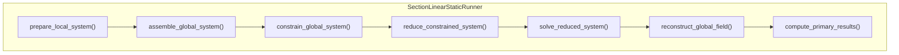

# Section solve — staged architecture and naming philosophy

**Status:** stage classes live in `processing/static/operations/`; former `engine/`
and Channel-A (`api/periodic`, `api/k6`, `operations/periodic/`) are **removed**
(Phase 0).

This document describes the **main production FI track**: classic FE via
[`SectionLinearStaticRunner`](../simulation_runner/section_linear_static_runner.py)
(prepare → assemble → constrain → reduce(`T`) → solve → reconstruct → primary →
secondary → tertiary → quaternary). Entry:
`simulation_runner/api/linear_static.py`.

**Buckling** is a sibling runner
([`section_linear_buckling_runner.py`](../simulation_runner/section_linear_buckling_runner.py))
with default **full-section** `K`/`Kg` eigenproduct (optional panel-classical track).
See [LINEAR_STATIC_MAIN_TRACK_PHASE0.md](LINEAR_STATIC_MAIN_TRACK_PHASE0.md),
[SHELL_MODEL.md](SHELL_MODEL.md), and
[`processing/buckling/results/RESULTS_DESIGN.md`](../processing/buckling/results/RESULTS_DESIGN.md).

## Why this philosophy

The section shell solve is a sequence of well-defined engineering transformations.
We follow `1d-fem/processing/static/operations/`: **each substep is a discrete,
single-responsibility stage, named for the transformation it performs.**

## System-state vocabulary

> **local system** → **global system** → **constrained system** →
> **reduced system** (`K_reduced = Tᵀ K T`) → **solved** → **reconstructed** →
> **disassembled** → **primary results**

## Stage ops vs assembly orchestra

Both live under `processing/static/operations/`, but they are **not** the same layer:

| Kind | Modules | Role |
|------|---------|------|
| **Stage ops** (1d-fem analogues) | `prepare_local`, `assemble_global`, `constrain_global`, `reduce_constrained`, `solve_reduced`, `reconstruct_field`, `disassemble_field`, `solve_states.py` | Educational FE system-state transitions invoked by `SectionLinearStaticRunner` |
| **Assembly orchestra** (blade geometry) | `section_assembly`, `global_shell_assembly`, `connected_assembly_core`, `connected_panel_topology`, `physics_contract` | Topology → formulation cache → scatter-add; builds runner inputs (`SectionAssemblyResult`), not a second solve spine |

## Stages

| Stage class | Engineering step | Output | 1d-fem analogue |
|-------------|------------------|--------|-----------------|
| `PrepareLocalShellSystem` | Validate each element `Ke` / `fe` | `LocalShellSystem` | `PrepareLocalSystem` |
| `AssembleGlobalShellSystem` | Scatter-add into global `K`, `f` | `GlobalShellSystem` | `AssembleGlobalSystem` |
| `ConstrainGlobalShellSystem` | Impose supports + MPCs | `ConstrainedShellSystem` | `ModifyGlobalSystem` |
| `ReduceConstrainedShellSystem` | Build `T`, form `K_reduced` | `ReducedShellSystem` | `CondenseModifiedSystem` |
| `SolveReducedShellSystem` | Factor / solve | `SolvedReducedShellSystem` | `SolveCondensedSystem` |
| `ReconstructGlobalShellField` | `d = T q` | `ReconstructedShellField` | `ReconstructGlobalSystem` |
| `DisassembleGlobalShellField` | Per-element `U_e` | `DisassembledShellResults` | `DisassembleGlobalSystem` |
| `ShellPrimaryResultsOrchestrator` | Reactions / residual | `PrimaryShellResults` | `PrimaryResultsOrchestrator` |

## Adaptations from the 1d-fem reference

- **Elimination, not penalty + condensation.** Shell uses master/reduced `T`. Constrain and reduce stay separate stages.
- **Factor-once / solve-many.** `SolveReducedShellSystem` factors once for multi-RHS kinematics (`solve_many`).
- **Always P→S→T→Q on `solve()`.** Quaternary FI has no 1d-fem tertiary analogue.

## Design rules

1. Stage classes do not import MITC4 element kernels directly — use formulation cache / `resolve_kernel`.
2. Runners own orchestration and diagnostics emission.
3. Do not reintroduce Channel-A product APIs.
