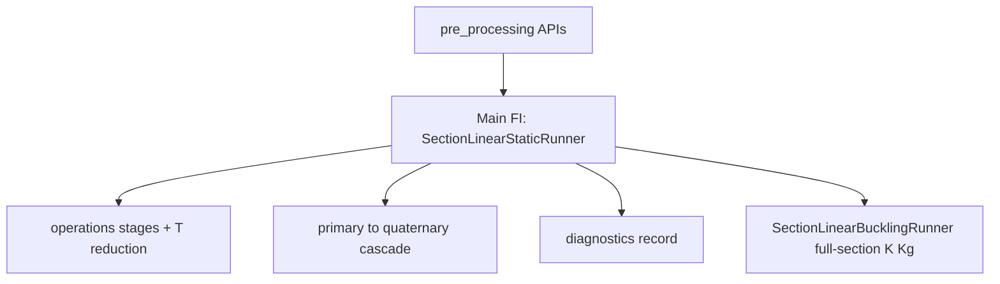

# Shell model design (MVP)

This package implements the **handoff layer** between global/section thin-wall recovery and **local CLPT shell** subcomponent analysis.

**Geometry / constitutive glossary:** [TAXONOMY.md](TAXONOMY.md) — station, section, subcomponent, strip, MaterialZone (constitutive region), element; material frame and isotropic vs orthotropic FI routing.

## MITC4 midsurface: `section_geometry` vs `section_shell_fea`

**Where each stage belongs**

| Stage | Package | Responsibility |
|-------|---------|----------------|
| Implicit solids (offsets, clips, capsule, unions) | `section_geometry` | SDF subcomponents (`OuterSkin`, `ShearWeb`, `SparCap`, …). |
| Mid-surface locus as explicit polyline | `section_geometry` | `midline_polyline()` in chord frame; geometrically consistent with the SDF recipe (typically not level-set marching of `__call__`). |
| Chord (S) → blade (B) for shell export | `coordinate_frames.chord_to_blade` (via `section_geometry.midlines.shell_midline_export.build_shell_midline_strips`) | Swap + pitch pivot + twist; strips are canonical B. |
| Neutral strip record (polyline + thickness + role) | `blade_structure_utilities.geometry_utilities.section_contract.shell_midline_strip` | `ShellMidlineStrip` — **no** `Panel`, laminates, or `n_elements`; FE-agnostic. |
| Strip list from `MultiCellSection` | `section_geometry` worker / `shell_midline_export` | Prefer `build_section_geometry(..., outputs=("midlines",))` → topology-prepared strips; legacy `build_shell_midline_strips` still available. |
| `ShellMeshInputs` + strip Q4 mesh | `mesh_utilities.section_mesh` | `shell_mesh_inputs_from_geometry_result` / `build_section_strip_mesh` — **default** `TARGET_ELEMENT_LENGTH_FRAC = 0.012`. Production passes `SectionStripMesh` into the runner (no remesh-on-execute). |
| One material zone per strip + laminate attach | `material_utilities.section_bind` | `bind_shell_material_zones` / `shell_material_zones_from_mesh_inputs` (order: **skin → caps → webs**). |
| External force vector (section contour) | `load_utilities.section_loads` | `BeamResultantVector` → `SectionForceVector` via `shape_section_force_vector*` / `distribute_beam_resultants`. |
| Element `Ke`/`Fe` → global `f`/`K` → solve / cascade | `section_shell_fea` | Bound zones + external `SectionForceVector` in → apply loads → formulation → assemble → BC → solve → P→S→T→Q. |

**FE ownership:** element formulation (`Ke`, element force vector `Fe`), load **application** (external `SectionForceVector` → global `f`), assembly, BCs, solve, cascade recovery. FE does **not** own SDF midlines, strip discretisation, layup/material assignment, or external force-vector **shaping**.

**Modularity rule:** strip Q4 meshing lives in `section_mesh`; FE consumes the mesh. Optional later: geometry-neutral **junction/adjacency** hints in the shared contract if endpoint clustering is insufficient.

**Naming:** “Caching” the midline means **materialising the mid-surface locus as a polyline** for the mesh handoff, distinct from SDF **evaluation caches** inside `section_geometry`.

## References

> The former `section_stress_model` package has been retired; its responsibilities moved into this
> package and into `materials`. Links below point to the current owners.

- Section physics and equations: [../README.md](../README.md) (Methodology) — FSDT shell + CLT laminate model.
- Recovery implementation: [`../simulation_runner/api/linear_static.py`](../simulation_runner/api/linear_static.py), [`../simulation_runner/api/station_recovery.py`](../simulation_runner/api/station_recovery.py), [`../processing/static/results/api/fi_recovery.py`](../processing/static/results/api/fi_recovery.py), [`../processing/static/diagnostics/equilibrium_checks.py`](../processing/static/diagnostics/equilibrium_checks.py), and [`../interface/recovery_point_set_builder.py`](../interface/recovery_point_set_builder.py).
- CLPT primitives: [`blade_structure_utilities.material_utilities`](../../materials/README.md) — `LaminateDefinition` (ABD) and ply-stress recovery.
- Section solve staged architecture and naming philosophy: [SECTION_SOLVE_STAGES.md](SECTION_SOLVE_STAGES.md) — educational, system-state stage decomposition of the local→global→reduced→recovered pipeline.
- Results tier × resolution taxonomy: [processing/static/results/RESULTS_DESIGN.md](../processing/static/results/RESULTS_DESIGN.md).
- FE geometry / constitutive hierarchy: [TAXONOMY.md](TAXONOMY.md).

## Solve pipeline layering (pre_processing / processing / simulation_runner)

**Layer contract:** `pre_processing` prepares inputs (each domain exposes its
own `*/api/` where needed); `simulation_runner` sequences `processing`
operations and result computers and **records diagnostic information**;
callers compose prep APIs into the runner API. Separation rule: pre_processing
*prepares*; processing *computes*; simulation_runner *sequences and records*.
There is **no** package-level `api/` façade.



| Layer | Location | Owns | Does not own |
|-------|----------|------|----------------|
| **pre_processing** | `containers/`, `element_library/`, `dispatch/`, `mesh/` (+ `mesh/api/`), `loading/` | Runner inputs | Solve orchestration, result tiers, diagnostics emission |
| **simulation_runner** | `section_linear_static_runner.py`, `section_linear_buckling_runner.py`, `api/` (`linear_static`, `linear_buckling`, `station_recovery`) | Orchestration; solve state; diagnostics recording | Element kernels, raw physics, cross-package adapters |
| **processing** | `static/` (ops, P→S→T→Q, diagnostics), `buckling/` (section/`panel` Kg eigen, P→S + fold) | Stage physics and result/diagnostic implementations | Public prep builders |
| **interface** | `interface/` | Cross-package adapters | Nodal force assembly, FE stages |

**Main production FI track:** [`SectionLinearStaticRunner`](../simulation_runner/section_linear_static_runner.py)
via [`simulation_runner/api/linear_static.py`](../simulation_runner/api/linear_static.py) —
`R → f` nodal loads → prepare → assemble → constrain → reduce(`T`) → solve →
**primary → secondary → tertiary → quaternary**. See
[LINEAR_STATIC_MAIN_TRACK_PHASE0.md](LINEAR_STATIC_MAIN_TRACK_PHASE0.md) and
[SECTION_SOLVE_STAGES.md](SECTION_SOLVE_STAGES.md).

**Buckling track (sibling):** [`SectionLinearBucklingRunner`](../simulation_runner/section_linear_buckling_runner.py)
via [`api/linear_buckling.py`](../simulation_runner/api/linear_buckling.py) — prestress from
**static secondary** → default **full-section** `K_r φ = λ (−Kg_r) φ` → P→S →
`ShellStationBucklingBundle`. Optional `eigen_track="panel"` keeps classical strip solves.
Not part of static quaternary FI.

**Channel-A / periodic:** **removed** (Phase 0). Do not reintroduce `api.periodic` /
`api.k6` / `operations/periodic/`.

Physical package layout background:
[PRE_PROCESSING_ARCHITECTURE_PROPOSAL.md](PRE_PROCESSING_ARCHITECTURE_PROPOSAL.md);
layer contract: [ELEMENT_AGNOSTIC_ARCHITECTURE.md](ELEMENT_AGNOSTIC_ARCHITECTURE.md).

## Multi-scale boundary conditions

Blade root clamp and section FE BCs live at **different scales**:

| Scale | Where | What is clamped / constrained |
|-------|-------|-------------------------------|
| **Blade / cantilever** | Upstream resultant integration (`beam_resultants` / distributed-load integrator) | Root clamp of the beam; produces station resultants \(R(z)\). |
| **Section FE** | `SectionLinearStaticRunner(...).execute()` | Contour-supported strip BCs via `build_clamp_supports` (`bc_mode="contour_support"`). |

**Production root path:** station 0 (root station) uses the **same** contour-supported
linear-static cascade as any other station. Only the applied resultant vector
\(R(z_\mathrm{root})\) differs — there is no special “clamped section FE” path and no
periodic unit-cell RVE on the product track. A quarantined clamped multi-row CCX
diagnostic for root end effects lives in
[ROOT_SEGMENT_CCX_DIAGNOSTIC.md](ROOT_SEGMENT_CCX_DIAGNOSTIC.md); it does not
gate or replace production FI at the root.

> **Historical note:** Former clamped global-coupled (`api/legacy_clamped.py`) and
> Channel-A periodic (`run_section_periodic_bc`) product surfaces have been **deleted**
> (Phase 0). Do not revive them for production FI.

Assembly parameter `bc_mode="contour_support"` refers to **contour-end strip support**
inside `build_clamp_supports` (panel contour endpoints), not a spanwise cut-face clamp.
Production FI and face traction use the linear-static cascade under contour support
(`SectionLinearStaticRunner(...).execute()`). Contour supports also remain for CCX
thin-wall / diagnostic helpers.

**Beam resultant handoff:** prefer
[`BeamResultantVector`](../../contract/beam_resultant_vector.py) (canonical
`BEAM_IO_ORDER`, frame tag, `about_xy`) into
`SectionLinearStaticRunner(panel_topology=..., resultants=...).execute()`.
See [LOAD_APPLICATION_DOUBLE_COUNTING.md](LOAD_APPLICATION_DOUBLE_COUNTING.md) for
exclusive beam vs face-traction ownership, and [DEFERRED_RESEARCH.md](DEFERRED_RESEARCH.md)
for axis-transport notes.

## Handoff contract (`ShellPanelResultants`)

Per panel contour station, mid-surface resultants use laminate axes consistent with `laminate_clpt`:

- **Membrane:** `N11`, `N22`, `N12` [N/m]
- **Bending:** `M11`, `M22`, `M12` [N·m/m]
- **Optional (FSDT):** `Q1`, `Q2` transverse shear [N/m]

### Resultant sources (by solve path)

| Path | Entry | N/M status | Provenance |
|------|-------|------------|------------|
| Linear-static cascade (authoritative production FI) | `SectionLinearStaticRunner(...).execute().get_results()` | Full N, M from tier cascade | FSDT MITC4 |
| Classic FE staged solve (same as above) | `from_cache(...).solve()` | Full N, M via result tiers | runner-owned tiers |
| MVP thin-wall mapping (removed) | ~~`panel_station_shell_resultants`~~ | N11, N12 only; **M = 0 placeholders** | deleted |
| Channel-A periodic / Saint-Venant `K6` (removed) | ~~`api/k6`~~ / ~~`run_section_periodic_bc`~~ | — | **removed** (Phase 0) |

Every field carries a `FieldProvenance` entry. Use `FieldProvenance.is_trusted` / `provenance_is_trusted()` to gate failure indices — `PLACEHOLDER` fields must not govern Hashin FI.

## Authoritative production path (FI)

**Linear-static cascade** (`SectionLinearStaticRunner(...).execute().get_results()`)
is the **authoritative production FI path**
(beam-resultant → equivalent nodal \(f\) → primary→…→quaternary). Channel-A
periodic product surfaces are **removed** (Phase 0). See
[LINEAR_STATIC_MAIN_TRACK_PHASE0.md](LINEAR_STATIC_MAIN_TRACK_PHASE0.md).

- **Provenance gate:** Hashin FI excludes fields where `FieldProvenance.is_trusted` is false; untrusted rows emit a separate `needs_review` flag (never NaN, never silently zero-governed).
- **Optimisation / orchestration:** call
  `SectionLinearStaticRunner(...).execute().get_results()` then open
  `quaternary_results.hashin_fi.in_plane`. Do not reintroduce Channel-A.
- **Interlaminar FI:** prefer quaternary interlaminar modes on the linear-static
  track. (`panel_topology` here is the shell FE panel-topology geometry seam —
  see `pre_processing/mesh/api/shell_panel_topology.py` — not an FE solve path.)

## Local solver

`solve_station_clpt_shell` builds `N_vec = [N11, N22, N12]` and `M_vec = [M11, M22, M12]`, then recovers ply stresses and evaluates Hashin via `blade_structure_utilities.material_utilities.failure.hashin_fi`. Per-ply strengths are supported via `LaminateDefinition` / `lam=`.

## Limitations

- **MVP thin-wall mapping** (`panel_station_shell_resultants`) is removed; do not feed placeholders into Hashin FI.
- **Out of scope (will not feature):** 7th warping / bimoment mode;
  geometric nonlinear Newton loop — see [DEFERRED_RESEARCH.md](DEFERRED_RESEARCH.md).
- **Deferred research:** CCX reaction-K6 MPC redesign; permanently parked
  historical `transformed_basis` periodic K6; beam→section resultant/stiffness matching
  (contract in `blade_structure_utilities.geometry_utilities.section_contract.beam_resultant_vector`; F2.1 shell-seeded
  strip `K6` parked) — see [DEFERRED_RESEARCH.md](DEFERRED_RESEARCH.md).
- Production package code no longer imports `multi_cell_blade_section`; the vendor
  thin-wall `run_section` oracle was removed from package tests. Demo scripts under
  `examples/area-diagrams-FSDT-shell/*` may still bootstrap the vendor tree.

## Post-MVP refactor

1. ~~Replace runtime `sys.path` injection~~ — **Done** for production paths;
   only repo-root inserts remain on runnable scripts; demo vendor bootstrap is optional.
2. ~~Populate `N22` and `M11, M22, M12` from shell kinematics~~ — **Done** on MITC4
   linear-static secondary recovery (trusted provenance).
3. ~~FSDT `Q1`/`Q2` + transverse-shear-aware failure~~ — **Done**: modular
   `FSDTInterfaceShearRecoveryOperator` recovers interface `τ13/τ23`; quaternary
   uses interface peak with scalar `1.5|Q|/t` fallback.

## Future shell kernels

**MITC4 is the production FSDT kernel** in `pre_processing/element_library/mitc4`. The external CalculiX (`ccx`) S4R backend (`calculix_ccx/`, quarantined validation backend) plugs in at the same registry seam. The former native pure-Python S4R kernel has been removed (see `docs/CALCULIX_CCX_ELEMENT_LIBRARY_RESTRUCTURE.md`).

The intended extension seam is:

```
ShellMeshInputs  ──►  section_mesh (build_section_strip_mesh → SectionStripMesh)
                 ──►  section_bind.bind_shell_material_zones / shell_material_zones_from_mesh_inputs
                              ──►  [zones, webs_geom, n_cells]
                                                     │
                                          kernel-specific assembly (Ke/Fe → solve)
```

`ShellMeshInputs`, the strip mesh, and the bound panel list are **FE-kernel-agnostic**:
they carry only B-frame polylines, thicknesses, and laminate assignments.  A future
kernel (e.g. DST, DKMT, or a reduced-integration quad) would:

1. Accept the same `(panels, webs_geom, n_cells)` tuple from
   `material_utilities.section_bind.bind_shell_material_zones` / `shell_material_zones_from_mesh_inputs`.
2. Consume `SectionStripMesh` from `mesh_utilities.section_mesh` (or implement an
   analogous mesh DTO) and assemble via the same panel layout, using `Panel.nodes`
   for arc-length parametrisation and `Panel.lam` for constitutive data.
3. Keep mesh density ownership outside FE (caller builds/passes `section_strip_mesh=`).

**BL-005 (closed):** CalculiX, loft, validation geometry, and assembly all consume the
same caller-owned `SectionStripMesh` via `panel_maps_from_section_strip_mesh`.
Remesh-without-strip-mesh raises; `discretise_strip` is fixture-only for flat-strip
CCX decks.

No changes to `mesh_utilities.section_mesh` handoff, adapter panel bind, or the contract module
(`blade_structure_utilities.geometry_utilities.section_contract.shell_midline_strip`) are needed to add a new kernel.

---

## Interface constraint modes

The global MITC4 assembly (`assemble_global_shell`) supports four modes
for enforcing displacement compatibility at panel junction clusters. Choose the mode
via the `interface_constraint_mode` parameter on mesh / runner construction.

> **Production default:** the **linear-static** cascade uses `shared` under contour support.
> Channel-A periodic product surfaces (including `assemble_for_periodic_k6` /
> `run_section_periodic_bc`) are **removed** (Phase 0). Historical notes on periodic ×
> `transformed_basis` wrong-K6 live in
> [PERIODIC_CLUSTER_BASIS_SINGULARITY.md](PERIODIC_CLUSTER_BASIS_SINGULARITY.md) (non-product).
> The `transformed_basis` / `shared_rotated` descriptions below remain useful for assembly
> diagnostics and fatigue singular-retry; they are not the production FI default.

### `shared` (production linear-static default)

Panel endpoints at each junction are merged into a **single global node** (the cluster node).
All five DOFs (UX, US, W, BETA_S, BETA_X) are shared as scalars.

- **Correct when**: all panels at a junction are collinear (e.g. single-panel or straight tube).
- **Incorrect for**: non-collinear junctions (T-junctions, L-junctions).  At a 90° skin–web
  joint, `U_S_skin ≠ U_S_web` physically, but `shared` equates them.  This is **Defect K**.
- **Boundary reactions**: `r_full` at the shared node includes contributions from all panels
  meeting there — cannot be split per-panel.

### `shared_rotated` (label alias of transformed_basis)

Equivalent to `transformed_basis` internally: allocates cluster master nodes and applies
6-DOF MPCs.  The label is stored in diagnostics to distinguish from an explicit
`transformed_basis` call, but the numerics are identical.

Use this when you want transformed-basis kinematics but prefer the `shared_rotated` label
in output (e.g. to track which runs used the auto-corrected path).

### `hybrid_collinear` (study-only; not production)

Per-cluster mix using `cluster_is_collinear_flags`: **shared** nodes on collinear
clusters; **cluster-basis MPCs** only on non-collinear clusters
(`assign_global_nodes_hybrid_collinear` / `build_hybrid_collinear_supports`).

- **Intent:** avoid Defect K at cusps without global TB on every junction.
- **Status (2026-08):** measured on CI-watch residual `5D-CN` — skin `|N12|` /
  mid-σ fine GCI **regressed** vs shared (17.9% → 29.1%). **Do not promote.**
  Production default remains `shared`. See
  [GCI_OUTLIER_DIAGNOSIS.md](GCI_OUTLIER_DIAGNOSIS.md).

### `hybrid_kind_crossing` (study-only; not production)

Narrower hybrid: **TB only** on clusters that are both **non-collinear** and
**kind-crossing** (≥2 distinct `cap`/`web`/`skin` owners); all other junctions
stay production **shared**. Caps remain `skin_offset`.
(`assign_global_nodes_hybrid_kind_crossing`).

- **Intent:** generalised joint kinematics for the CI watch cusp class without
  global TB or collinear-gated hybrid.
- **Status (2026-08):** CI watch scorecard
  (`visualisation/output/gci_study_mitc4_hkc/`) — trust/mesh 5/5; membrane
  magnitude **1/5** (`3D-CN` cleared; `4D-*`/`5D-*` still fail, several regress).
  Phase B entry (40/40 magnitude) **not met** → **keep `shared`**; leave mode
  study-only. See [GCI_OUTLIER_DIAGNOSIS.md](GCI_OUTLIER_DIAGNOSIS.md).

### `shared_cluster_frame` (study-only; not production)

Production **shared** node IDs (no TB virtual refs). For kind-crossing ∩
non-collinear clusters only, endpoint Ke/Fe are congruence-transformed into the
cluster ``t_ref`` frame (`build_shared_cluster_frame_rotations` /
`apply_shared_cluster_frame_to_cache`). Caps stay `skin_offset`.

- **Intent:** Defect-K frame correction without TB peak relocation.
- **Status:** CI watch scorecard (`gci_study_mitc4_scf/`) — trust/mesh 5/5;
  membrane magnitude **0/5** (regresses mid-σ on several keys). **Do not promote.**
  Default remains `shared`. See [GCI_OUTLIER_DIAGNOSIS.md](GCI_OUTLIER_DIAGNOSIS.md).

### `transformed_basis` (non-collinear-correct; not production default)

Each panel gets **unique endpoint nodes**.  Displacement compatibility is enforced via
multi-point constraints (MPCs) that transform between panel-local and cluster-reference frames:

```
u_panel_s  = ts * u_cluster_s + tn * w_cluster
w_panel    = ns * u_cluster_s + nn * w_cluster
beta_s     = ts * beta_cluster_t + tn * beta_cluster_n   (6-DOF basis)
```

where `ts = ŝ·t_ref`, `tn = ŝ·n_ref`, `ns = n̂·t_ref`, `nn = n̂·n_ref`.

- **Correct for**: arbitrary junction geometry including T-junctions and L-junctions.
- **Boundary reactions**: per-panel contribution extracted from edge-integrated tractions
  (not from `r_full` at cluster node, which carries aggregate reaction).
- **Primary metric**: `reaction_dN11_rel`, `reaction_dN12_rel` < 0.10
  (legacy aliases `reaction_dNx_rel` / `reaction_dNxy_rel` still emitted).
- **Fatigue note:** some recovery paths may retry `transformed_basis` after a singular
  `shared` solve; that retry is consumer-side, not a product default.
---

## Acceptance metrics

### Primary (authoritative)

| Metric | Source | Description | Acceptance |
|--------|--------|-------------|------------|
| `reaction_dN11_rel` | `r_full` (or edge tractions) | Spanwise force balance at junction | ≤ 0.05 skin, 0.10 web |
| `reaction_dN12_rel` | same | Contour force balance at junction | ≤ 0.05 skin, 0.10 web |
| `global_force_balance_rel_at_fixed` | `r_full` at fixed UX DOFs | Global UX Newton's 3rd law | < 1e-6 |

### Secondary (diagnostic / informational)

| Metric | Source | Description | Note |
|--------|--------|-------------|------|
| `dTx_rel` | Edge line-integration | Spanwise traction continuity (Newton III) | < 0.05 (2-way) |
| `dT_yz_rel` | Edge line-integration | Contour traction vector continuity | < 0.10 (2-way) |
| `Tx_rel_cluster` | Cluster sum | N-way junction traction equilibrium | < 0.10 |
| `T_yz_rel_cluster` | Cluster sum | N-way junction YZ traction balance | < 0.15 |
| `resultant_dN11_rel` | Centroid resultant | Field N11 mismatch at boundary | informational |

The **cluster-sum metrics** (`Tx_rel_cluster`, `T_yz_rel_cluster`) are the authoritative
N-way equilibrium check; pair-wise secondary residuals are only meaningful for 2-way junctions.

### Known residuals

The secondary pair-wise residuals (`dTx_rel`, `dT_yz_rel`) may not converge to zero under
mesh refinement, especially at non-collinear junctions.  This is **Defect K**: the panel-local
shear gradient grows near the junction as elements shrink, inflating the recovered traction.
This is distinct from the primary reaction residuals which are governed by the MPC constraint
quality.

**Metric policy (2026-07-14):** primary `reaction_dN11_rel` / `reaction_dN12_rel` (and
cluster sums) are **authoritative** for acceptance. Secondary pair-wise residuals stay
**informational** — Spike 1B parked the periodic `transformed_basis` K6 reformulation, so
production FI remains on `shared` and Defect K is an accepted limitation there. Do not gate
optimiser constraints on secondary `dTx_rel` / `dT_yz_rel`.

The old `global_force_balance_rel` panel-sum metric (≈ 0.5 for shared-DOF topology) is an
artefact of double-counting shared junction reactions and must **not** be used for acceptance.
Use `global_force_balance_rel_at_fixed` (< 1e-6 for a correctly solved assembly).

---

## Cascade mesh convergence (critical acceptance)

Campaign findings, E-frame naming, residual interpretation, and
**root-cause-first** follow-up (anti-masking) are documented in
[NUMERICAL_STABILITY_AND_GCI.md](NUMERICAL_STABILITY_AND_GCI.md).

**Critical indicator:** drift of M + P→S→T→Q dataclass scalars under increasing
mesh density, with density owned by `section_mesh.build_section_strip_mesh`
(`target_element_length_frac`). Drift \(= \max_h|s|/\min_h|s|\). In addition,
the multi-key study reports ASME V&V 20 / Roache **fine-grid GCI** on the three
finest rungs (`processing/static/diagnostics/asme_gci.py`): observed order \(p\),
Richardson \(Q_\mathrm{ext}\), \(\mathrm{GCI}_\mathrm{fine}=F_s|Q_1-Q_2|/((r_{21}^p-1)|Q_1|)\)
with \(F_s=1.25\) (three levels). Mesh sizing remains \(h=\mathrm{frac}\times\mathrm{chord}\)
at a single station recipe (no chord-similarity mode).

| Stage | Scalars |
|-------|---------|
| M | `el_min/h`, `el_max/h`, `n_elem` per kind (`assert_strip_mesh_quality`) |
| P | \(\|d\|_\infty\), \(\|f-Kd\|/\|f\|\) |
| S | peak \|N12\|, \|N11\| per kind (raw + endpoint-excluded interior) |
| T | peak mid-face \(\|\sigma\|\) on trusted rows (raw + interior) |
| Q | peak in-plane Hashin (raw + interior); governing FI |

Harness: `processing/static/diagnostics/cascade_mesh_convergence.py`.
Pytest: `tests/test_cascade_mesh_convergence.py` (tied `skin_offset` must settle;
untied `"none"` must diverge on **raw** cap S/Q).

**Cap kind-peak policy (Defect K analogue):** under production
`cap_tie_mode="skin_offset"`, cap elemental maxima sit on tie-slave / endpoint-band
elements and are **not** a fair mesh-independence CI gate (see
`processing/static/diagnostics/cap_peak_sampling.py`). Raw and interior peaks are
always written to ladder CSVs for monitoring. CI hard-gates skin/web
`peak_abs_n12` + `peak_mid_sig`; Hashin / `governing_fi` are study gates.
Study mode adds a last-two check on **cap interior** peaks (≤ 2.0).

### Multi-key grid independence study

Systematic ladders over `SYSTEM_TYPE_KEYS` live in
`processing/static/diagnostics/grid_independence_study.py`
(ladder `(0.024, 0.016, 0.012, 0.008, 0.005)`). Default load source is Cotide
`new_3.2m_rotor` + `NACA_63-415.dat` at max `|m_YB|` (structural-floor
thicknesses, shared across keys). Use `--synthetic` for the old analytic
recipe. Cap ties: `skin_offset` on cap-bearing layouts, `none` on A-family.

Gates (every rung `mesh_ok` + `cascade_trust_ok`):

| Mode | Skin/web + governing | Cap kind-peaks |
|------|----------------------|----------------|
| `--gates ci` (default / pytest) | production ≤ 2.0; last-two ≤ 2.0; fine-grid GCI ≤ **10%** on skin/web `peak_abs_n12` + `peak_mid_sig` only (CI freeze). Hashin / `governing_fi` study-reported | informational (CSV only) |
| `--gates study` | full ladder ≤ 2.0; last-two ≤ 1.25; fine-grid GCI ≤ **5%** on skin/web N12 / mid-σ / Hashin + `governing_fi` | interior last-two ≤ 2.0 (interior GCI reported, not gated) |

`|M11|`, `|M22|`, `|Q2|` (and near-null `|M12|`/`|Q1|`/`|τ13|`) are
**study-reported in CSV only** — not CI and not study hard-gates. No consumer
has required bending/shear CI; leave deferred (do not densify the global ladder
to chase them). When a consumer appears, diagnose junction bending ownership
first — see [NUMERICAL_STABILITY_AND_GCI.md](NUMERICAL_STABILITY_AND_GCI.md) §7.

Non-monotonic / oscillatory triplets fail with detail `gci_non_monotonic` (a
two-level \(F_s=3\), \(p=2\) estimate is still written to CSV for diagnostics).
When observed \(p\) hits the clamp bounds \([0.5,4]\), GCI uses assumed \(p=2\)
(`p_clamped_assumed`). Asymptotic-range ratio
\(\mathrm{GCI}_{23}/(r_{21}^p\,\mathrm{GCI}_{12})\) is written to the summary
CSV but is not a hard gate.

```powershell
python -m blade_structure_utilities.fem_utilities.section_shell_fea.benchmarks.run_grid_independence_study --keys all
python -m ...run_grid_independence_study --keys smoke --gates study
```

Writes `visualisation/output/gci_study_mitc4/` (`gci_ladder.csv`, `gci_summary.csv`, `plots/`).
Pytest: `tests/test_grid_independence_study.py` (fast: `5D-F` + `2A-F`; slow smoke
matrix over eight representative keys). Production `TARGET_ELEMENT_LENGTH_FRAC`
is unchanged by the study.

One-shot solve quality (`DiagnosticsBin.solve_*` / `cascade_trust_ok`) is
necessary but not sufficient — CI runs both the harness and the trust fill.

**Residual reporting:** ladder CSV column `residual_rel_unreduced` is
`‖f−Kd‖/‖f‖` on the **full** DOF basis (MPC/support reactions included). On
tied cap layouts this is often O(1)–O(10) and is **not** a failed solve.
Trust / CI use the **reduced** SuperLU residual (`solve_residual_rel`, typically
≪ 1e-8). Cascade also reports `residual_rel_independent` =
`‖(f−Kd)[independent]‖/‖f‖` when reduction maps are available.

**Production defaults:** `cap_tie_mode="skin_offset"`,
`interface_constraint_mode="shared"`, mesh frac `TARGET_ELEMENT_LENGTH_FRAC=0.012`,
junction clustering `ENDPOINT_TOL_FRAC=0.006` (+ wall-offset safety).

## CalculiX joint oracle

The quarantined `calculix_ccx/` backend can cross-check production joint
kinematics against CalculiX S4R:

| Joint | MITC4 | CalculiX export |
|-------|-------|-----------------|
| Skin–web / cap–web | `shared` nodes | Shared junction nodes |
| Skin–cap | `skin_offset` rigid-link MPCs | `*TIE` (or `*EQUATION` fallback) with position tolerance ≈ wall offset |

Deck builder: `build_ccx_section_mesh(..., cap_tie_mode=...)` +
`write_section_inp(..., cap_tie_export="tie"|"equation")`. Validation harness:
`calculix_ccx/joint_validation.py` and
`benchmarks/run_ccx_joint_validation.py`.

Acceptance metrics are interior `|N12|` / load share / primary reactions — not
raw corner Hashin. **Defect K** (non-collinear shared-node frames) is therefore
a property of the shared-node joint model shared by MITC4 and CCX, not an
MITC4-only defect. Soft contact / CZM / spring-adhesive layers are out of scope
for production FI.

### CCX membrane GCI (40 keys)

`backend="ccx"` in `grid_independence_study` runs the same Cotide recipe and
`STUDY_REFINEMENTS` ladder through live CalculiX. Gates are **membrane-only**
(`gates="ccx"`): skin/web `peak_abs_n12` drift + fine-grid GCI. Hashin,
mid-face σ, and `governing_fi` stay NaN (no ply cascade from `.dat` stresses).
CLI: `benchmarks/run_ccx_grid_independence_study.py` →
`visualisation/output/gci_study_ccx/` (`gci_ladder.csv`, `gci_summary.csv`, `plots/`,
`ccx_work/`). This does not change production MITC4 CI gates.

## Mesh-sweep comparison (Defect K harness)

```powershell
python -m blade_structure_utilities.fem_utilities.section_shell_fea.benchmarks.run_defect_k_mesh_sweep
```

Writes `visualisation/output/mesh_sweep_secondary.csv` via
`processing/static/diagnostics/defect_k_mesh_sweep.py` (side-by-side `shared` vs
`transformed_basis` cascade scalars with `cap_tie_mode="skin_offset"`).

### Defect K promote/keep decision (Phase B2)

**Keep production `interface_constraint_mode="shared"`.** Promotion to
`transformed_basis` requires equal-or-better tied S/T/Q mesh-density drift,
primary equilibrium bands, and no rise in singular / `cascade_trust_ok=False`
rate on the residual outlier set.

**Compatibility (2026-08):** `skin_offset` + `transformed_basis` is now
runnable. Cluster-frame MPCs attach in `assemble_section_from_zones`; cap ties
expand skin masters through junction slaves and skip cap endpoints already
owned by cluster constraints. Smoke:
`tests/test_defect_k_mesh_sweep.py`.

**Outlier dual-mode study** (`gci_defect_k_shared/` vs `gci_defect_k_tb/`,
keys `4D-CN,5D-F,4D-F,3B-F,3B-CN,2D-F`, `--gates study`):

| Layout | Hashin GCI shared→TB | gov GCI shared→TB |
|--------|----------------------|-------------------|
| 4D-CN | 0.64 → **0.13** | 0.12 → **0.08** |
| 5D-F | 0.04 → **0.01** | 0.96 → **0.01** |
| 4D-F | 0.05 → 0.09 | 0.03 → 0.05 |
| 3B-F | 0.09 → **0.08** | 0.09 → **0.08** |
| 3B-CN | 0.21 → **0.15** | 0.21 → **0.15** |
| 2D-F | 0.03 → 0.08 | 0.002 → 0.08 |

Trust OK on both modes for all six. `|N12|` GCI improves under TB on all six.
Hashin/gov improve on **4/6** — not equal-or-better everywhere (**4D-F**,
**2D-F** regress). Phase B2 promote bar not met → **keep `shared`**. Defect K
remains an accepted limitation on production junctions; Hashin/`governing_fi`
stay study gates. CI-watch `cap_peak_sampling` (2026-08) shows the five
`|N12|`/mid-σ fails are still largely junction-owned, so a future local joint
formulation is the physics path — **promote bar unchanged** until
equal-or-better Hashin/gov on **all** residual keys (incl. `4D-F` / `2D-F`)
without trust regression. No soft-contact / CZM.

---

## Gauss integration order

Edge tractions are integrated with `gauss_n=4` (4-point Gauss-Legendre on each interface
edge).  The per-Gauss-point arrays `Tx_gps` and `Ts_gps` are returned by
`mitc4_edge_shear_traction_integrated` (via `resolve_kernel(...).recover_edge_shear_traction`
in the Defect K harness) for intra-edge variability inspection without re-solving the element.

---

## Production baseline & next steps (2026-07-14)

| Bucket | Status | Canonical doc |
|--------|--------|---------------|
| Performance A1–A4, maintainability B1–B2, SoC R1–R15 | **Complete** | [NEXT_STEPS_PERF_AND_MAINTAINABILITY.md](NEXT_STEPS_PERF_AND_MAINTAINABILITY.md) |
| Four-tier results + interface-shear optimiser FI | **Complete** | [processing/static/results/RESULTS_DESIGN.md](../processing/static/results/RESULTS_DESIGN.md) |
| Load Channel A/B provenance + single periodic free set | **Complete** | [LOAD_APPLICATION_DOUBLE_COUNTING.md](LOAD_APPLICATION_DOUBLE_COUNTING.md) |
| Theory support | **FSDT production**; CCX opt-in validation; HSDT removed | [ELEMENT_AGNOSTIC_ARCHITECTURE.md](ELEMENT_AGNOSTIC_ARCHITECTURE.md) |
| Parked research | `transformed_basis` K6, Defect K, CCX reaction-K6 MPC redesign, F2.1 shell-seeded strip K6 | [DEFERRED_RESEARCH.md](DEFERRED_RESEARCH.md) |
| Beam resultant handoff | `BeamResultantVector` (order + frame + `about_xy`) | `blade_structure_utilities.geometry_utilities.section_contract.beam_resultant_vector` |

Do **not** schedule parked research into optimiser constraints. Verification commands and the
recorded gate counts live in [NEXT_STEPS_PERF_AND_MAINTAINABILITY.md](NEXT_STEPS_PERF_AND_MAINTAINABILITY.md)
§ Production baseline gate / Verification commands.
