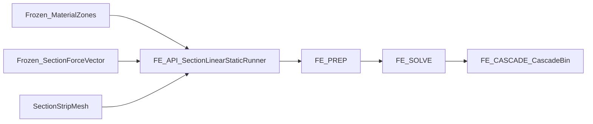

# FE-row ownership matrix -- `section_shell_fea`

Internal analogue of the bind B-row / loads Ld-row matrices. Domain row IDs,
not software layers. Prefix **`FE-`**. `simulation_runner` is the only L4
sequencer; skip-layer imports are defects. Staging layout
(`pre_processing/` · `processing/`) is a **permanent exception** to the
small-worker `api/`+`types/`+domain-homes shell.

Up: [`docs index`](../README.md) · [`section_shell_fea`](../../README.md) ·
outer contract:
[`package_boundaries.md`](../../../../../blade_structure_precompute/module/section_selection/docs/package_boundaries.md) ·
[`COEXISTENCE_IMPLICIT_SHELL.md`](../../../../docs/COEXISTENCE_IMPLICIT_SHELL.md) ·
Ld-row template:
[`Ld_ROW_OWNERSHIP_MATRIX.md`](../../../../load_utilities/section_loads/docs/reference/Ld_ROW_OWNERSHIP_MATRIX.md) ·
B-row template:
[`B_ROW_OWNERSHIP_MATRIX.md`](../../../../material_utilities/section_bind/docs/reference/B_ROW_OWNERSHIP_MATRIX.md)

Graph baseline: live [`../../graphify-out/`](../../graphify-out/)
(full-package directed AST graph, 2026-09-04: ~3018 nodes; god node
`SectionLinearStaticRunner`).

## Table of contents

1. [Outer contract](#1-outer-contract)
2. [Target model](#2-target-model)
3. [Ownership matrix](#3-ownership-matrix)
4. [Forbidden internal leaks](#4-forbidden-internal-leaks)
5. [Presence / empty products](#5-presence--empty-products)
6. [Package map](#6-package-map)
7. [See also](#7-see-also)

---

## 1. Outer contract

Do not reopen these worker boundaries:

| | |
|---|---|
| **Product** | Apply frozen SFV → assemble / BC / solve → `CascadeBin` (P→S→T→Q + Hashin FI) via `SectionLinearStaticRunner` from L4-EVAL |
| **Owns** | Apply SFV → `f`/`Fe`; MITC4 `Ke`; assemble; BC; reduce(`T`); solve; cascade recovery; optional buckling sibling |
| **Must not own** | Midline CSG; strip Q4 density; layup / bind **policy**; SFV **shaping** |
| **Upstream** | Frozen `MaterialZone`s (+ panel topology DTO) from bind; frozen `SectionForceVector` from loads; `SectionStripMesh` from mesh |
| **Banned top-level homes** | `engine/`, `core/` (already removed). **Named staging exceptions:** top-level `interface/`; nested `containers/` under prep/processing; permanent `pre_processing/` · `processing/` staging |

Unification rule: unify the **applied station shell system** (frozen zones +
frozen SFV + strip mesh → `CascadeBin`). Do **not** collapse prep + solve +
cascade into one mega-home, and do **not** steal bind policy, SFV shaping, or
strip Q4.

Production L4 seam: `SectionLinearStaticRunner(...).execute().get_results()`
with pre-bound `ShellPanelTopology` and `section_force_vector=`. Named helpers
(`shell_panel_topology_from_shell_inputs` without zones, demo SFV shaping in
diagnostics / CCX / demos) remain **convenience** — not a second L4 sequencer.

### Consumer contract

| Consumer | May import / call | Must not |
|----------|-------------------|----------|
| L4-EVAL | `SectionLinearStaticRunner` → `CascadeBin`; `ShellPanelTopology` (barrel); `extract_shell_full_element_results` (barrel); buckling sibling | Own bind policy or SFV shaping; deep-import `pre_processing.mesh.api` as ownership |
| Demos / tests / benchmarks / CCX | Named FE-PREP helpers; may call `bind_shell_material_zones` / `shape_section_force_vector*` as **documented convenience** | Become the production L4 seam |
| `section_bind` / `section_loads` | Nothing as ownership | Import FE |
| Geometry SDF / mesh Q4 | Nothing as ownership | Steal FE cascade |
| Parent barrels | Re-export runner / CascadeBin if needed | Present convenience bind/SFV helpers as the L4 seam |

Public barrel: `SectionLinearStaticRunner`, `CascadeBin` /
`SectionLinearStaticResult`, `DiagnosticsBin`, buckling sibling,
`ShellPanelTopology`, `extract_shell_full_element_results`. Deep homes are
maintainer-internal.

## 2. Target model

A station FE solve is not a catalogue letter. It is:

1. **Frozen zones** — ordered `MaterialZone` list on `ShellPanelTopology` (skin → caps → webs); `n_cells = n_web + 1` including `N = 0`.
2. **Frozen SFV** — contour densities from loads (any channel); FE **applies** only.
3. **Strip mesh** — `SectionStripMesh` from mesh (density outside FE).
4. **Prep** — formulation cache / ABD / apply SFV → nodal `f`.
| **Solve** | prepare → assemble (`K`, `f_element`) → compose `SectionConstraintSet` → `f_total = f_element + f_station` → constrain → reduce(`T`) → solve.
6. **Cascade** — P→S→T→Q; Hashin FI on quaternary; `DiagnosticsBin`.
7. **Optional buckling** — sibling runner from static secondary prestress.



Graph notes (Step 0): dual sequencers observed —
`SectionLinearStaticRunner` (god) vs `shell_panel_topology_from_shell_inputs`
(called from `station_recovery`, `station_theory_dispatch`, diagnostics, CCX,
demos) vs `build_shell_panel_topology`. AST edges into `section_bind` from
`shell_panel_topology.py`, constitutive barrel, assembly, topology diagnostics.
Lazy `shape_section_force_vector*` imports live in recovery / dispatch /
diagnostics / demos (not always AST-visible).

## 3. Ownership matrix

| Row | Home | Owns | May call | Forbidden imports | Primary output |
|-----|------|------|----------|-------------------|----------------|
| `FE-API` | [`simulation_runner/`](../../simulation_runner/README.md) | Sole L4 sequencer; static + buckling runners; `CascadeBin` | `FE-PREP`, `FE-SOLVE`, `FE-CASCADE`, `FE-BUCK` | bind policy; SFV shaping on production paths | `SectionLinearStaticRunner` |
| `FE-PREP` | [`pre_processing/`](../../pre_processing/README.md) | Apply SFV → `f`/`Fe`; MITC4 `Ke`; constitutive stacks; panel-topology DTO; dispatch | mesh / bind **product types** only | package barrel as ownership; invent assignment policy | formulation cache / panel topology |
| `FE-SOLVE` | [`processing/static/operations/`](../../processing/static/README.md) + [`constraints/`](../../processing/static/constraints/README.md) | assemble once; compose one immutable constraint set; `f_total = f_element + f_station`; constrain/reduce/solve kernel | `FE-PREP` products | `section_bind`; `shape_section_force_vector*` | reduced / solved system |
| `FE-CASCADE` | [`processing/static/results/`](../../processing/static/results/docs/README.md) | P→S→T→Q + `DiagnosticsBin` | solve-state DTOs | bind / loads shaping | `CascadeBin` tiers |
| `FE-BUCK` | [`processing/buckling/`](../../processing/buckling/README.md) | Geometric stiffness / eigen (sibling of static FI) | static secondary prestress | second L4 sequencer role | buckling bundle |
| `FE-ADAPTER` | [`interface/`](../../interface/README.md) | Cross-package adapters only (named staging exception) | FE products | MITC4 kernels; SFV shaping as ownership | station analysis builders |
| `FE-CCX` | [`calculix_ccx/`](../../calculix_ccx/README.md) | Opt-in CCX oracle quarantine | FE products for comparison | production theory registration at import | CCX validation |

Package-level `api/` re-exports the worker `__all__` (deliberate
`API_STANDARDS` seam). The unused `types/` barrel was removed: it had no
consumers and shadowed stdlib `types` when tools ran from the package
directory.

## 4. Forbidden internal leaks

- No revive of `engine/` or Channel-A / periodic product surfaces.
- No production path that calls `bind_shell_material_zones` or
  `shape_section_force_vector*` inside the L4 runner (orchestration owns that
  sequencing). Convenience call sites must be named FE-PREP / FE-ADAPTER /
  FE-CCX / demo leaks.
- No strip Q4 density kwargs on production runners (mesh owns density).
- No skip-layer: cascade / solve must not import bind policy or loads shaping.
- Nested `containers/` stay FE-local DTOs — not a small-worker mega-home to
  delete; declare them, do not ban them.
- Top-level `interface/` stays as FE-ADAPTER exception (layout test requires it).

## 5. Presence / empty products

FE must accept web-less topologies (`0A`/`0B`: `n_cells = 1`, no web zones) as
first-class products. Cite upstream ADRs — do not silently skip N=0:

- Geometry: [`ADR_ZERO_WEB_SHELL_MESH.md`](../../../../geometry_utilities/section_geometry/docs/reference/ADR_ZERO_WEB_SHELL_MESH.md)
- Mesh: [`ADR_ZERO_WEB_STRIP_MESH.md`](../../../../mesh_utilities/section_mesh/docs/reference/ADR_ZERO_WEB_STRIP_MESH.md)
- Bind: [`ADR_ZERO_WEB_BIND.md`](../../../../material_utilities/section_bind/docs/reference/ADR_ZERO_WEB_BIND.md)
- Loads: [`ADR_ZERO_WEB_LOADS.md`](../../../../load_utilities/section_loads/docs/reference/ADR_ZERO_WEB_LOADS.md)

No separate FE zero-web ADR unless a gap appears in acceptance tests.

## 6. Package map

```text
section_shell_fea/
  simulation_runner/   # FE-API
  pre_processing/      # FE-PREP (loading, element_library, constitutive, mesh, containers, dispatch)
  processing/
    static/            # FE-SOLVE + FE-CASCADE
    buckling/          # FE-BUCK
  interface/           # FE-ADAPTER (named exception)
  calculix_ccx/        # FE-CCX
  api/ types/          # thin barrel aliases
  visualisation/ docs/ benchmarks/ tests/
  graphify-out/        # package-local architecture graph
```

## 7. See also

- Package README: [`../../README.md`](../../README.md)
- [`ELEMENT_AGNOSTIC_ARCHITECTURE.md`](../ELEMENT_AGNOSTIC_ARCHITECTURE.md)
- [`SECTION_SOLVE_STAGES.md`](../SECTION_SOLVE_STAGES.md)
- [`SHELL_MODEL.md`](../SHELL_MODEL.md)
- Live graph: [`../../graphify-out/`](../../graphify-out/)
- Handoff: [`BSU_WORKER_ARCHITECTURE_HANDOFF.md`](../../../../../blade_structure_precompute/module/section_selection/docs/BSU_WORKER_ARCHITECTURE_HANDOFF.md)