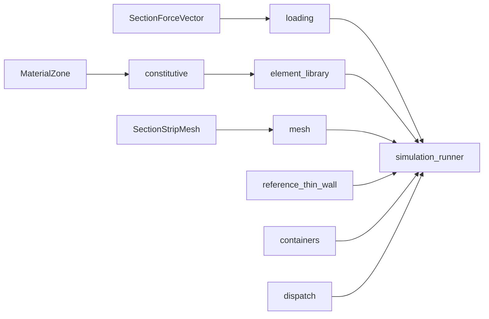

# pre_processing — FE prep homes

Constitutive · mesh · loading · reference_thin_wall · element_library ·
containers · dispatch.

↑ Parent: [`../README.md`](../README.md) · Docs index: [`../docs/README.md`](../docs/README.md)

**Layer contract:** prepare inputs only. Does **not** assemble, constrain, solve,
or fill cascade tiers (those live under [`../processing/`](../processing/README.md)).

## Homes

| Home | Owns | README |
|------|------|--------|
| [`mesh/`](mesh/README.md) | FE maps / global numbering / `ShellPanelTopology` over BSU strip meshes | equations + I/O |
| [`loading/`](loading/README.md) | FE load adapters (skin-pair / SC axis); SFV **apply** lives in [`../processing/static/operations/assembly/load_application.py`](../processing/static/operations/assembly/load_application.py) | I/O |
| [`reference_thin_wall/`](reference_thin_wall/README.md) | FE reference/Vlasov adapters; thin-wall **theory** stays in [`geometry_utilities.section_thin_wall_model`](../../../geometry_utilities/section_thin_wall_model/README.md) | equations + I/O |
| [`element_library/`](element_library/README.md) | MITC4 / FSDT `Ke` + formulation registry | equations + I/O |
| [`constitutive/`](constitutive/README.md) | Panel ABD stacks from bound laminates | equations + I/O |
| [`containers/`](containers/README.md) | FE-local DTOs / theory capabilities | I/O |
| [`dispatch/`](dispatch/README.md) | External solve registries (e.g. CalculiX); native formulations use `element_library` | I/O |

> Strip-mesh *generation* is upstream in
> [`mesh_utilities.section_mesh`](../../../mesh_utilities/section_mesh/README.md).
> `mesh/` adapts frozen `SectionStripMesh` / `ShellMeshInputs` into FE topology —
> it must not call `SectionMeshRunner.execute()`.
>
> `topology/` is a time-bounded **compatibility shim** re-exporting from `mesh/`
> (expires **2026-11-30**). Prefer `pre_processing.mesh` in new code.
>
> `loading/thin_wall/` is a time-bounded **compatibility shim** re-exporting from
> `reference_thin_wall/` (deprecation register `compat-fe-loading-thin-wall-shim`).
>
> Expiry classification: [`../docs/ALIAS_EXPIRY_LEDGER.md`](../docs/ALIAS_EXPIRY_LEDGER.md).

## Pipeline pointer

\[
(\mathrm{zones},\,\mathrm{SFV},\,\mathrm{mesh})
\;\xrightarrow{\mathrm{prep}}\;
\{\mathbf{f},\,\mathbf{K}_e,\,\mathrm{ABD},\,\mathrm{topology}\}
\;\xrightarrow{\mathrm{processing}}\;
\mathbf{KU}=\mathbf{F}.
\]

## PNG pointers

| Figure | Stage |
|--------|-------|
| [`../visualisation/output/section_centerline_mesh_v2/section_mesh_2C-F_i000.png`](../visualisation/output/section_centerline_mesh_v2/section_mesh_2C-F_i000.png) | Mesh / topology consumed after prep |
| Loads shaping (upstream) | [`section_loads` viz](../../../load_utilities/section_loads/visualisation/README.md) — not owned here |

## See also

- [`../docs/SECTION_SOLVE_STAGES.md`](../docs/SECTION_SOLVE_STAGES.md)
- [`../docs/SHELL_MODEL.md`](../docs/SHELL_MODEL.md)
- [`../docs/ALIAS_EXPIRY_LEDGER.md`](../docs/ALIAS_EXPIRY_LEDGER.md)
- [`../processing/README.md`](../processing/README.md)
