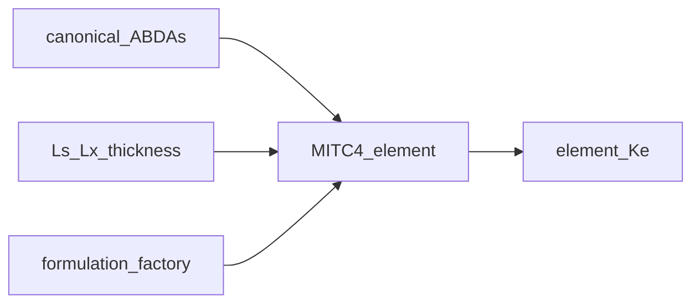

# element_library — MITC4 / shell formulations

↑ Parent computable set: [`../../README.md` §2](../../README.md#2-computable-set)

Form MITC4 / first-order shear deformation theory (FSDT) element stiffness
matrices \(\mathbf{K}_e\) for the section shell worker so assemble/solve can
remain formulation-agnostic at the cascade tiers.

## Purpose / ownership

| Owns | Does **not** own | Why |
|------|------------------|-----|
| MITC4 Q4 FSDT shell element (`mitc4/`) | Strip mesh generation ([`section_mesh`](../../../../mesh_utilities/section_mesh/README.md)) | Mesh knots are upstream |
| Formulation factory / validation | Global assemble / BC / solve ([`../../processing/static/`](../../processing/static/README.md)) | Kernel stops at dense `Ke` |
| Element-local \(B\), \(D\), shape functions | Layup policy / ABD assembly (material libraries + bind) | Constitutive blocks arrive prepared |

---

## Mathematics

Production kernel is **MITC4** (Bathe–Dvorkin mixed interpolation of tensorial
components) under first-order shear deformation theory (FSDT). Frame on each
facet: curvilinear **C ≡ E** (laminate).

The normative field order, signs, units, weak form, boundary pairs, limits,
legacy rotation map, and completed curvature-sign migration are specified in the
[`mitc4/` formulation contract](mitc4/README.md).

**DOF layout per node** (`ndof=6` MITC4+ default):

\[
[u_x,\,u_s,\,w,\,\beta_s,\,\beta_x,\,\beta_z]
\quad(24\ \mathrm{DOFs/element}).
\]

Strain–displacement operators \(\mathbf{B}_m\), \(\mathbf{B}_b\), \(\mathbf{B}_s^{\mathrm{MITC}}\)
map DOFs to membrane strain, curvature, and transverse shear. Element stiffness:

\[
\mathbf{K}_e
=
\int_{\Omega_e}
\big(
\mathbf{B}_m^{\mathsf{T}}\mathbf{A}\mathbf{B}_m
+
\mathbf{B}_m^{\mathsf{T}}\mathbf{B}\mathbf{B}_b
+
\mathbf{B}_b^{\mathsf{T}}\mathbf{B}^{\mathsf T}\mathbf{B}_m
+
\mathbf{B}_b^{\mathsf{T}}\mathbf{D}_b\mathbf{B}_b
+
\mathbf{B}_s^{\mathsf{T}}\mathbf{A}_s\mathbf{B}_s
\big)\,
\mathrm{d}A
\;(+\;\text{Hughes–Brezzi drilling when }ndof=6).
\]

Constitutive blocks come from the bound zone canonical ABDAs object
([`../constitutive/`](../constitutive/README.md)).

Physical model summary: [`../../docs/SHELL_MODEL.md`](../../docs/SHELL_MODEL.md).

---

## Exact I/O

| Symbol / path | Role |
|---------------|------|
| [`mitc4/`](mitc4/) | Production MITC4 implementation and normative formulation contract |
| [`formulation_factory.py`](formulation_factory.py) | Theory → element constructor |
| [`shell_element_base.py`](shell_element_base.py) | Shared shell element Protocol / base |
| [`kernel.py`](kernel.py) | Element-agnostic helpers (`ndof`, resultant recovery hooks) |

| In | Flat-Q4 geometry, `PanelConstitutiveSpec.fsdt`, thickness, drilling settings |
| Out | Dense `Ke` (\(4\mathrm{ndof}\times 4\mathrm{ndof}\)); optional `Fe` hooks |

Consumers use the package barrel / runner — not deep `mitc4.*` imports from
outside this worker.

---

## Adding a formulation (extension recipe)

The library is a **single registration graph** keyed by `formulation_id`
(`registry._FORMULATIONS`). A continuum theory (`ShellTheory`) maps to a default
formulation via the descriptor's `continuum_theory`. To add a formulation without
touching any generic module:

1. **Descriptor** — build a `ShellFormulationDescriptor` (`contracts.py`): topology,
   DOF layout, work-conjugate generalized layout, stress names/frame/capabilities,
   and an `AnalysisDofLayout`. This is the immutable identity + layout contract.
2. **Factory** — implement `ShellElementFactory.iter_elements(...)` yielding live
   elements (`ShellElementBase` subclasses with `element_stiffness_matrix()` /
   `element_force_vector()`). Optionally accept `template_cache=` to opt into the
   per-build `ShellFormulationTemplateCache` (WP3) for exact within-build `Ke`
   reuse. Set a `formulation_id` attribute so the cache records provenance.
3. **Kernel** — implement the `kernel.StripElementKernel` Protocol (stiffness /
   geometric stiffness / recovery). Assembly, recovery, and buckling consume it via
   `resolve_kernel` / `resolve_kernel_by_id` only.
4. **Projector** — implement `registry.NativeToCanonicalShellProjector`
   (native → canonical resultants / stress).
5. **Register** — from a `register_<formulation>()` hook, call
   `register_formulation(ShellFormulationRegistration(descriptor=..., factory_cls=...,
   kernel=..., projector=..., template_key_strategy=None, validate_element=None,
   validate_cache=None))`. Optional hooks (`template_key_strategy`,
   `validate_element`, `validate_cache`) may start as `None`.
6. **Build** — callers select it with
   `build_formulation_cache(..., formulation_id="MY-FORMULATION")` (primary) or via
   `shell_theory=` (resolves the theory default). `register_element_factory` remains
   a thin compatibility façade over the same graph.

Generic modules (`formulation_factory.py`, `registry.py`, `contracts.py`,
`shell_element_base.py`, `formulation_validation.py`) must not import a formulation's
classes at module top level or hard-code its Gauss rules — enforced by the AST gate
in `tests/test_fe_preprocessing_wp1_extension.py`.

```mermaid
flowchart TD
  desc[ShellFormulationDescriptor<br/>contracts.py] --> reg[ShellFormulationRegistration]
  fac[ShellElementFactory] --> reg
  ker[StripElementKernel] --> reg
  proj[NativeToCanonicalShellProjector] --> reg
  reg -->|register_formulation| graph[(registry._FORMULATIONS<br/>by formulation_id)]
  graph -->|resolve_element_factory| bfc[build_formulation_cache]
  graph -->|resolve_kernel_by_id| rec[recovery / buckling]
  bfc --> cache[ShellFormulationCache]
  tc[ShellFormulationTemplateCache<br/>template_cache.py] -.per build.-> bfc
  pt[phase_timing.py<br/>neutral seam] -.timing.-> bfc
```

---

## Call graph



---

## PNG pointers

| Figure | Meaning |
|--------|---------|
| Element / FI oracle bars | [`../../visualisation/output/benchmark_shell_elements/naca2412_twinweb_carbon__panel_maxfi_bars.png`](../../visualisation/output/benchmark_shell_elements/naca2412_twinweb_carbon__panel_maxfi_bars.png) |
| Resultants overlay (benchmark) | [`../../visualisation/output/benchmark_shell_elements/naca2412_twinweb_carbon__resultants_overlay.png`](../../visualisation/output/benchmark_shell_elements/naca2412_twinweb_carbon__resultants_overlay.png) |
| Mesh the kernel acts on | [`../../visualisation/output/section_centerline_mesh_v2/section_mesh_2C-F_i000.png`](../../visualisation/output/section_centerline_mesh_v2/section_mesh_2C-F_i000.png) |

---

## Provenance / what happens today

| Claim | Today |
|-------|-------|
| Production theory | MITC4 FSDT |
| CCX | Quarantined validation only ([`../../calculix_ccx/`](../../calculix_ccx/README.md)) |
| Element-agnostic cascade | Result tiers do not hard-code MITC4 types |

## See also

- [`../../README.md`](../../README.md) — package README · computable set §2
- [`../../../../docs/CASCADE_GLOSSARY.md`](../../../../docs/CASCADE_GLOSSARY.md)
- [`../../docs/SHELL_MODEL.md`](../../docs/SHELL_MODEL.md)
- [`../../docs/ELEMENT_AGNOSTIC_ARCHITECTURE.md`](../../docs/ELEMENT_AGNOSTIC_ARCHITECTURE.md)
- [`../constitutive/README.md`](../constitutive/README.md)
