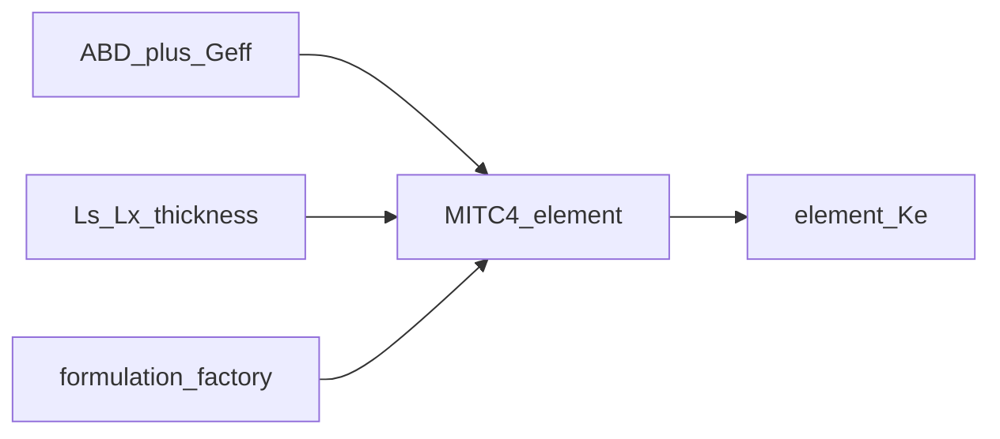

# element_library — MITC4 / shell formulations

↑ Parent computable set: [`../../README.md` §2](../../README.md#2-computable-set)

Form MITC4 / first-order shear deformation theory (FSDT) element stiffness
matrices \(\mathbf{K}_e\) for the section shell worker so assemble/solve can
remain formulation-agnostic at the cascade tiers.

## Purpose / ownership

| Owns | Does **not** own | Why |
|------|------------------|-----|
| MITC4 Q4 FSDT shell element (`mitc4/`) | Strip mesh generation ([`section_mesh`](../../../../mesh_utilities/section_mesh/README.md)) | Mesh knots are upstream |
| Formulation factory / validation | Global assemble / BC / solve ([`../../processing/static/`](../../processing/static/README.md)) | Kernel stops at dense `Ke` |
| Element-local \(B\), \(D\), shape functions | Layup policy / ABD assembly (material libraries + bind) | Constitutive blocks arrive prepared |

---

## Mathematics

Production kernel is **MITC4** (Bathe–Dvorkin mixed interpolation of tensorial
components) under first-order shear deformation theory (FSDT). Frame on each
facet: curvilinear **C ≡ E** (laminate).

**DOF layout per node** (`ndof=6` MITC4+ default):

\[
[u_x,\,u_s,\,w,\,\beta_s,\,\beta_x,\,\beta_z]
\quad(24\ \mathrm{DOFs/element}).
\]

Strain–displacement operators \(\mathbf{B}_m\), \(\mathbf{B}_b\), \(\mathbf{B}_s^{\mathrm{MITC}}\)
map DOFs to membrane strain, curvature, and transverse shear. Element stiffness:

\[
\mathbf{K}_e
=
\int_{\Omega_e}
\big(
\mathbf{B}_m^{\mathsf{T}}\mathbf{A}\mathbf{B}_m
+
\mathbf{B}_b^{\mathsf{T}}\mathbf{D}_b\mathbf{B}_b
+
\mathbf{B}_s^{\mathsf{T}}\mathbf{A}_s\mathbf{B}_s
\big)\,
\mathrm{d}A
\;(+\;\text{Hughes–Brezzi drilling when }ndof=6).
\]

Constitutive blocks come from the bound zone ABD / \(G_{\mathrm{eff}}\)
([`../constitutive/`](../constitutive/README.md)).

Physical model summary: [`../../docs/SHELL_MODEL.md`](../../docs/SHELL_MODEL.md).

---

## Exact I/O

| Symbol / path | Role |
|---------------|------|
| [`mitc4/`](mitc4/) | Production MITC4 implementation (`element.py` DOF / B / Ke) |
| [`formulation_factory.py`](formulation_factory.py) | Theory → element constructor |
| [`shell_element_base.py`](shell_element_base.py) | Shared shell element Protocol / base |
| [`kernel.py`](kernel.py) | Element-agnostic helpers (`ndof`, resultant recovery hooks) |

| In | `L_s`, `L_x`, ABD, thickness, \(G_{\mathrm{eff}}\), optional drilling flag |
| Out | Dense `Ke` (\(4\mathrm{ndof}\times 4\mathrm{ndof}\)); optional `Fe` hooks |

Consumers use the package barrel / runner — not deep `mitc4.*` imports from
outside this worker.

---

## Call graph

---

## PNG pointers

| Figure | Meaning |
|--------|---------|
| Element / FI oracle bars | [`../../visualisation/output/benchmark_shell_elements/naca2412_twinweb_carbon__panel_maxfi_bars.png`](../../visualisation/output/benchmark_shell_elements/naca2412_twinweb_carbon__panel_maxfi_bars.png) |
| Resultants overlay (benchmark) | [`../../visualisation/output/benchmark_shell_elements/naca2412_twinweb_carbon__resultants_overlay.png`](../../visualisation/output/benchmark_shell_elements/naca2412_twinweb_carbon__resultants_overlay.png) |
| Mesh the kernel acts on | [`../../visualisation/output/section_centerline_mesh_v2/section_mesh_2C-F_i000.png`](../../visualisation/output/section_centerline_mesh_v2/section_mesh_2C-F_i000.png) |

---

## Provenance / what happens today

| Claim | Today |
|-------|-------|
| Production theory | MITC4 FSDT |
| CCX | Quarantined validation only ([`../../calculix_ccx/`](../../calculix_ccx/README.md)) |
| Element-agnostic cascade | Result tiers do not hard-code MITC4 types |

## See also

- [`../../README.md`](../../README.md) — package README · computable set §2
- [`../../../../docs/CASCADE_GLOSSARY.md`](../../../../docs/CASCADE_GLOSSARY.md)
- [`../../docs/SHELL_MODEL.md`](../../docs/SHELL_MODEL.md)
- [`../../docs/ELEMENT_AGNOSTIC_ARCHITECTURE.md`](../../docs/ELEMENT_AGNOSTIC_ARCHITECTURE.md)
- [`../constitutive/README.md`](../constitutive/README.md)
