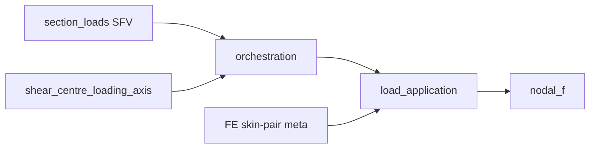

# loading — FE load adaptation over BSU section_loads

Internal FE home for adapting BSU load products into FE preparation metadata
and nodal application helpers.

↑ Parent: [`../README.md`](../README.md) · Package: [`../../README.md`](../../README.md)

## Ownership

| Package | Owns |
|---------|------|
| [`load_utilities.section_loads`](../../../../load_utilities/section_loads/README.md) | Channel A/B shaping, station-load DTOs, equipollence, `SectionForceVector` |
| [`processing/.../assembly/load_application.py`](../../processing/static/operations/assembly/load_application.py) | SFV → nodal DOF application |
| **`pre_processing.loading` (this home)** | FE-specific skin-pair / refusal adapters, shear-centre loading-axis adapters, quarantined regression oracles |
| Public `section_shell_fea` barrel | Canonical worker export surface |

Import `SectionForceVector` and station-load products from the public
`load_utilities.section_loads` barrel. This package does **not** re-export Channel B
builders and must not call `SectionLoadsRunner.execute()` during FE execution —
orchestration supplies frozen load products.

`builders/`, `api/`, and `containers/` remain warning-alias shims for one
migration cycle (expires **2026-11-30**). Prefer BSU imports in new code.

## Retained FE adapters

| Path | Role |
|------|------|
| [`traction_face_load.py`](traction_face_load.py) | Skin-pair / refusal geometry for FE apply |
| [`shear_centre_loading_axis.py`](shear_centre_loading_axis.py) | Loading-axis adapter; SC from BSU section-property / thin-wall kernels |
| [`section_force_vector_to_nodal_load.py`](section_force_vector_to_nodal_load.py) | Compat re-export of processing apply (warns) |
| [`beam_resultants_to_nodal_load.py`](beam_resultants_to_nodal_load.py) | **Regression-only** oracle — not a production apply path |

## Mathematics

Contour densities \((f_x,f_s,f_w)\) [N/m] on SFV samples are converted to absolute
forces \(f\,\mathrm{d}s\,L_x\) and lumped 50/50 onto the nearest through-thickness
skin node pair in curvilinear **C** DOFs \([u_x,u_s,w]\):

\[
\mathbf{f}_{\mathrm{node}}
\;+\!=\;
\tfrac12\,(f_x,\,f_s,\,f_w)\,\mathrm{d}s\,L_x.
\]

Equipollence of the *shaped* SFV is a loads-worker concern; this home only
adapts geometry and projects densities onto DOFs via the processing apply owner.

## Call graph

## See also

- [`../../../../load_utilities/section_loads/README.md`](../../../../load_utilities/section_loads/README.md)
- [`../../docs/DEPRECATED_ALIASES.md`](../../docs/DEPRECATED_ALIASES.md)
- [`../../docs/TAXONOMY.md`](../../docs/TAXONOMY.md)
