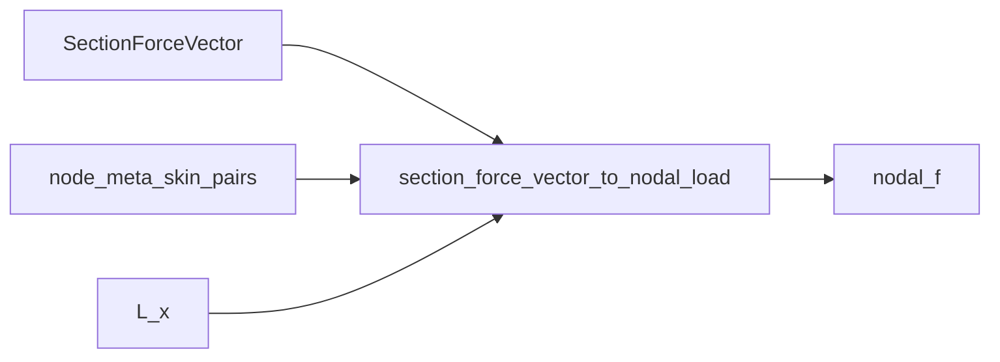

# loading — apply SectionForceVector → nodal loads

↑ Parent computable set: [`../../README.md` §2](../../README.md#2-computable-set)

Project a shaped `SectionForceVector` (SFV) onto MITC4 nodal degrees of freedom as
absolute forces — contour densities become the shell right-hand side without this
home owning thin-wall or aero shaping.

## Purpose / ownership

| Owns | Does **not** own | Why |
|------|------------------|-----|
| `section_force_vector_to_nodal_load` | SFV *shaping* ([`section_loads`](../../../../load_utilities/section_loads/README.md)) | One SFV product; FE only applies |
| Legacy `beam_resultants_to_nodal_load` helpers | TractionField / XFOIL staging (`section_loads.surface_traction`) | Regression/reference only through next major; production apply is SFV |
| Skin node-pair lumping of contour densities | MITC4 `Ke` / assemble / solve | Stiffness and solve live elsewhere |

**Locked boundary:** FE only **applies** a precomputed `SectionForceVector`. Channel B
staging (`build_station_load_field`) is owned by `section_loads`; temporary FE
re-exports emit `DeprecationWarning`.

---

## Mathematics

Contour densities \((f_x,f_s,f_w)\) [N/m] on SFV samples are converted to absolute
forces \(f\,\mathrm{d}s\,L_x\) and lumped 50/50 onto the nearest through-thickness
skin node pair in curvilinear **C** DOFs \([u_x,u_s,w]\):

\[
\mathbf{f}_{\mathrm{node}}
\;+\!=\;
\tfrac12\,(f_x,\,f_s,\,f_w)\,\mathrm{d}s\,L_x.
\]

Nearest-pair matching uses B-plane sample coordinates vs skin midline
locations. Equipollence of the *shaped* SFV is a loads-worker concern; this home
only projects densities onto DOFs.

Weak-form RHS term corresponding to this projection:

\[
\delta W_{\mathrm{ext}}
=
\int_{\partial\Omega}
\delta\mathbf{u}^{\mathsf{T}}\,\mathbf{t}\,\mathrm{d}s
\;\approx\;
\delta\mathbf{d}^{\mathsf{T}}\,\mathbf{f}.
\]

---

## Exact I/O

### `section_force_vector_to_nodal_load(node_meta, sfv, *, ndof=6, L_x=1.0, f=None) -> ndarray`

| In | `node_meta` (skin pairs), `SectionForceVector`, strip length \(L_x\) |
| Out | Global load vector `f` length `n_nodes * ndof` |
| Side effect | Accumulates into provided `f` when given |

| Path | Role |
|------|------|
| [`section_force_vector_to_nodal_load.py`](section_force_vector_to_nodal_load.py) | **Product** apply path |
| [`beam_resultants_to_nodal_load.py`](beam_resultants_to_nodal_load.py) | Legacy / comparison helpers |
| [`traction_face_load.py`](traction_face_load.py) | Skin pair geometry helpers |

Staging / XFOIL: import from
`blade_structure_utilities.load_utilities.section_loads` (or
`section_loads.surface_traction.station_load`).

---

## Call graph

---

## PNG pointers

| Figure | Meaning |
|--------|---------|
| Upstream shaped SFV / equipollence | [`section_loads` visualisation](../../../../load_utilities/section_loads/visualisation/README.md) |
| Station mesh receiving loads | [`../../visualisation/output/section_centerline_mesh_v2/section_mesh_2C-F_i000.png`](../../visualisation/output/section_centerline_mesh_v2/section_mesh_2C-F_i000.png) |

---

## Provenance / what happens today

| Claim | Today |
|-------|-------|
| Product FI RHS | Runner applies SFV via this home |
| Channel B construction | Moved to `section_loads`; FE re-exports are temporary |
| Double-count risk | Callers must not stack tip-integrated \(V\) with Channel B — see [`../../docs/LOAD_APPLICATION_DOUBLE_COUNTING.md`](../../docs/LOAD_APPLICATION_DOUBLE_COUNTING.md) |

## See also

- [`../../README.md`](../../README.md) — package README · computable set §2
- [`../../../../docs/CASCADE_GLOSSARY.md`](../../../../docs/CASCADE_GLOSSARY.md)
- [`../../docs/README.md`](../../docs/README.md)
- [`../../../../load_utilities/section_loads/README.md`](../../../../load_utilities/section_loads/README.md)
- [`../../simulation_runner/README.md`](../../simulation_runner/README.md)
