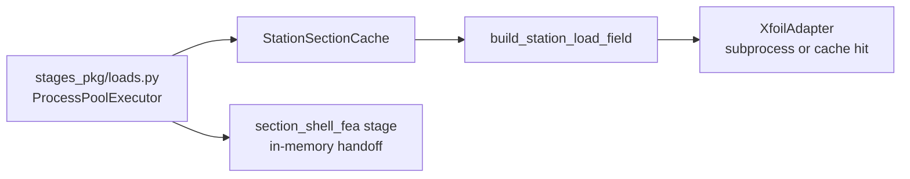

# section_loads — performance optimisation report

Status/review document for computational-efficiency work on `blade_precompute/section_loads` and its orchestration / utility dependencies (`blade_structure_utilities.load_utilities.section_loads.surface_traction`). For methodology see [README.md](../README.md). For a well-optimised sibling package to emulate, see [section_geometry/docs/PERFORMANCE_WORK_SUMMARY.md](../../section_geometry/docs/PERFORMANCE_WORK_SUMMARY.md).

## Goal

Reduce wall-clock time for per-station surface traction construction (aero polars → panel tractions → load matching) without changing numerical parity. When XFOIL is enabled, subprocess cost still dominates on cache miss; the remaining orchestration gaps are **final-pass recomputation** and **IO/plotting overhead**.

## Implementation status

| # | Finding | Status |
|---|---------|--------|
| 1 | XFOIL content-addressed cache | **Done** — `station_load_builder.py` |
| 2 | Duplicate section geometry in orchestration | **Done** — `StationSectionCache` |
| 3 | Entire stage recomputed on optimise final pass | **Open** |
| 4 | No cross-station parallelisation | **Done** — `ProcessPoolExecutor` in `loads.py` |
| 5 | Matplotlib PNG generation in station loop | **Open** |
| 6 | Large JSON write per station | **Open** |
| 7 | `interp1d` rebuilt on every call | **Open** |
| 8 | Repeated outline panelisation / transforms | **Open** |
| 9 | XFOIL output parsing in Python loops | **Open** |
| 10 | Plotting ribbon per-panel `ax.fill` loops | **Open** |
| 11 | Per-station object churn and PATH lookups | **Open** |
| 12 | In-memory retention of all station fields | **Open** |

## Package structure

| Path | Role |
|------|------|
| `api/build_station_load_field.py` | Public API wrapper |
| `engine/station_load_builder.py` | **Core per-station logic** (outline → XFOIL → matching) |
| `engine/incident_aero.py` | Re/Ma/α derivation |
| `engine/outline_frames.py` | B-frame ↔ S-frame transforms |
| `core/types.py` | DTOs + JSON serialisation |
| `vis.py` | Matplotlib PNG writers |
| `io/load_field_json.py` | JSON payload helper |

**Utility dependency:** `section_loads/surface_traction/` — panelisation, Cp/Cf interpolation, vectorised traction builders, XFOIL adapter.

## Pipeline invocation model



| Question | Answer |
|----------|--------|
| Per station or once? | **Per station** over `station_indices(...)` |
| Default station count | `SECTION_PLOT_STATION_SPEC="all"` → every structural station (`N_STRUCTURAL`, default 16) |
| XFOIL calls | **1 subprocess per station on cache miss** when XFOIL is available and synthetic mode is off; **0 on cache hit** |
| Parallelism | **`ProcessPoolExecutor`** when `section_solve_n_workers > 1` and `n_stations > 1` |
| Double run | **Yes** on optimise jobs: `section_loads` + `section_loads_final` |
| Downstream reuse | In-memory `station_load_fields` dict passed to shell stage; JSON also written per station |

**Orchestration entry:** `orchestration/precompute/stages_pkg/loads.py` → `section_loads_impl`.

```165:175:blade_precompute/orchestration/precompute/stages_pkg/loads.py
    idx = station_indices(int(inp.span_r_z_m.shape[0]), section_plot_station_spec)
    n_stations = len(idx)
    ...
    n_workers = max(1, int(section_solve_n_workers))
    do_parallel = n_workers > 1 and len(idx) > 1
```

On design jobs, `_defer_pngs=True` runs the stage once before optimisation (JSON only), then again as `section_loads_final` with PNGs (`pipeline.py` lines 568, 637, 820–825).

Per-stage wall time is recorded in `<job>/runtime.json` (`section_loads_s`, `section_loads_final_s`).

## What is already good

| Area | Detail |
|------|--------|
| Core traction math | Vectorised NumPy in `section_loads/surface_traction/tractions.py`, `integration.py`, `matching.py` |
| Synthetic / CI path | `use_direct_xfoil_scalars` or `ADVANCED_BLADE_SECTION_LOADS_SYNTHETIC_AERO=1` skips XFOIL entirely |
| Public API | Thin wrapper; computation isolated in `engine/station_load_builder.py` |
| Plot gating | `persist_pngs=False` skips PNG generation during optimise pre-loop |
| XFOIL result cache | Content-addressed skip-on-hit under `station_dir/xfoil_cache/<key>/` |
| Cross-stage section cache | `StationSectionCache` memoises `build_section_view` + `build_shell_mesh_inputs` |
| Parallel station fan-out | Mirrors geometry stage pattern when workers > 1 |

## Ranked findings

### 1. Uncached XFOIL subprocess per station

**Status:** **Done** — see `engine/station_load_builder.py` (`_xfoil_cache_key`, `_try_xfoil_cache_hit`, `_store_xfoil_cache_artifacts`).

**Impact:** Was critical when XFOIL is on PATH — cost scales **O(N_stations × T_xfoil)** on cache miss.

**Where:** `engine/station_load_builder.py` (`_run_xfoil_or_synthetic`, 212–234); `section_loads/surface_traction/xfoil/xfoil_adapter.py` (117–125).

```212:234:blade_precompute/section_loads/engine/station_load_builder.py
    cache_key: str | None = None
    if workdir is not None:
        cache_key = _xfoil_cache_key(xfoil_geometry, xfoil_cfg)
        cached = _try_xfoil_cache_hit(workdir, cache_key)
        if cached is not None:
            result = cached
        else:
            result = None
    ...
    if result is None:
        try:
            result = adapter.run_cp_analysis(xfoil_geometry, xfoil_cfg)
        ...
        if workdir is not None and cache_key is not None:
            _store_xfoil_cache_artifacts(workdir, cache_key, result)
```

Cache key: SHA-256 digest of `(airfoil coords, Re, Ma, alpha, n_iterations)`. On hit, parses existing `cp_output.dat` / `cf_output.dat` without spawning subprocess.

**Remaining gap:** Cache is per-station workdir only; no cross-station deduplication when identical airfoil/Re/Ma/α repeats at different span locations.

---

### 2. Full section geometry rebuilt per station in orchestration

**Status:** **Done** — see `orchestration/precompute/station_section_cache.py` `StationSectionCache`, consumed by `stages_pkg/loads.py` and `stages_pkg/shell.py`.

**Impact:** Was high — duplicated NACA sampling, `MultiCellSection`, midline extraction, and shell mesh inputs.

**Where (cross-package):** `orchestration/precompute/stages_pkg/loads.py` (269); `station_section_cache.py` (25–49).

```269:269:blade_precompute/orchestration/precompute/stages_pkg/loads.py
            shell_inputs_i = section_cache.shell_mesh_inputs(inp, i, chord=chord)
```

```25:49:blade_precompute/orchestration/precompute/station_section_cache.py
    def section_bundle(
        self,
        inp: PrecomputeInputs,
        station_index: int,
        *,
        chord: float | None = None,
    ) -> tuple[Any, Any]:
        ...
        if i in self._shell_inputs and i in self._section_views:
            return self._section_views[i], self._shell_inputs[i]
        ...
        section_i = build_section_view(...)
        shell_inputs_i = build_shell_mesh_inputs(...)
        self._section_views[i] = section_i
        self._shell_inputs[i] = shell_inputs_i
        return section_i, shell_inputs_i
```

**Remaining gap:** Cache is per-stage invocation, not shared from `section_geometry` stage outputs on disk.

---

### 3. Entire stage recomputed on optimise final pass

**Status:** **Open**

**Impact:** High when XFOIL enabled — **2× subprocess cost** (mitigated by XFOIL cache on second pass) plus duplicate geometry/traction work.

**Where (cross-package):** `orchestration/precompute/pipeline.py` (568, 637, 820–825).

When `_defer_pngs=True` (design optimisation), all stations are computed once for shell handoff (JSON only), then again on final geometry with PNGs as `section_loads_final`.

**Fix direction:** Reuse first-pass in-memory `station_load_fields` when spanwise geometry unchanged; only rerun stations whose design vector changed geometry; defer PNG generation to a post-pass that reads existing JSON without recomputing tractions/XFOIL.

**Pattern:** section_geometry optimise mode — `persist_pngs=False` during pre-loop, PNGs only on final pass; loads should **reuse computed data**, not recompute it.

---

### 4. No cross-station parallelisation

**Status:** **Done** — see `orchestration/precompute/stages_pkg/loads.py` (`ProcessPoolExecutor`, 201–259).

**Impact:** Was high — station work is embarrassingly parallel but was serialised.

**Where (cross-package):** `orchestration/precompute/stages_pkg/loads.py` (174–230).

```201:230:blade_precompute/orchestration/precompute/stages_pkg/loads.py
    if do_parallel:
        run_log.info_event("section_loads.parallel", n_workers=n_workers, n_stations=n_stations)
        ...
        with ProcessPoolExecutor(max_workers=min(n_workers, nbatch)) as ex:
            futures = [ex.submit(_section_loads_station_task, **kw) for kw in task_kwargs]
            ...
```

Parallel workers use `_section_loads_station_task` with picklable job config dict. Regression: `section_loads/tests/test_section_loads_parallel.py`.

**Remaining gap:** Pool is created per stage invocation (not long-lived across pipeline stages).

---

### 5. Matplotlib PNG generation inside station loop

**Status:** **Open**

**Impact:** Medium–high when `persist_pngs=True` — 2 figures per station at dpi 200.

**Where:** `orchestration/precompute/stages_pkg/loads.py` (parallel path via `_section_loads_station_task`); `vis.py` (`write_station_load_pngs`, 175–196; `plot_force_vs_chord_png`, dpi default 200).

```175:196:blade_precompute/section_loads/vis.py
def write_station_load_pngs(
    load_field: SectionStationLoadField,
    station_dir: Path,
    *,
    persist: bool = True,
    dpi: int = 200,
) -> list[Path]:
    ...
    paths = [
        plot_force_vs_chord_png(load_field, station_dir / "force_vs_chord.png", dpi=dpi),
        plot_airfoil_area_diagrams_png(load_field, station_dir / "airfoil_area_diagrams.png", dpi=dpi),
    ]
```

`_sframe_plot_context` in `vis.py` rebuilds geometry and re-transforms tractions for plotting only.

**Fix direction:** Default off for production runs; offline plotting from JSON; lower DPI for diagnostics; reuse S-frame outline stored on `SectionStationLoadField`.

**Pattern:** section_geometry **plot from computed mesh**, not recompute — `plot_section_from_mesh` vs dense grid fallback.

---

### 6. Large JSON write per station with `.tolist()` expansion

**Status:** **Open**

**Impact:** Medium — CPU (Python float boxing), memory spike, disk I/O for ~400-panel skin rings.

**Where:** `orchestration/precompute/stages_pkg/loads.py`; `core/types.py` (102–138).

```110:137:blade_precompute/section_loads/core/types.py
            "outline_yz": np.asarray(self.outline_yz, dtype=float).tolist(),
            ...
            "traction_field": {
                "pressure_forces": np.asarray(tf.pressure_forces, dtype=float).tolist(),
                "shear_forces": np.asarray(tf.shear_forces, dtype=float).tolist(),
                "total_forces": np.asarray(tf.total_forces, dtype=float).tolist(),
            },
```

Shell stage already holds fields in memory via `station_load_fields`.

**Fix direction:** NPZ sidecar for arrays; slim JSON with metadata only; skip JSON when in-memory handoff suffices for a given run mode.

---

### 7. `scipy.interpolate.interp1d` rebuilt on every `interpolate()` call

**Status:** **Open**

**Impact:** Medium — unnecessary object churn; called twice per station (Cp + Cf).

**Where:** `section_loads/surface_traction/distributions.py` (47–57); called from `station_load_builder.py`.

```47:57:section_loads/surface_traction/distributions.py
    def interpolate(self, query_points: ArrayLike) -> NDArray[np.float64]:
        interpolator = interp1d(
            self.stations,
            self.values,
            kind="linear",
            ...
        )
        return np.asarray(interpolator(np.asarray(query_points, dtype=float)), dtype=float)
```

For linear interpolation onto fixed panel stations, `np.interp` suffices (already used in `plotting.py`).

**Fix direction:** Cache interpolator on the distribution object lazily, or replace with `np.interp`.

---

### 8. Repeated outline panelisation and frame transforms per station

**Status:** **Open**

**Impact:** Medium — redundant work within one station call and again at plot time.

| Step | File |
|------|------|
| B-frame panelisation | `station_load_builder.py` (`SectionOutlineGeometry.from_closed_contour`) |
| S-frame for XFOIL | `outline_frames.py` (`bframe_outline_to_sframe_chord`) |
| TE arc offset | `outline_frames.py` (`xfoil_te_arc_offset`) |
| Plot context rebuild | `vis.py` (`_sframe_plot_context`) |

**Fix direction:** Compute S-frame geometry + `s_te` once; pass through pipeline; store on DTO for viz.

---

### 9. XFOIL output parsing in pure Python loops

**Status:** **Open**

**Impact:** Low–medium relative to subprocess cost.

**Where:** `section_loads/surface_traction/xfoil/xfoil_io.py` (line-by-line parse into Python lists, then `np.asarray`).

**Fix direction:** `np.loadtxt` / `genfromtxt` where format allows; parse once and cache `CpDistribution`/`CfDistribution` objects (finding #1 cache path already reuses parsed files).

---

### 10. Plotting ribbon draws: per-panel `ax.fill` loops

**Status:** **Open**

**Impact:** Low–medium (PNG path only).

**Where:** `section_loads/surface_traction/plotting.py` — O(N_panels) matplotlib polygon fills × 3 subplots × 2 PNGs per station.

**Fix direction:** `PolyCollection` or vectorised `fill_between` where topology allows.

---

### 11. Per-station object churn and PATH lookups

**Status:** **Open**

**Impact:** Low.

**Where:** `station_load_builder.py` — new `XfoilAdapter()` per station (199); `_xfoil_available` calls `shutil.which("xfoil")` per station; adapter resolves executable again internally.

**Fix direction:** Resolve XFOIL executable once per job; reuse adapter instance or module-level singleton builders.

---

### 12. In-memory retention of all station fields

**Status:** **Open**

**Impact:** Low (CPU); can matter for memory at high N.

**Where:** `SectionLoadsOutputs.station_load_fields` retains every `SectionStationLoadField` for downstream shell stage.

**Fix direction:** Lazy load from NPZ/JSON paths if memory becomes an issue.

---

## Explicit non-goals / already-fast paths

| Item | Rationale |
|------|-----------|
| Core traction/integration/matching math | Already vectorised NumPy |
| Synthetic aero mode | Fast path for CI and XFOIL-unavailable environments |
| Numba / Cython | Follow section_geometry precedent — vectorise and cache first |
| Changing load-matching formulation | Out of scope for performance work |

## Recommended measurement approach

1. **Pipeline-level:** Compare `<job>/runtime.json` `section_loads_s` and `section_loads_final_s` before/after changes.
2. **Per-station breakdown:** Time one station with XFOIL on vs synthetic mode; record subprocess wall time vs Python post-process share; compare cache hit vs miss.
3. **Micro-benchmark:** cProfile `build_station_load_field` with synthetic aero to isolate geometry/panelisation cost from XFOIL.
4. **Regression:** Compare `load_field.json` traction arrays station-by-station; `section_loads/tests/test_section_loads_parallel.py`; other tests in `section_loads/tests/`.

## Suggested implementation priority

1. Avoid double full recompute on final pass (finding #3).
2. Defer / slim PNG and JSON IO (findings #5–6).
3. Interpolator and transform micro-optimisations (findings #7–11).
4. Cross-station XFOIL cache deduplication (finding #1 remaining gap).

## Related documents

- [section_loads README.md](../README.md) — methodology and API
- [orchestration PERFORMANCE_OPTIMISATION_REPORT.md](../../orchestration/docs/PERFORMANCE_OPTIMISATION_REPORT.md) — `StationSectionCache`, final-pass policy
- [section_geometry PERFORMANCE_WORK_SUMMARY.md](../../section_geometry/docs/PERFORMANCE_WORK_SUMMARY.md) — optimisation patterns to adopt
- [orchestration/precompute/__init__.py](../../orchestration/precompute/__init__.py) — stage order and worker hierarchy
