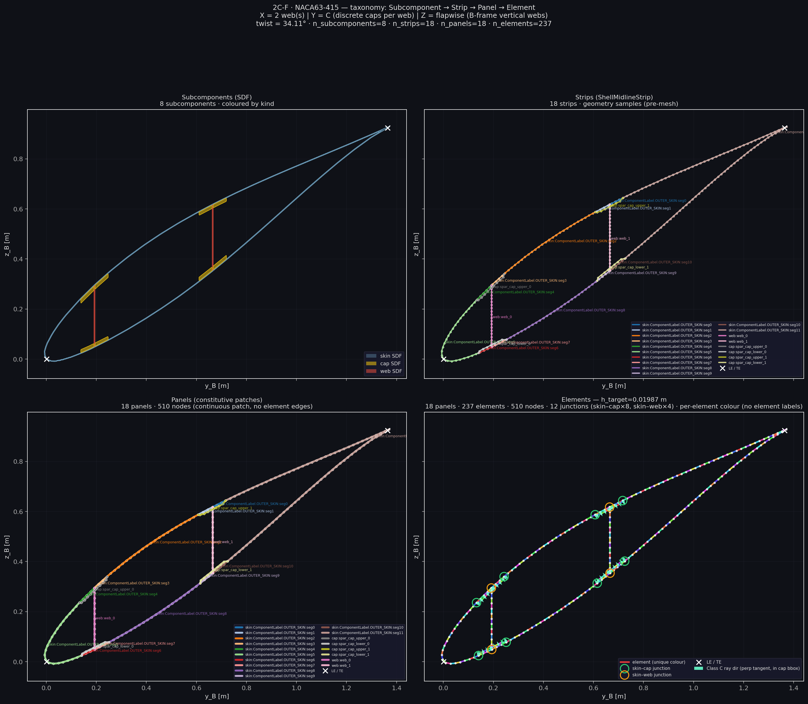

# mesh — FE mesh map / panel topology

Kernel-agnostic strip → global node map and `ShellPanelTopology` builders.

↑ Parent: [`../README.md`](../README.md) · Package: [`../../README.md`](../../README.md)

## Purpose / ownership

| Owns | Does **not** own |
|------|------------------|
| `shell_mesh_map` global node numbering / connectivity | Strip Q4 discretisation ([`section_mesh`](../../../../mesh_utilities/section_mesh/README.md)) |
| `ShellPanelTopology` geometry seam | Midline CSG ([`section_geometry`](../../../../geometry_utilities/section_geometry/README.md)) |
| Junction clustering / panel endpoint maps | Element `Ke` kernels; SFV shaping |

**Locked:** production passes a caller-owned `SectionStripMesh`. This home maps
it into FE panel topology; it does **not** remesh on `execute()`.

---

## Mathematics

Per-panel element count from target edge length (when not overridden):

\[
n_e
=
\max\!\Big(1,\;
\lceil L_{\mathrm{arc}} / \ell_{\mathrm{target}} \rceil
\Big),
\qquad
\ell_{\mathrm{target}}
=
f_{\mathrm{frac}}\,c.
\]

Default production frac is owned by `section_mesh`
(`TARGET_ELEMENT_LENGTH_FRAC ≈ 0.012`). Junction nodes are clustered in the
section plane; DOFs live in curvilinear **C** on each facet (**C ≡ E**).

Connectivity is Q4 along the strip: four nodes × `ndof` → element DOF map
consumed by assemble.

---

## Exact I/O

| Path | Role |
|------|------|
| [`shell_mesh_map.py`](shell_mesh_map.py) | Node maps, `effective_n_elements_spec`, panel end tangents |
| [`api/shell_panel_topology.py`](api/shell_panel_topology.py) | `ShellPanelTopology`, builders from `ShellMeshInputs` |
| [`connected_panel_topology.py`](connected_panel_topology.py) | Connected-section topology helpers |
| [`naca_profile.py`](naca_profile.py) | FE-demo thin-wall LE→TE helpers only — production outer polygons → [`section_geometry.sdf.naca`](../../../../geometry_utilities/section_geometry/sdf/naca.py) |

### `ShellPanelTopology`

| Field | Role |
|-------|------|
| `shell_inputs` | `ShellMeshInputs` polylines (solve path — no SDF re-eval) |
| `zones` | Bound `MaterialZone` tuple |
| `webs_geom` / `n_cells` | Multi-cell topology |
| `section` | Optional viz / SDF host only |

| In | Bound zones + mesh inputs / strip mesh |
| Out | Topology DTO for runner / assembly orchestra |

---

## PNG pointers

| Figure | Meaning |
|--------|---------|
| Section centerline mesh |  |
| More layouts | [`../../visualisation/output/section_centerline_mesh_v2/`](../../visualisation/output/section_centerline_mesh_v2/) |
| GCI refinement ladders | [`../../visualisation/output/gci_study_mitc4/plots/ladder_governing_fi.png`](../../visualisation/output/gci_study_mitc4/plots/ladder_governing_fi.png) |

---

## Provenance / what happens today

| Claim | Today |
|-------|-------|
| Remesh ownership | Outside FE — caller supplies strip mesh |
| Shared with CCX | Same topology seam for quarantined CCX decks |
| Defect K | Shared DOF junctions — see [`../../docs/SHELL_MODEL.md`](../../docs/SHELL_MODEL.md) |

## See also

- [`../../docs/TAXONOMY.md`](../../docs/TAXONOMY.md)
- [`../../../../mesh_utilities/section_mesh/README.md`](../../../../mesh_utilities/section_mesh/README.md)
- [`../element_library/README.md`](../element_library/README.md)
