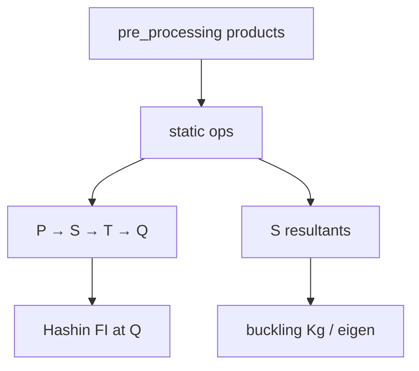

# processing — FE solve tracks

`static/` assemble/solve/cascade · `buckling/` eigen track.

↑ Parent: [`../README.md`](../README.md) · Docs index: [`../docs/README.md`](../docs/README.md)

**Layer contract:** compute system-state transitions and recovery. Does **not**
shape SFV, bind laminates, or remesh (prep + upstream workers).

## Tracks

| Track | Home | Product |
|-------|------|---------|
| Linear static | [`static/`](static/README.md) | \(\mathbf{KU}=\mathbf{F}\) + **P→S→T→Q** (+ diagnostics) |
| Linear buckling | [`buckling/`](buckling/README.md) | \(K_r\phi=\lambda(-K_{g,r})\phi\) → P→S + station fold |

## Mathematics (pointer)

Static:

\[
\mathbf{K}_r\mathbf{q}=\mathbf{f}_r
\;\rightarrow\;
\mathbf{d}=\mathbf{T}\mathbf{q}
\;\rightarrow\;
U_e
\;\rightarrow\;
(N,M,Q)
\;\rightarrow\;
\boldsymbol{\sigma}_{\mathrm{ply}}
\;\rightarrow\;
\mathrm{FI}.
\]

Buckling (section track default):

\[
\mathbf{K}_r\,\boldsymbol{\phi}
=
\lambda\,(-\mathbf{K}_{g,r})\,\boldsymbol{\phi},
\qquad
BI=1/\lambda_{\min}.
\]

## PNG pointers

| Figure | Track |
|--------|-------|
| [`../visualisation/output/gci_study_mitc4/plots/ladder_governing_fi.png`](../visualisation/output/gci_study_mitc4/plots/ladder_governing_fi.png) | Static Q under mesh refinement |
| [`../processing/static/results/compute_quaternary/examples/outputs/hashin_envelope_composite.png`](static/results/compute_quaternary/examples/outputs/hashin_envelope_composite.png) | Quaternary Hashin FI |
| [`../visualisation/output/gci_study_mitc4/plots/ladder_d_inf.png`](../visualisation/output/gci_study_mitc4/plots/ladder_d_inf.png) | Primary displacement ladder |

## See also

- [`../docs/SECTION_SOLVE_STAGES.md`](../docs/SECTION_SOLVE_STAGES.md)
- [`static/results/docs/README.md`](static/results/docs/README.md)
- [`../pre_processing/README.md`](../pre_processing/README.md)
- [`../simulation_runner/README.md`](../simulation_runner/README.md)
