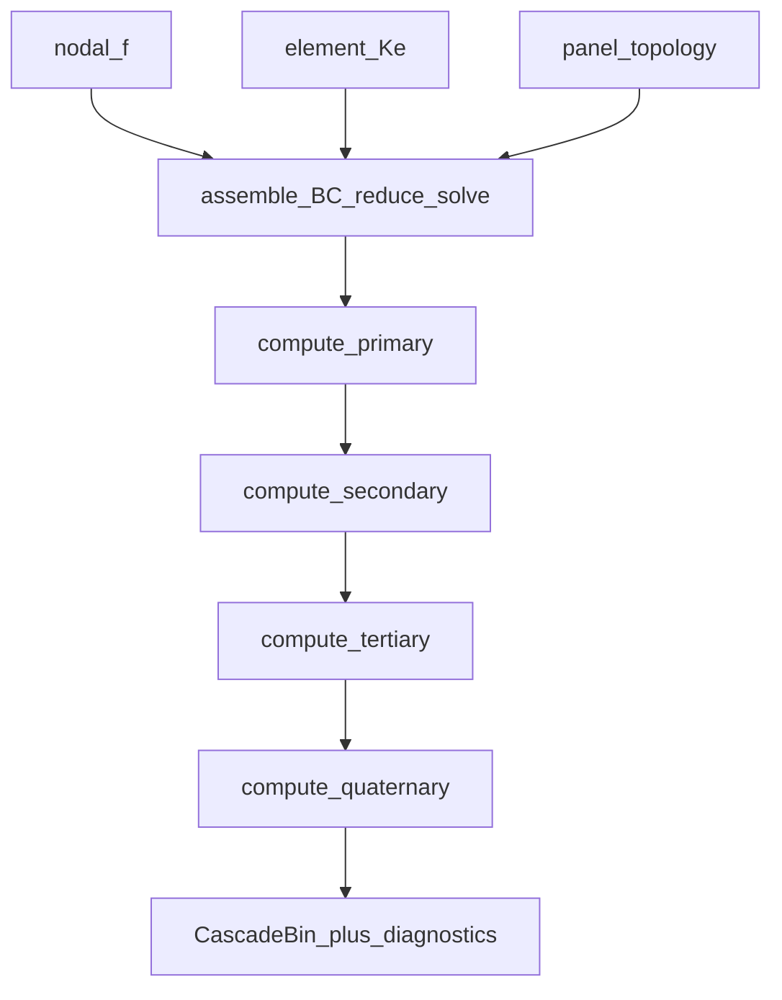
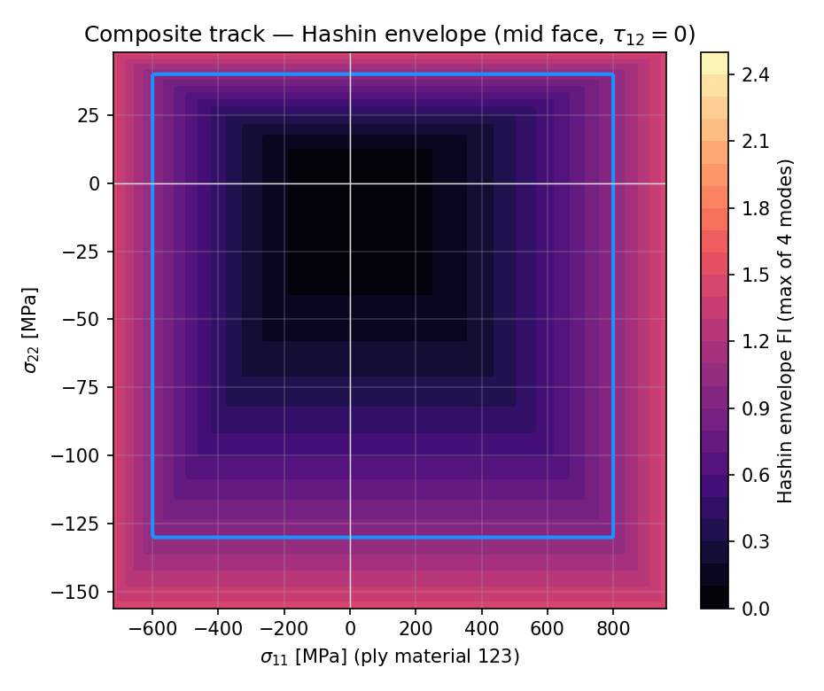
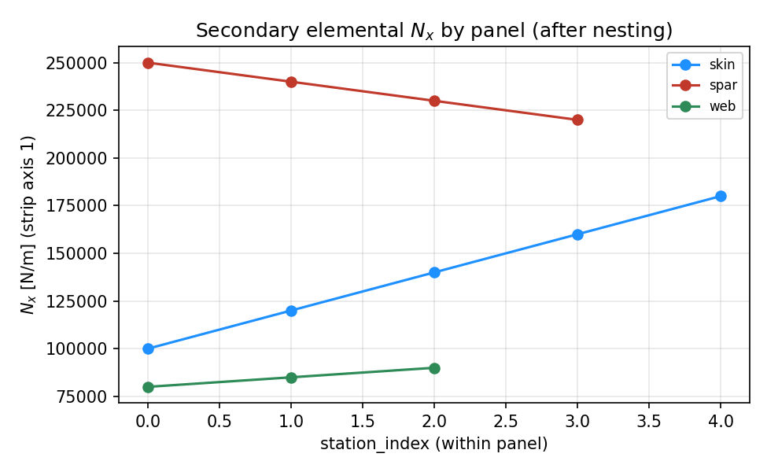

# processing/static — assemble, solve, cascade

↑ Parent computable set: [`../../README.md` §2](../../README.md#2-computable-set)

Assemble, constrain, and solve the linear-static shell system
\(\mathbf{KU}=\mathbf{F}\), then recover the primary→secondary→tertiary→quaternary
(P→S→T→Q) cascade bin consumed by sizing and fatigue callers.

## Purpose / ownership

| Owns | Does **not** own | Why |
|------|------------------|-----|
| Assemble \(\mathbf{K}\), \(\mathbf{f}\); apply BCs; solve \(F=KU\) | SFV shaping / nodal projection details ([`../../pre_processing/loading/`](../../pre_processing/loading/README.md)) | Apply path is a prep home |
| Cascade bins primary → quaternary | Campaign sizing loops / rainflow | Orchestration stays outside the FE worker |
| Per-solve `DiagnosticsBin` phase timings | Station log file writers (orchestration) | Nest timings into campaign logs upstream |
| GCI / trust / cap-peak diagnostics | Remeshing | Mesh density policy is `section_mesh` |

---

## Mathematics

After element `Ke`/`Fe` are formed:

1. **Assemble** global \(\mathbf{K}\), \(\mathbf{f}\).
2. **Constrain** essential BCs (+ MPCs as configured).
3. **Reduce** \(\mathbf{K}_r=\mathbf{T}^{\mathsf{T}}\mathbf{K}\mathbf{T}\), \(\mathbf{f}_r=\mathbf{T}^{\mathsf{T}}\mathbf{f}\).
4. **Solve** \(\mathbf{K}_r\mathbf{q}=\mathbf{f}_r\); reconstruct \(\mathbf{d}=\mathbf{T}\mathbf{q}\).
5. **Recover** through the cascade:

\[
\mathrm{P}\ (U_e)
\;\rightarrow\;
\mathrm{S}\ (N,M,Q)_{\mathbf{E}}
\;\rightarrow\;
\mathrm{T}\ (\sigma_{\mathrm{ply}})_{\mathbf{M}}
\;\rightarrow\;
\mathrm{Q}\ (\mathrm{FI}).
\]

**Hashin FI lives at quaternary (Q)** — `quaternary_results.hashin_fi`.

Tier ownership and frame ladder:
[`results/docs/README.md`](results/docs/README.md).
Stage classes: [`../../docs/SECTION_SOLVE_STAGES.md`](../../docs/SECTION_SOLVE_STAGES.md).

---

## Exact I/O

| Path | Role |
|------|------|
| [`operations/`](operations/) | Prepare / assemble / constrain / reduce / solve / reconstruct / disassemble |
| [`results/`](results/) | Cascade `compute_*` tiers + bin types |
| [`diagnostics/`](diagnostics/) | GCI, trust, loading/mesh plots, timings, cap-peak |

Public product is the cascade bin returned by
[`../../simulation_runner/`](../../simulation_runner/README.md).

| In | Formulation cache + nodal `f` + BC / topology |
| Out | `CascadeBin` with P→S→T→Q + `diagnostics` |

---

## Call graph

---

## PNG pointers

| Proof | Figure |
|-------|--------|
| Displacement ladder (primary) |  |
| Governing FI ladder (Q + GCI) |  |
| Hashin envelope (Q demo) |  |
| Secondary resultants |  |
| Cap-peak SoT | [`../../visualisation/output/cap_peak_sampling/`](../../visualisation/output/cap_peak_sampling/) |

---

## Provenance / what happens today

| Claim | Today |
|-------|-------|
| Cascade index | [`results/docs/README.md`](results/docs/README.md) |
| Tier demos | Nested `results/compute_*/examples/` (committed PNG docs) |
| Package demos | [`../../visualisation/demos/`](../../visualisation/demos/README.md) |
| GCI narrative | [`../../docs/NUMERICAL_STABILITY_AND_GCI.md`](../../docs/NUMERICAL_STABILITY_AND_GCI.md) |

## See also

- [`../../README.md`](../../README.md) — package README · computable set §2
- [`../../../../docs/CASCADE_GLOSSARY.md`](../../../../docs/CASCADE_GLOSSARY.md)
- [`../../docs/README.md`](../../docs/README.md)
- [`results/docs/README.md`](results/docs/README.md)
- [`../../docs/SECTION_SOLVE_STAGES.md`](../../docs/SECTION_SOLVE_STAGES.md)
- [`../buckling/`](../buckling/) — eigen / prestress track (sibling)
