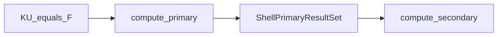

# compute_primary — ShellPrimaryResultSet (P tier)

↑ Cascade index: [`../docs/README.md`](../docs/README.md) · Parent static:
[`../../README.md`](../../README.md)

## Purpose / ownership

| Owns | Does **not** own |
|------|------------------|
| Disassembly of nodal \(U\) → element \(U_e\) | Stress recovery (secondary) |
| Reaction / residual helpers on the primary set | Hashin FI (quaternary) |
| `ShellPrimaryResultSet` assembly | Mesh / loading / bind |

## Exact I/O

| | |
|---|---|
| **In** | Global solve state \(U\), assembly maps, BC reactions |
| **Out** | `ShellPrimaryResultSet` (`U_e`, reactions, residual hooks) |

## Mathematics

After \(K U = F\) (reduced system), map free DOFs back to full nodal
displacements, then scatter to per-element \(U_e\) for cascade consumers.

Primary does **not** evaluate constitutive stress or FI — see
[`../compute_secondary/`](../compute_secondary/) → tertiary → quaternary.

## Call graph

## Proof figures

Deformed-shape / \(d_\infty\) ladders live under package visualisation
([`../../../../visualisation/output/gci_study_mitc4/`](../../../../visualisation/output/gci_study_mitc4/)),
not a primary-local `output/`.

## See also

- [`../docs/README.md`](../docs/README.md)
- [`../compute_secondary/docs/README.md`](../compute_secondary/docs/README.md)
