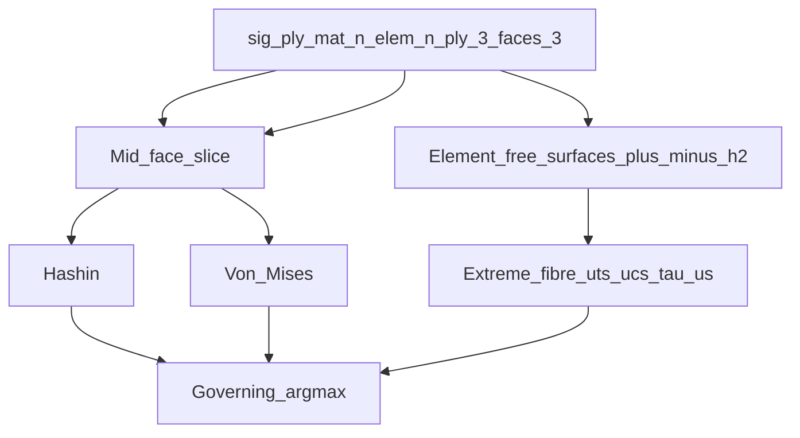
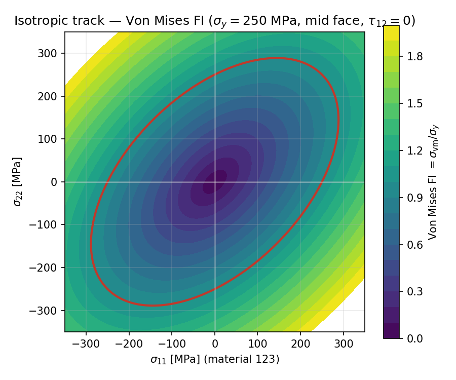
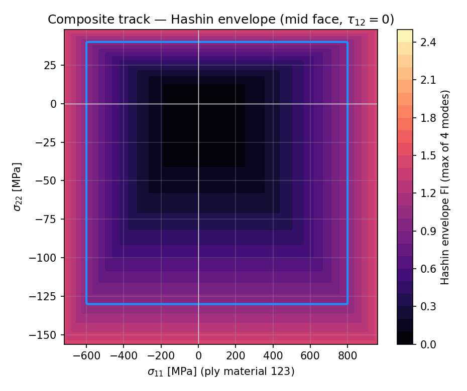
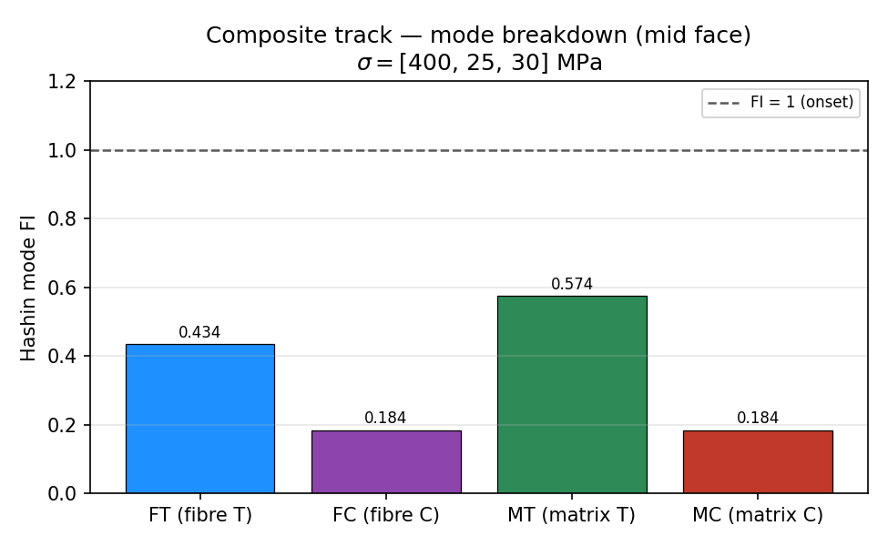
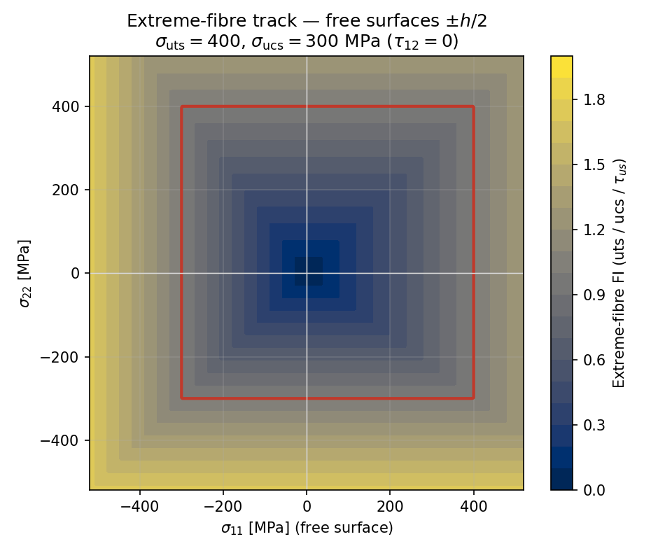
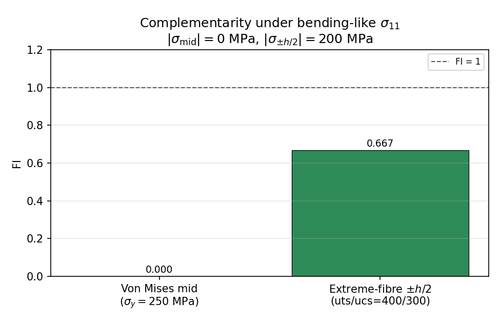
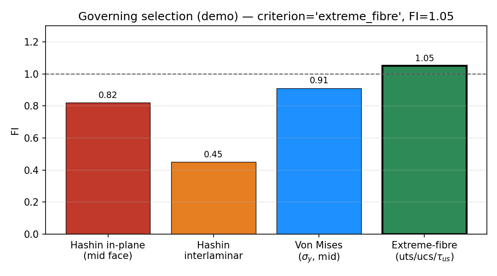

# compute_quaternary — tier-4 failure indices

Deep documentation for the **`compute_quaternary/`** directory only: failure indices (Von Mises for isotropic panels, Hashin for orthotropic stacks, extreme-fibre for every panel) and governing-element selection from tertiary ply stresses. No CLT recovery, no fatigue.

## Table of contents

1. [Purpose / ownership](#purpose--ownership)
2. [Directory map](#directory-map)
3. [Ply material frame (M)](#ply-material-frame-m)
4. [Strength vocabulary (yield vs ultimate)](#strength-vocabulary-yield-vs-ultimate)
5. [Exact I/O of `ShellQuaternaryResultsOrchestrator.compute()`](#exact-io-of-shellquaternaryresultsorchestratorcompute)
6. [Provenance / trust](#provenance--trust)
7. [What happens today](#what-happens-today)
8. [Mermaid: quaternary pipeline](#mermaid-quaternary-pipeline)
9. [Tracks](#tracks)
10. [Criteria formulas](#criteria-formulas)
11. [Governing selection](#governing-selection)
12. [Plots](#plots)
13. [Public exports](#public-exports)
14. [See also](#see-also)

---

## Purpose / ownership

| Owns | Does **not** own |
|------|------------------|
| Von Mises FI (isotropic panels; mid face; \(\sigma_y\)) | CLT ABD / ply-stress recovery (tier 3) |
| Hashin in-plane modes + interlaminar FI (composite; mid face) | FE assembly / secondary resultants |
| Extreme-fibre FI (every panel; free surfaces; ultimates) | Changing tertiary face recovery |
| Governing element selection across criteria | Fatigue / BV / BSF |

**Product:** `ShellQuaternaryResultSet` (`hashin_fi`, `von_mises_fi`, `sig_extreme_fibre`, `extreme_fibre_fi`, `governing`, `needs_review`).

Tertiary supplies the full per-plate face field `(n_elem, n_ply, 3, 3)`. Quaternary **selects** stations by criterion: mid face for Hashin / VM; laminate \(\pm h/2\) for extreme-fibre. See [cascade complementarity](../../docs/README.md#mid-face-criteria-vs-extreme-fibre).

---

## Directory map

| Path | Role |
|------|------|
| `quaternary_results_orchestrator.py` | `ShellQuaternaryResultsOrchestrator.compute()` — panel-kind branch + extreme-fibre + governing |
| `compute_hashin_fi.py` | Hashin modes, interlaminar FI, strength vectors from laminate |
| `compute_von_mises_fi.py` | Von Mises FI wrappers (isotropic; \(\sigma_y\)) |
| `compute_extreme_fibre_fi.py` | Free-surface stress extract + component-wise ultimate FI |
| `compute_governing_element.py` | Helpers for Hashin governing selection (bundle path) |
| `bundle_fi.py` | Legacy flatten panel-rows → tertiary → quaternary; prefer runner `quaternary_results` |
| `__init__.py` | Public exports |
| `docs/` | This README + `bug_log.md` |
| `examples/` | L5 FI plot demos |

---

## Ply material frame (M)

Quaternary evaluates in-plane criteria on tertiary face stresses in ply material
frame **M** (after `T_ply`). Interlaminar shear uses **E**-frame \(Q_1,Q_2\) /
`tau_iface`. Canon: [`coordinate_frames/README.md`](../../../../../../../geometry_utilities/coordinate_frames/README.md).

\[
\boldsymbol{\sigma}_{M}=[\sigma_{11},\sigma_{22},\tau_{12}]
\]

| Axis | Role | Not |
|------|------|-----|
| **1** | Fibre direction in **M** (laminate \(x_1\) after ply rotation) | \(X_B\) / \(X_S\) |
| **2** | In-plane transverse in **M** | \(Y_B\) / \(Y_S\) |
| **3** | Through-thickness (not a stress component here; \(\sigma_{33}=0\) in CLPT) | \(Z_B\) / \(Z_S\) / laminate \(x_3\) as a stress |

| Track | Stress station |
|-------|----------------|
| Isotropic VM | Mid face of plate 0: `sig[..., 0, FACE_MID, :]` |
| Composite Hashin | Mid face of every ply: `sig[..., FACE_MID, :]` |
| Extreme-fibre | Top-plate outer + bottom-plate inner (laminate \(\pm h/2\)) |

**Extreme-fibre free surfaces in the blade section** (same laminate \(\pm h/2\); panel-kind reading):

| Panel | \(+h/2\) free surface | \(-h/2\) free surface |
|-------|----------------------|------------------------|
| Skin | fluid side | void side |
| Spar cap | skin side | void side |
| Web | **fore** (LE side) | **aft** (TE side) |

Webs use formal names **fore** / **aft** (LE / TE are explanatory); they are **not** fluid/void. See [tertiary panel face semantics](../../compute_tertiary/docs/README.md#panel-face-semantics-blade-section).

---

## Strength vocabulary (yield vs ultimate)

Textbook **yield vs ultimate** — not `*_allow*`.

Aligned with material DB (`yield_strength`, `sigma_ult` / `sigma_ult_tension` / `sigma_ult_compression`, `tau_ult`):

| Symbol | Meaning | Material DB source | Used by |
|--------|---------|--------------------|---------|
| \(\sigma_y\) | Yield strength [Pa] | `yield_strength` → `panel_sigma_y_pa` | Von Mises only |
| \(\sigma_{\mathrm{uts}}\) | Ultimate tensile strength [Pa] | `sigma_ult_tension` else `sigma_ult` → `panel_sigma_uts_pa` | Extreme-fibre \(+\sigma\) |
| \(\sigma_{\mathrm{ucs}}\) | Ultimate compressive strength [Pa] | `sigma_ult_compression` else `sigma_ult` → `panel_sigma_ucs_pa` | Extreme-fibre \(-\sigma\) |
| \(\tau_{\mathrm{us}}\) | Ultimate shear strength [Pa], unsigned | `tau_ult` → `panel_tau_us_pa` | Extreme-fibre \(\tau_{12}\) |

Hashin ply strengths remain `Xt`/`Xc`/`Yt`/`Yc`/`S12` (separate).

**Forbidden:** feeding VM with ultimates; feeding extreme-fibre with \(\sigma_y\); public `*_allow*` names on the Q panel cache (`panel_sigma_y_pa` only). Legacy material field `sigma_allow` may bridge to \(\sigma_y\) only when `yield_strength` is absent.

---

## Exact I/O of `ShellQuaternaryResultsOrchestrator.compute()`

### Inputs

| Argument | Type | What is used |
|----------|------|----------------|
| `tertiary` | `ShellTertiaryResultSet` | `ply_results.sig_ply_mat` `(n_elem, n_ply, 3, 3)`, trust masks, optional `tau_iface`, `transverse_shear`, `thickness_m`, `panel_index`, `element_index` |
| `cache` | `ShellFormulationCache` | `panel_constitutive_kind`, `panel_sigma_y_pa`, `panel_sigma_uts_pa`, `panel_sigma_ucs_pa`, `panel_tau_us_pa`, `panel_laminates` |
| `peak_factor` | `float` (default `1.5`) | Parabolic peak factor for Q1/Q2 interlaminar fallback |

### Output: `ShellQuaternaryResultSet`

| Field | Shape / type | Meaning |
|-------|----------------|---------|
| `hashin_fi.in_plane` | `(n_elem, n_ply)` | Envelope max of FT/FC/MT/MC per ply |
| `hashin_fi.interlaminar` | `(n_elem,)` | Delamination / transverse-shear mode |
| `hashin_fi.fi_ft` … `fi_mc` | `(n_elem, n_ply)` each | Individual Hashin modes |
| `von_mises_fi` | `(n_elem,)` | Isotropic track; `nan` where unused |
| `sig_extreme_fibre` | `(n_elem, 2, 3)` | Outer / inner free-surface stress vectors |
| `extreme_fibre_fi` | `(n_elem,)` | Max component FI over free surfaces |
| `governing` | `dict` | See [Governing selection](#governing-selection) |
| `needs_review` | `(n_elem,)` bool | See [Provenance / trust](#provenance--trust) |
| `meta` | `dict` | `n_rows`, `n_ply` |

Empty tertiary → empty `needs_review` and empty governing defaults.

---

## Provenance / trust

| Trigger | Effect |
|---------|--------|
| Tertiary `trusted_mask=False` | `needs_review=True`; FI left at zero / unused |
| Isotropic panel, missing finite `panel_sigma_y_pa` | `needs_review=True`; no VM written |
| Any panel, missing finite uts/ucs/\(\tau_{\mathrm{us}}\) | Extreme-fibre `needs_review=True` for that panel’s elements (no fall back to \(\sigma_y\)) |
| Composite panel, missing laminate / Hashin strengths | `needs_review=True` |
| Hashin padded / inactive plies | Mode FI forced to 0 (not review by itself) |
| Interlaminar path: untrusted Q1/Q2, bad thickness, or interface tau flags | `needs_review` OR’d with interlaminar `bad` / `nr_iface` |

---

## What happens today

Matching `ShellQuaternaryResultsOrchestrator.compute()`:

1. Read `sig_ply_mat` `(n_elem, n_ply, 3, 3)` and `panel_index`; default trust = all true if mask missing.
2. Group element rows by `panel_index`.
3. For each panel, read `cache.panel_constitutive_kind[pi]` (default `"orthotropic"`):
   - **`"isotropic"`:** require finite `panel_sigma_y_pa`; evaluate Von Mises on mid-face plate 0; skip Hashin.
   - **Otherwise (composite):** load Hashin strengths from `panel_laminates[pi]`; evaluate modes on mid-face stresses.
4. **Every panel — extreme-fibre:** resolve panel ultimates once; extract free-surface stresses; component-wise FI on every element.
5. **Composite only — interlaminar:** allowable from first ply \(S_{il}\). Prefer `tau_iface` FI; else / fallback `1.5 |Q| / t`.
6. Build `governing` = argmax over Hashin in-plane, interlaminar, Von Mises, and extreme-fibre.
7. Pack `ShellQuaternaryResultSet`.

---

## Mermaid: quaternary pipeline

---

## Tracks

| | **Isotropic shell** | **Composite (orthotropic stack)** | **Extreme-fibre (all panels)** |
|---|---|---|---|
| Gate | `panel_constitutive_kind[pi] == "isotropic"` | else (default `"orthotropic"`) | Always (material-agnostic) |
| Stress used | Mid face, plate 0 | Mid face, all plies | Top outer + bottom inner |
| Strengths | `panel_sigma_y_pa` (\(\sigma_y\)) | Per-ply `Xt, Xc, Yt, Yc, S12` | `panel_sigma_uts_pa`, `panel_sigma_ucs_pa`, `panel_tau_us_pa` |
| In-plane criterion | Von Mises FI | Hashin envelope | Component max-stress FI |
| Interlaminar | Not on this track | `tau_iface` and/or Q1/Q2 peak / \(S_{il}\) | N/A |
| Output | `von_mises_fi` | `hashin_fi` modes + interlaminar | `sig_extreme_fibre`, `extreme_fibre_fi` |

---

## Criteria formulas

Each equation is paired with the function that evaluates it. Orchestrator entry: `ShellQuaternaryResultsOrchestrator.compute`.

### Von Mises (isotropic; yield; mid face)

Input stress: tertiary mid face of plate 0, \(\boldsymbol{\sigma}=\texttt{sig}[\ldots,\,0,\,\texttt{FACE\_MID},:]\).

\[
\sigma_{\mathrm{vm}}=\sqrt{\sigma_{11}^{2}-\sigma_{11}\sigma_{22}+\sigma_{22}^{2}+3\tau_{12}^{2}},\qquad
\mathrm{FI}=\frac{\sigma_{\mathrm{vm}}}{\sigma_y}
\]

| Symbol / step | Function |
|---------------|----------|
| \(\sigma_{\mathrm{vm}}\), \(\mathrm{FI}\) | `von_mises_plane_stress_fi` (`material_utilities.failure.von_mises`) |
| Shell wrapper | `von_mises_fi` / `von_mises_fi_from_row` (`compute_von_mises_fi.py`) |
| Strength \(\sigma_y\) | `cache.panel_sigma_y_pa` ← `yield_strength` (material `sigma_allow` bridge only if yield missing) |

### Hashin in-plane modes (composite; mid face)

Input stress: tertiary mid face of every ply, \(\boldsymbol{\sigma}=\texttt{sig}[\ldots,\,\texttt{FACE\_MID},:]\).

Macaulay splits: \(\langle\sigma\rangle_+=\max(\sigma,0)\), \(\langle\sigma\rangle_-=\min(\sigma,0)\). Let \(S=S_{12}\).

\[
\begin{aligned}
\mathrm{FI}_{FT}&=\left(\frac{\langle\sigma_{11}\rangle_+}{X_t}\right)^2+\left(\frac{\tau_{12}}{S}\right)^2 \\
\mathrm{FI}_{FC}&=\left(\frac{\langle\sigma_{11}\rangle_-}{X_c}\right)^2+\left(\frac{\tau_{12}}{S}\right)^2 \\
\mathrm{FI}_{MT}&=\left(\frac{\langle\sigma_{22}\rangle_+}{Y_t}\right)^2+\left(\frac{\tau_{12}}{S}\right)^2 \\
\mathrm{FI}_{MC}&=\left(\frac{\langle\sigma_{22}\rangle_-}{Y_c}\right)^2+\left(\frac{\tau_{12}}{S}\right)^2
\end{aligned}
\]

\[
\mathrm{FI}_{\mathrm{env}}=\max(\mathrm{FI}_{FT},\mathrm{FI}_{FC},\mathrm{FI}_{MT},\mathrm{FI}_{MC})
\]

FI = 1 at onset. Note: \((\tau_{12}/S)^2\) appears in **all four** modes here. No face-max inside the criterion.

| Symbol / step | Function |
|---------------|----------|
| Mode FIs | `hashin_fi_modes` · envelope `hashin_fi` (`material_utilities.failure`) |
| Ply batch | `ply_hashin_fi_modes` / `ply_hashin_fi` (`compute_hashin_fi.py`) |
| Strengths \(X_t,X_c,Y_t,Y_c,S_{12}\) | `ply_strength_vectors_from_lam` |

### Extreme-fibre (every element; ultimates; free surfaces)

Stations: laminate \(x_3=+h/2\) (top-plate `FACE_OUTER`) and \(x_3=-h/2\) (bottom-plate `FACE_INNER`).

\[
\texttt{sig\_extreme\_fibre}=\texttt{extreme\_fibre\_stress\_from\_ply\_mat}(\texttt{sig\_ply\_mat})
\in\mathbb{R}^{n_{\mathrm{elem}}\times 2\times 3}
\]

For each surface stress \([\sigma_{11},\sigma_{22},\tau_{12}]\):

\[
\begin{aligned}
S_{11}&=\begin{cases}\sigma_{\mathrm{uts}} & \sigma_{11}\ge 0\\ \sigma_{\mathrm{ucs}} & \sigma_{11}<0\end{cases},
\qquad
S_{22}=\begin{cases}\sigma_{\mathrm{uts}} & \sigma_{22}\ge 0\\ \sigma_{\mathrm{ucs}} & \sigma_{22}<0\end{cases},\\[0.5em]
\mathrm{FI}_{11}&=\frac{\lvert\sigma_{11}\rvert}{S_{11}},\quad
\mathrm{FI}_{22}=\frac{\lvert\sigma_{22}\rvert}{S_{22}},\quad
\mathrm{FI}_{12}=\frac{\lvert\tau_{12}\rvert}{\tau_{\mathrm{us}}}
\end{aligned}
\]

\[
\mathrm{FI}_{\mathrm{surf}}=\max(\mathrm{FI}_{11},\mathrm{FI}_{22},\mathrm{FI}_{12}),\qquad
\mathrm{FI}_{\mathrm{elem}}=\max(\mathrm{FI}_{\mathrm{outer}},\mathrm{FI}_{\mathrm{inner}})
\]

| Symbol / step | Function |
|---------------|----------|
| Free-surface extract | `extreme_fibre_stress_from_ply_mat` (`compute_extreme_fibre_fi.py`) |
| Component / element FI | `extreme_fibre_fi` |
| Strengths | `cache.panel_sigma_uts_pa`, `panel_sigma_ucs_pa`, `panel_tau_us_pa` |

Does **not** read Hashin ply strengths or \(\sigma_y\).

### Interlaminar (composite)

Preferred (from tertiary `tau_iface`):

\[
\mathrm{FI}_{\mathrm{il}}=\max_{\mathrm{iface}}\frac{\sqrt{\tau_{13}^{2}+\tau_{23}^{2}}}{S_{\mathrm{il}}}
\]

Fallback (from tertiary \(Q_x,Q_y\), thickness \(t\)):

\[
\mathrm{FI}_{\mathrm{il}}=\frac{1.5\,\sqrt{Q_x^{2}+Q_y^{2}}}{t\,S_{\mathrm{il}}}
\quad(\texttt{peak\_factor}=1.5)
\]

| Symbol / step | Function |
|---------------|----------|
| Interface path | `interlaminar_fi_from_interface_tau` |
| \(Q\) fallback | `batched_interlaminar_fi` |
| Allowable \(S_{\mathrm{il}}\) | `interlaminar_allowable_from_lam` (prefer ply `S13`, else `S12`) |

---

## Governing selection

`governing` is a single dict from argmax over Hashin in-plane, interlaminar, Von Mises, and extreme-fibre.

| Winner | `criterion` | `ply_index` | Meaning |
|--------|-------------|-------------|---------|
| In-plane Hashin max over `(elem, ply)` | `"hashin"` | winning ply index (≥ 0) | Ply envelope at that element |
| Interlaminar max over elems | `"hashin"` | **-1** | Delamination / transverse-shear channel |
| Von Mises max over elems | `"von_mises"` | `0` | Isotropic mid-face stress |
| Extreme-fibre max over elems | `"extreme_fibre"` | **-1** | Free-surface ultimate FI (not a ply) |
| Nothing finite | `""` | `-1` | Empty / no candidates |

Also stores `fi`, `panel_index`, `element_index`.

---

## Plots

Produced by [`../examples/plot_fi_demo.py`](../examples/plot_fi_demo.py) (see [`../examples/README.md`](../examples/README.md)).

> **Synthetic / helper-level demo:** stress grids and strengths are hand-chosen; criteria helpers are called directly. Not `ShellQuaternaryResultsOrchestrator.compute()` output. Captions distinguish yield \(\sigma_y\) (Von Mises) from ultimates \(\sigma_{\mathrm{uts}}/\sigma_{\mathrm{ucs}}/\tau_{\mathrm{us}}\) (extreme-fibre).

**Isotropic track — Von Mises FI** (mid face; \(\tau_{12}=0\); red contour = FI=1; strength = \(\sigma_y\)):

**Composite track — Hashin envelope** (mid face; \(\tau_{12}=0\); blue contour = FI=1):

**Composite — four-mode breakdown** for one mid-face stress state:

**Extreme-fibre track — free-surface envelope** (sign of \(\sigma\) selects uts vs ucs; \(\tau_{12}=0\)):

Panel-kind reading of those free surfaces (skin fluid/void, spar skin/void, web fore/aft) is illustrated in tertiary [`panel_face_semantics.png`](../../compute_tertiary/examples/outputs/panel_face_semantics.png).

**Complementarity under bending** — mid-face VM (\(\sigma_y\)) vs free-surface extreme-fibre (ultimates):

**Governing selection schematic** (demo argmax across Hashin / interlaminar / Von Mises / extreme-fibre):

---

## Public exports

From `compute_quaternary/__init__.py` (summary):

| Export | Role |
|--------|------|
| `ShellQuaternaryResultsOrchestrator` | Tier-4 entry point |
| `von_mises_fi` / `von_mises_fi_from_row` | Isotropic criterion (\(\sigma_y\)) |
| `extreme_fibre_stress_from_ply_mat` / `extreme_fibre_fi` | Free-surface ultimate track |
| `ply_hashin_fi` / `ply_hashin_fi_modes` | Composite in-plane Hashin |
| `ply_strength_vectors_from_lam` | Xt/Xc/Yt/Yc/S12 from laminate |
| `interlaminar_fi_from_interface_tau` / `batched_interlaminar_fi` | Interlaminar modes |
| `select_governing_hashin_element` / `max_hashin_fi_from_bundle` | Governing helpers |
| `compute_quaternary_fi_from_panel_rows` / `BundleQuaternaryFi` | Legacy panel-row path |

---

## See also

- Structural frames R/B/S/S′: [`coordinate_frames/README.md`](../../../../../../geometry_utilities/coordinate_frames/README.md)
- Results cascade index: [`../../docs/README.md`](../../docs/README.md)
- Examples: [`../examples/README.md`](../examples/README.md)
- Secondary (resultants upstream): [`../../compute_secondary/docs/README.md`](../../compute_secondary/docs/README.md)
- Tertiary (stress inputs): [`../../compute_tertiary/docs/README.md`](../../compute_tertiary/docs/README.md)
- Material criteria: `blade_structure_utilities.material_utilities.failure` (`hashin_fi`, `von_mises_plane_stress_fi`)
- Parent shell package: [`../../../../../README.md`](../../../../../README.md)
