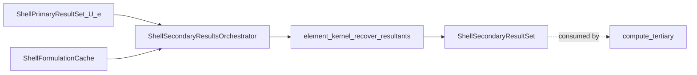
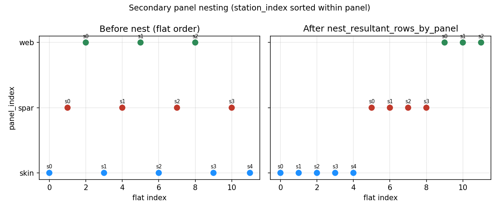
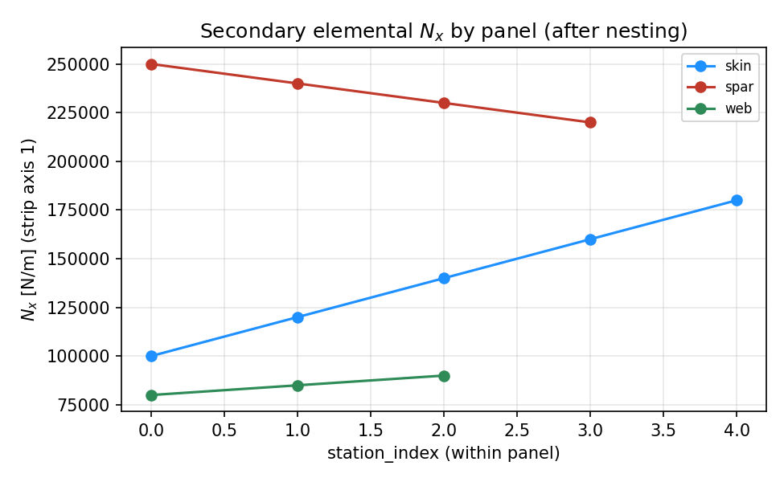
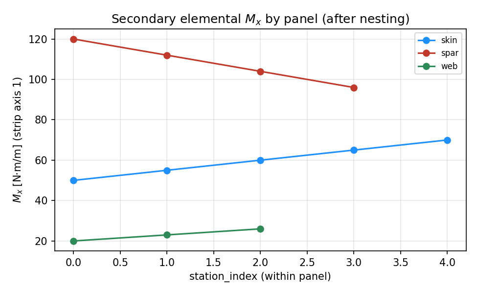
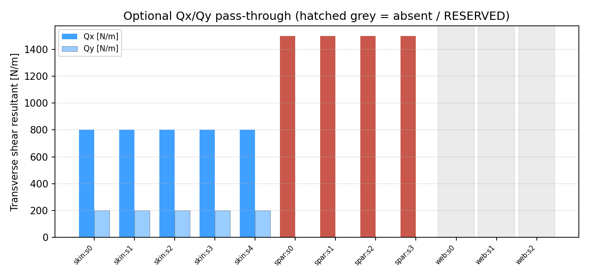
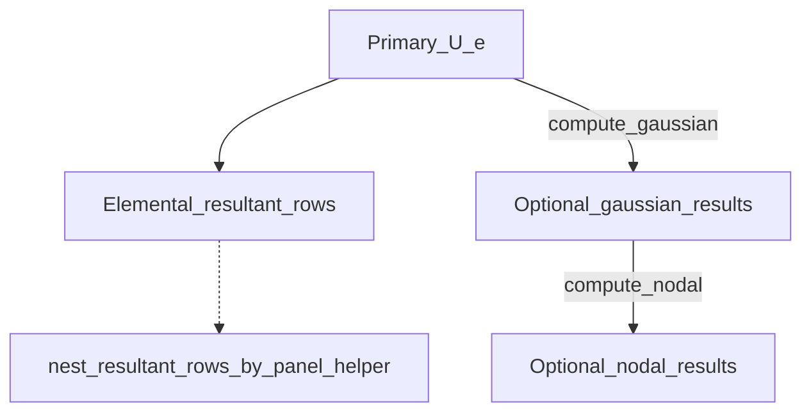

# compute_secondary — tier-2 shell resultants

Deep documentation for the **static** [`compute_secondary/`](.) directory only: recover element shell membrane/bending (and optional transverse shear) resultants from primary elemental displacements, package them as `ShellSecondaryResultSet` for tertiary CLT. No failure indices, no fatigue. (Buckling’s separate secondary path under `processing/buckling/` is out of scope here.)

## Table of contents

1. [Purpose / ownership](#purpose--ownership)
2. [Directory map](#directory-map)
3. [Element (E) resultant frame](#element-e-resultant-frame)
4. [Mathematics](#mathematics)
5. [Key equations → functions](#key-equations--functions)
6. [Exact I/O of `ShellSecondaryResultsOrchestrator.compute()`](#exact-io-of-shellsecondaryresultsorchestratorcompute)
7. [Lengths \(L_s\) and \(L_x\)](#lengths-l_s-and-l_x)
8. [Provenance / trust](#provenance--trust)
9. [What happens today](#what-happens-today)
10. [Mermaid: secondary pipeline](#mermaid-secondary-pipeline)
11. [Panel nesting](#panel-nesting)
12. [Gaussian vs nodal fields](#gaussian-vs-nodal-fields)
13. [Plots](#plots)
14. [Mermaid: field fan-out](#mermaid-field-fan-out)
15. [Public exports](#public-exports)
16. [See also](#see-also)

---

## Purpose / ownership

| Owns | Does **not** own |
|------|------------------|
| Element resultant recovery from `U_e` + formulation cache (kernel) | FE assembly / solve (tier 1 / primary) |
| Optional FSDT `Q1`/`Q2` recovery + provenance tags | CLT ply stresses (tier 3 / tertiary) |
| Optional Gaussian / nodal resultant resolutions (off by default) | Hashin / Von Mises FI (tier 4) |
| Helper to nest flat rows by `panel_index` | Fatigue / BV / BSF |

**Product:** `ShellSecondaryResultSet` (elemental `resultant_rows` of `ShellPanelResultants`; optional gaussian/nodal).

---

## Directory map

| Path | Role |
|------|------|
| `secondary_results_orchestrator.py` | `ShellSecondaryResultsOrchestrator.compute()` — kernel resultant recovery |
| `panel_row_nesting.py` | `nest_resultant_rows_by_panel` — regroup flat rows by panel, sort by `station_index` |
| `compute_gaussian_fields.py` | Optional 2×2 Gauss-point resultants (`compute_gaussian=True`) |
| `compute_nodal_fields.py` | Optional nodal scatter from Gaussian (`compute_nodal=True`) |
| `__init__.py` | Public exports |
| `docs/` | This README + `bug_log.md` |
| `examples/` | L5 resultant / nesting plot demos |

---

## Element (E) resultant frame

Secondary resultants live in element / laminate frame **E**
(\((x_1,x_2,x_3)\); coincides with curvilinear strip **C** on each MITC4 facet).
Not blade **B** / **S** XYZ. Canon: [`coordinate_frames/README.md`](../../../../../../../geometry_utilities/coordinate_frames/README.md).

| Field | **E** component | Units | Definition (thickness integral) |
|-------|-----------------|-------|----------------------------------|
| `N11`, `N22`, `N12` | \(N_{11}, N_{22}, N_{12}\) | N/m | \(\displaystyle N_{\alpha\beta}=\int_{-h/2}^{h/2}\sigma_{\alpha\beta}\,dx_3\) |
| `M11`, `M22`, `M12` | \(M_{11}, M_{22}, M_{12}\) | N·m/m | \(\displaystyle M_{\alpha\beta}=\int_{-h/2}^{h/2}x_3\,\sigma_{\alpha\beta}\,dx_3\) |
| `Q1`, `Q2` | \(Q_1, Q_2\) (optional FSDT) | N/m | \(\displaystyle Q_{\alpha}=\int_{-h/2}^{h/2}\tau_{\alpha 3}\,dx_3\) |

Greek indices \(\alpha,\beta\in\{1,2\}\). Transverse shear keeps a **single** free in-plane index because the other factor is always thickness (\(3\)); the stresses that integrate to \(Q_1,Q_2\) are \(\tau_{13},\tau_{23}\).

| Index / axis | **E** / **C** role |
|--------------|---------------------|
| \(x_1\) / **C** \(x\) | Strip / laminate longitudinal (span on the unit slice) |
| \(x_2\) / **C** \(s\) | Contour tangent |
| \(x_3\) / **C** \(n\) | Through-thickness (shell normal); **not** a secondary resultant axis |
| Voigt \(12\) | In-plane shear \(N_{12}\), \(M_{12}\), \(\gamma_{12}\) |

Diagnostics on each row:

| Field | Formula used today | Notes |
|-------|--------------------|-------|
| `sigma_11_pa` | \(N_{11}/t\) | Uniform-through-thickness membrane estimate of \(\sigma_{11}\) |
| `tau_12_pa` | \(N_{12}\) (stored as-is) | Legacy diagnostic; **not** \(N_{12}/t\) |
| `q_n_per_m` | \(N_{12}\) | Same numerical value as `tau_12_pa` on the MITC4 path |

Through-thickness sampling is tertiary: secondary ships mid-surface \([\mathbf{N};\mathbf{M}]\) (+ optional \(\mathbf{Q}\)); tertiary inverts ABD → \(\boldsymbol{\varepsilon}_0,\boldsymbol{\kappa}\) and evaluates \(\boldsymbol{\sigma}(x_3)\). See [`../../compute_tertiary/docs/README.md`](../../compute_tertiary/docs/README.md).

Each scalar may carry `FieldProvenance`; missing shear sets `Q1`/`Q2` provenance to `RESERVED`.

---

## Mathematics

Production recovery is **forward CLPT + FSDT kinematics** from the elemental DOF vector \(\mathbf{d}_e\equiv\mathbf{U}_e\) (primary), not an inverse from stresses. Implementation: `mitc4_resultants` / `mitc4_shear_resultants` in `pre_processing/element_library/mitc4/element.py`, dispatched by `ShellElementKernel.recover_resultants` / `recover_shear`.

### Parent space and physical derivatives

On each flat MITC4 facet, isoparametric parent coordinates \((\xi,\eta)\in[-1,1]^2\) map to **C**/**E**:

| Parent | Physical | Length |
|--------|----------|--------|
| \(\xi\) | contour \(s\) / \(x_2\) | \(L_s\) |
| \(\eta\) | span \(x\) / \(x_1\) | \(L_x\) (often \(1\,\mathrm{m}\) for a unit slice) |

\[
\frac{\partial}{\partial x_1}=\frac{2}{L_x}\frac{\partial}{\partial\eta},\qquad
\frac{\partial}{\partial x_2}=\frac{2}{L_s}\frac{\partial}{\partial\xi}.
\]

Bilinear shape functions \(N_I(\xi,\eta)=\tfrac14(1+\xi_I\xi)(1+\eta_I\eta)\), \(I=1\ldots4\), with node corners
\((\xi,\eta)=(-1,-1),\ (1,-1),\ (1,1),\ (-1,1)\).

### Element DOF vector (curvilinear **C** ≡ **E**)

Default MITC4+ (`ndof=6`, 24 DOFs/element). Per node \(I\):

\[
\mathbf{d}_I=[u_{x},\,u_{s},\,w,\,\beta_{s},\,\beta_{x},\,\beta_{z}]_I^\mathsf{T}
\equiv
[u_1,\,u_2,\,u_3,\,\beta_{2},\,\beta_{1},\,\beta_{3}]_I^\mathsf{T}
\]

| DOF | Role |
|-----|------|
| \(u_x=u_1\) | Displacement along \(x_1\) |
| \(u_s=u_2\) | Displacement along \(x_2\) |
| \(w=u_3\) | Displacement along \(x_3\) (shell normal) |
| \(\beta_s\) | Mindlin rotation about \(x_2\) (\(\approx -\partial w/\partial x_1\) in the thin limit) |
| \(\beta_x\) | Mindlin rotation about \(x_1\) (\(\approx +\partial w/\partial x_2\) in the thin limit) |
| \(\beta_z\) | Drilling about \(x_3\) (stiffness stabilisation only; **does not** enter \(\mathbf{B}_m,\mathbf{B}_b,\mathbf{B}_s\)) |

Element vector \(\mathbf{d}_e=\mathrm{stack}_I(\mathbf{d}_I)\). MITC4 without drilling uses `ndof=5` (drop \(\beta_z\)).

### Mid-surface membrane strain

Engineering Voigt strain from membrane displacements only:

\[
\boldsymbol{\varepsilon}_0
=
\begin{bmatrix}
\varepsilon_{11}\\
\varepsilon_{22}\\
\gamma_{12}
\end{bmatrix}
=
\begin{bmatrix}
\partial u_1/\partial x_1\\
\partial u_2/\partial x_2\\
\partial u_1/\partial x_2+\partial u_2/\partial x_1
\end{bmatrix}
=
\mathbf{B}_m(\xi,\eta)\,\mathbf{d}_e.
\]

### Mid-surface curvature (Mindlin)

\[
\boldsymbol{\kappa}
=
\begin{bmatrix}
\kappa_{11}\\
\kappa_{22}\\
\kappa_{12}
\end{bmatrix}
=
\begin{bmatrix}
\partial\beta_s/\partial x_1\\
-\partial\beta_x/\partial x_2\\
\partial\beta_s/\partial x_2-\partial\beta_x/\partial x_1
\end{bmatrix}
=
\mathbf{B}_b(\xi,\eta)\,\mathbf{d}_e.
\]

(The sign convention on \(\beta_x\) matches the MITC4 DOF definition above so that \(\boldsymbol{\kappa}\) is conjugate to \(\mathbf{M}\) in the ABD product.)

### CLPT constitutive law (forward)

Panel ABD from the laminate (cache `panel_abd_stacks[pi][0]`):

\[
\begin{bmatrix}\mathbf{N}\\\mathbf{M}\end{bmatrix}
=
\begin{bmatrix}
\mathbf{A} & \mathbf{B}\\
\mathbf{B}^\mathsf{T} & \mathbf{D}
\end{bmatrix}
\begin{bmatrix}\boldsymbol{\varepsilon}_0\\\boldsymbol{\kappa}\end{bmatrix},
\qquad
\begin{aligned}
\mathbf{N}&=[N_{11},N_{22},N_{12}]^\mathsf{T},\\
\mathbf{M}&=[M_{11},M_{22},M_{12}]^\mathsf{T}.
\end{aligned}
\]

Expanded (what `mitc4_resultants` evaluates):

\[
\mathbf{N}=\mathbf{A}\,\boldsymbol{\varepsilon}_0+\mathbf{B}\,\boldsymbol{\kappa},\qquad
\mathbf{M}=\mathbf{B}^\mathsf{T}\,\boldsymbol{\varepsilon}_0+\mathbf{D}\,\boldsymbol{\kappa}.
\]

**Elemental product** (default hot path): evaluate at the parent-space centroid \((\xi,\eta)=(0,0)\).

**Gaussian product** (optional): same formulas at the four 2×2 Gauss–Legendre points
\(\xi,\eta=\pm 1/\sqrt{3}\).

Tertiary later **inverts** the same ABD with these \(\mathbf{N},\mathbf{M}\) to recover \(\boldsymbol{\varepsilon}_0,\boldsymbol{\kappa}\) again for ply-face stress — that inverse is **not** performed here.

### FSDT transverse shear (optional)

Assumed shear strain (MITC4 mixed interpolation, Bathe & Dvorkin 1985) — not raw \(\nabla w-\boldsymbol{\beta}\) at the sample point:

\[
\boldsymbol{\gamma}
=
\begin{bmatrix}\gamma_{13}\\\gamma_{23}\end{bmatrix}
=
\begin{bmatrix}\gamma_{xn}\\\gamma_{sn}\end{bmatrix}
=
\mathbf{B}_s^{\mathrm{MITC}}(\xi,\eta)\,\mathbf{d}_e.
\]

Tying (edge mid-side interpolation of covariant shear, then linear blend into the element):

- \(\gamma_{13}=\gamma_{xn}\): sample at \(\eta=\pm 1\), blend with weights \(\tfrac12(1\pm\eta)\); contributions from \(w\) and \(\beta_s\).
- \(\gamma_{23}=\gamma_{sn}\): sample at \(\xi=\pm 1\), blend with weights \(\tfrac12(1\pm\xi)\); contributions from \(w\) and \(\beta_x\).

Isotropic-effective constitutive map used for recovery (and consistent with the element shear stiffness):

\[
\mathbf{Q}
=
\begin{bmatrix}Q_1\\Q_2\end{bmatrix}
=
H_s\,\boldsymbol{\gamma},\qquad
H_s=k_s\,G_{\mathrm{eff}}\,t,
\]

with default shear correction \(k_s=5/6\), laminate thickness \(t\), and effective transverse shear modulus \(G_{\mathrm{eff}}\) from the panel ABD stack (`panel_abd_stacks[pi][4]`).

Returns \((Q_1,Q_2)=(\texttt{None},\texttt{None})\) when \(G_{\mathrm{eff}}\le 0\) or \(t\le 0\); orchestrator then stamps `RESERVED` provenance on `Q1`/`Q2`.

**Centroid product:** \((\xi,\eta)=(0,0)\) via `mitc4_shear_resultants`. Gaussian secondary fields currently recover **membrane/bending only** (`recover_resultants_at`); they do not re-sample \(\mathbf{Q}\) at Gauss points.

### Relation to through-thickness stress (consumed downstream)

Secondary does not sample \(x_3\). The continuum identities that tertiary / shear operators rely on are:

\[
\begin{aligned}
N_{\alpha\beta}&=\int_{-h/2}^{h/2}\sigma_{\alpha\beta}\,dx_3,\\
M_{\alpha\beta}&=\int_{-h/2}^{h/2}x_3\,\sigma_{\alpha\beta}\,dx_3,\\
Q_{\alpha}&=\int_{-h/2}^{h/2}\tau_{\alpha 3}\,dx_3.
\end{aligned}
\]

Under CLPT plane stress, \(\boldsymbol{\sigma}_{123}(x_3)=\bar{\mathbf{Q}}(x_3)\,(\boldsymbol{\varepsilon}_0+x_3\boldsymbol{\kappa})\). Under FSDT parabolic recovery, \(\tau_{13},\tau_{23}\) are reconstructed from \(Q_1,Q_2\) so that the thickness integrals recover those resultants and free surfaces vanish — see tertiary `FSDTInterfaceShearRecoveryOperator`.

---

## Key equations → functions

Each production equation below is paired with the function that evaluates it. Orchestrator entry: `ShellSecondaryResultsOrchestrator.compute` → `_compute_secondary_resultants`.

### Membrane / bending resultants

\[
\boldsymbol{\varepsilon}_0=\mathbf{B}_m\,\mathbf{d}_e,\qquad
\boldsymbol{\kappa}=\mathbf{B}_b\,\mathbf{d}_e,\qquad
\mathbf{N}=\mathbf{A}\boldsymbol{\varepsilon}_0+\mathbf{B}\boldsymbol{\kappa},\qquad
\mathbf{M}=\mathbf{B}^\mathsf{T}\boldsymbol{\varepsilon}_0+\mathbf{D}\boldsymbol{\kappa}
\]

| Symbol / step | Function |
|---------------|----------|
| \(\mathbf{B}_m,\mathbf{B}_b\) | `_b_membrane`, `_b_bending` (`mitc4/element.py`) |
| \(\boldsymbol{\varepsilon}_0,\boldsymbol{\kappa}\to\mathbf{N},\mathbf{M}\) at centroid | `mitc4_resultants` |
| Same at arbitrary \((\xi,\eta)\) | `mitc4_resultants_at` |
| Kernel dispatch | `ShellElementKernel.recover_resultants` / `recover_resultants_at` |
| ABD blocks \(\mathbf{A},\mathbf{B},\mathbf{D}\) | `LaminateDefinition.build_ABD` → cache `panel_abd_stacks` |

### FSDT transverse shear

\[
\boldsymbol{\gamma}=\mathbf{B}_s^{\mathrm{MITC}}\,\mathbf{d}_e,\qquad
\mathbf{Q}=k_s\,G_{\mathrm{eff}}\,t\,\boldsymbol{\gamma}
\]

| Symbol / step | Function |
|---------------|----------|
| \(\mathbf{B}_s^{\mathrm{MITC}}\) | `_b_shear_mitc` |
| \(\mathbf{Q}\) at centroid | `mitc4_shear_resultants` |
| Kernel dispatch | `ShellElementKernel.recover_shear` |

### Orchestrator packaging

| Step | Function |
|------|----------|
| Resolve \(L_s\) | `_element_L_s` |
| Build `ShellPanelResultants` + provenance | `_compute_secondary_resultants` |
| Optional 2×2 Gauss \(\mathbf{N},\mathbf{M}\) | `compute_gaussian_resultants` |
| Optional nodal scatter | `compute_nodal_resultants` |
| Panel regroup helper | `nest_resultant_rows_by_panel` |

---

## Exact I/O of `ShellSecondaryResultsOrchestrator.compute()`

### Constructor inputs

| Argument | Role |
|----------|------|
| `primary` | `ShellPrimaryResultSet` — uses `elemental_results.U_e` |
| `cache` | `ShellFormulationCache` — `stiffness_objects`, `panel_abd_stacks` |
| `L_x` | Reference length along **C**/**E** span \(x\)/\(x_1\) (default `1.0`) |
| `theory` | Kernel name (default resolves to MITC4) |
| `panel_meta` / `panel_maps` / `panels` | Element lengths `L_s`, panel labels |
| `provenance_tag` | String stamped on trusted fields |
| `compute_gaussian` / `compute_nodal` | Opt-in R10 resolutions (default **False**) |

### Output: `ShellSecondaryResultSet`

| Field | When | Meaning |
|-------|------|---------|
| `elemental_results.resultant_rows` | always | `list[ShellPanelResultants]` in stiffness-object iteration order |
| `gaussian_results` | `compute_gaussian=True` | `ShellGaussianResults` fields `(n_elem, 4)` at 2×2 GPs |
| `nodal_results` | `compute_nodal=True` (requires gaussian) | Nodal scatter of resultants |
| `global_results` | typically unused here | Pass-through slot on the set type |

Each row includes `panel_index`, `station_index` (element index on the panel), `thickness_m`, diagnostics `sigma_11_pa` / `tau_12_pa` (**E**), and optional `Q1`/`Q2` (= \(Q_1,Q_2\)).

---

## Lengths \(L_s\) and \(L_x\)

Kernel recovery is `recover_resultants(U_e, L_s, L_x, ABD)` (and similarly for shear). Both lengths enter the Jacobian of \(\mathbf{B}_m,\mathbf{B}_b,\mathbf{B}_s\) and therefore scale strains/curvatures and recovered resultants.

| Symbol | Meaning | Typical source |
|--------|---------|----------------|
| \(L_s\) | Element length along contour tangent (**C** \(s\) / **E** \(x_2\)) | `panel_maps` node spacing, or `panel_meta["element_L_s"]` |
| \(L_x\) | Reference length along span (**C** \(x\) / **E** \(x_1\)) | Orchestrator ctor (default `1.0` for unit-slice recovery) |

Both are metres. Wrong \(L_s\) scales membrane/bending/shear recovery incorrectly for that element.

---

## Provenance / trust

| Field group | Typical provenance | If not trusted / missing |
|-------------|--------------------|---------------------------|
| `N11, N22, N12, M11, M22, M12` | Kernel `provenance_kind` + `provenance_tag` | Tertiary `clpt_inputs_trusted` → row skipped for CLT (`trusted_mask=False`) |
| `Q1, Q2` present | Same trusted kind | Tertiary may recover `tau_iface` |
| `Q1, Q2` absent | `RESERVED` (“FSDT / G_eff or thickness unavailable”) | `interlaminar_inputs_trusted` false; quaternary may use no interlaminar or Q-fallback only if pass-through arrays exist |

Absent provenance entry for a membrane/bending field is treated as **trusted** by tertiary gating.

---

## What happens today

Matching `ShellSecondaryResultsOrchestrator.compute()` → `_compute_secondary_resultants`:

1. Zip `cache.stiffness_objects` with primary `U_e`.
2. Per element: resolve contour length `L_s`, panel ABD stack (ABD, thickness, \(G_{\mathrm{eff}}\)).
3. `kernel.recover_resultants(U_e, L_s, L_x, ABD)` → \(N_{11}\ldots M_{12}\) at \((\xi,\eta)=(0,0)\).
4. `kernel.recover_shear(...)` → \(Q_1,Q_2\) (or `None` → RESERVED provenance).
5. Append `ShellPanelResultants` with provenance + panel metadata + diagnostics \(N_{11}/t\), \(N_{12}\).
6. If flags set: compute Gaussian (and optionally nodal) membrane/bending resultants; attach to the set.

**Explicit:** the orchestrator does **not** call `nest_resultant_rows_by_panel` internally. Rows are flat in cache order; nesting is a **helper** for callers that need panel-contiguous lists. Tertiary regroups by `panel_index` itself when recovering CLT.

---

## Mermaid: secondary pipeline

---

## Panel nesting

`nest_resultant_rows_by_panel(rows, n_panels)`:

1. Bucket rows by `panel_index` into `list[list[ShellPanelResultants]]`.
2. Sort each panel’s list by `station_index`.

Use when a consumer needs panel-contiguous, station-ordered rows. Demo plot: [`../examples/outputs/panel_nesting_order.png`](../examples/outputs/panel_nesting_order.png).

---

## Gaussian vs nodal fields

| Resolution | Flag | Role |
|------------|------|------|
| Elemental (default) | always | One resultant set per element at centroid — **FI / tertiary hot path** |
| Gaussian | `compute_gaussian=True` | 2×2 Gauss-point \(\mathbf{N},\mathbf{M}\) fields `(n_elem, 4)` |
| Nodal | `compute_nodal=True` | Scatter Gaussian → nodes (requires gaussian) |

Defaults keep gauss/nodal **off** so the tertiary → quaternary path stays cheap. Optional Gaussian recovery does **not** currently populate \(\mathbf{Q}\) at Gauss points.

---

## Plots

Produced by [`../examples/plot_secondary_demo.py`](../examples/plot_secondary_demo.py) (see [`../examples/README.md`](../examples/README.md)).

> **Synthetic demo:** hand-built `ShellPanelResultants` rows. The orchestrator instead recovers rows from primary `U_e` + the element kernel. Nesting plots show the **helper** `nest_resultant_rows_by_panel` — the orchestrator does **not** nest internally.

**Panel nesting before/after** (helper only):

**\(N_{11}\) by panel** (E-frame; synthetic):

**\(M_{11}\) by panel** (synthetic):

**Optional \(Q_1,Q_2\) pass-through** (grey bands = absent; synthetic):

---

## Mermaid: field fan-out

---

## Public exports

From `compute_secondary/__init__.py`:

| Export | Role |
|--------|------|
| `ShellSecondaryResultsOrchestrator` | Tier-2 entry point |
| `compute_gaussian_resultants` | Optional Gauss-point recovery |
| `compute_nodal_resultants` | Optional nodal scatter |

Also available: `panel_row_nesting.nest_resultant_rows_by_panel` (import from module path).

---

## See also

- Results cascade index: [`../../docs/README.md`](../../docs/README.md)
- Examples: [`../examples/README.md`](../examples/README.md)
- Upstream: `compute_primary/` (solve / `U_e`; [`../compute_primary/docs/README.md`](../compute_primary/docs/README.md))
- Tertiary (CLT consumer): [`../../compute_tertiary/docs/README.md`](../../compute_tertiary/docs/README.md)
- Quaternary (FI): [`../../compute_quaternary/docs/README.md`](../../compute_quaternary/docs/README.md)
- Element kernel math: `pre_processing/element_library/mitc4/element.py`
- `ShellPanelResultants`: `pre_processing/containers/recovery_types.py`
- Frames: [`coordinate_frames/README.md`](../../../../../../../geometry_utilities/coordinate_frames/README.md)
- Parent shell package: [`../../../../../README.md`](../../../../../README.md)
