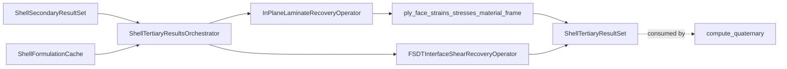
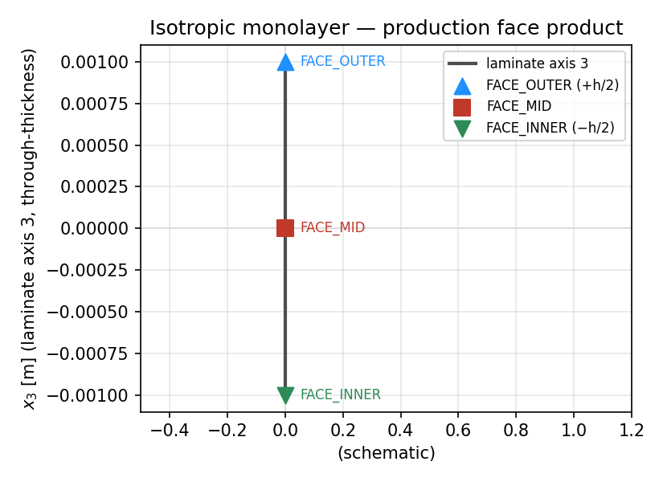
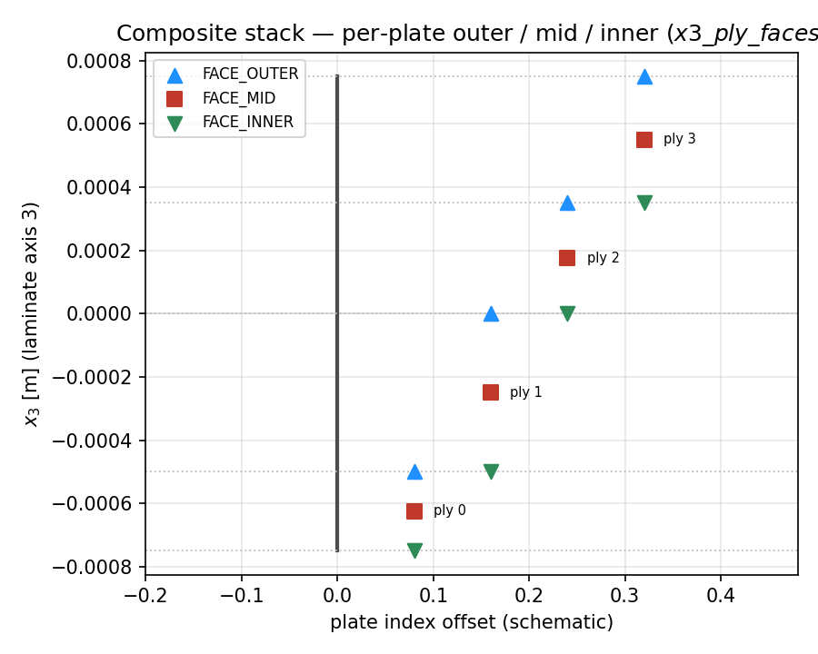
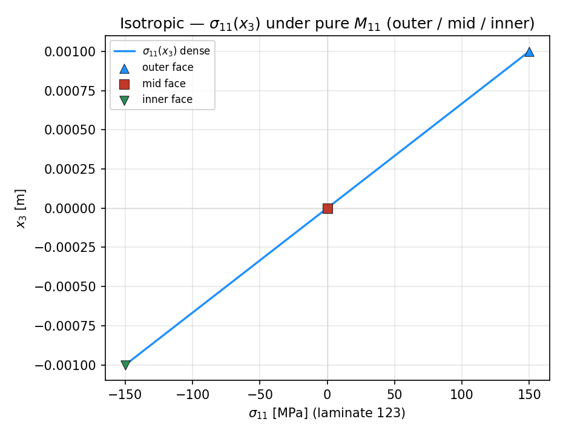
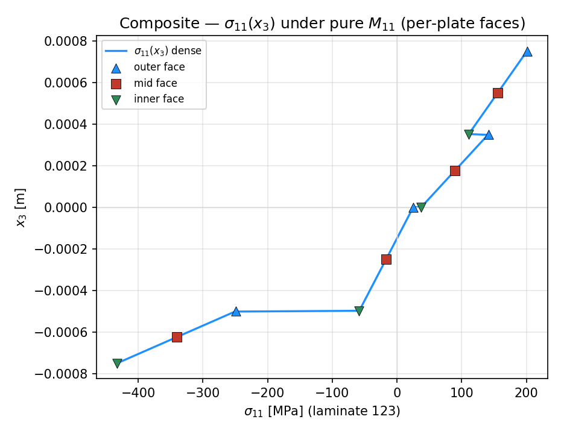
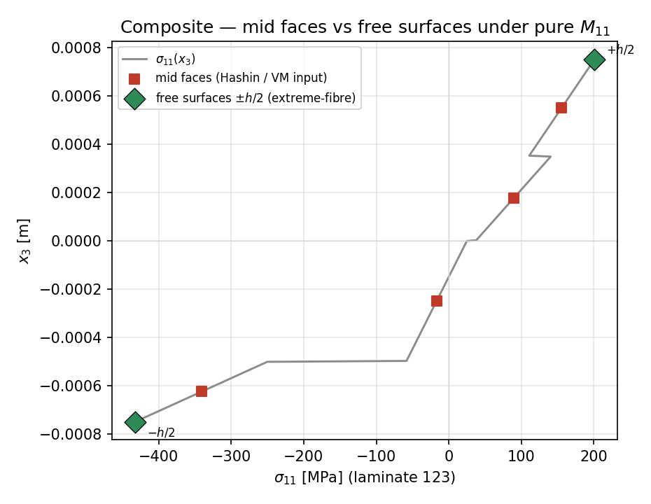
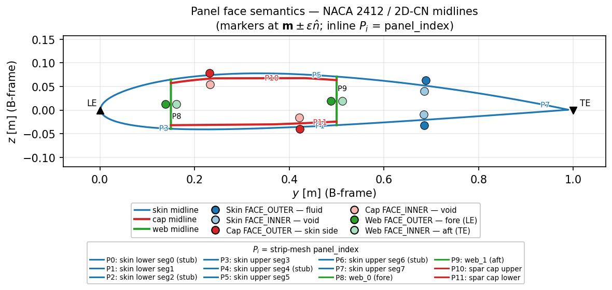

# compute_tertiary — tier-3 CLT stress recovery

Deep documentation for the **`compute_tertiary/`** directory only: classical laminate theory (CLT) recovery of mid-surface strains/curvatures and **per-plate face** plane-stress from secondary shell panel resultants. No failure indices, no fatigue.

**Status:** in-plane plate-face recovery is **complete** for the production orchestrator contract below.

## Table of contents

1. [Purpose / ownership](#purpose--ownership)
2. [Directory map](#directory-map)
3. [Laminate / shell 123 frame](#laminate--shell-123-frame)
4. [CLPT = stack of plates](#clpt--stack-of-plates)
5. [Key equations → functions](#key-equations--functions)
6. [Panel face semantics (blade section)](#panel-face-semantics-blade-section)
7. [Exact I/O of `ShellTertiaryResultsOrchestrator.compute()`](#exact-io-of-shelltertiaryresultsorchestratorcompute)
8. [Provenance / trust](#provenance--trust)
9. [Contract (production)](#contract-production)
10. [Mermaid: tertiary pipeline](#mermaid-tertiary-pipeline)
11. [Isotropic vs composite inside tertiary](#isotropic-vs-composite-inside-tertiary)
12. [Stations API](#stations-api)
13. [Plots](#plots)
14. [Public exports](#public-exports)
15. [See also](#see-also)

---

## Purpose / ownership

| Owns | Does **not** own |
|------|------------------|
| CLT ABD solve → `eps0`, `kappa` | FE assembly / linear-static solve |
| Per-plate outer / mid / inner plane-stress in material frame | Secondary resultant recovery (tier 2) |
| Optional FSDT interface transverse shear \(\tau_{13},\tau_{23}\) | Hashin / Von Mises / extreme-fibre FI (tier 4) |
| Provenance gating for which secondary rows enter recovery | Fatigue / BV / BSF consumers |

**Product:** `ShellTertiaryResultSet` wrapping `ShellPlyResults`.

Quaternary chooses which face(s) to consume: mid-face for standard Hashin / Von Mises; free surfaces \(\pm h/2\) for the extreme-fibre track. See [cascade index](../../docs/README.md).

---

## Directory map

| Path | Role |
|------|------|
| `tertiary_results_orchestrator.py` | `ShellTertiaryResultsOrchestrator.compute()` — panel-grouped recovery |
| `recovery_operators.py` | `InPlaneLaminateRecoveryOperator`, FSDT/HSDT/CCX shear operators |
| `compute_clt_strains.py` | Batched ABD → `eps0`, `kappa` + trust mask |
| `compute_ply_stresses.py` | Per-plate face \(\boldsymbol{\varepsilon}/\boldsymbol{\sigma}\) → material frame (`T_ply`) |
| `provenance.py` | Which secondary resultant fields may enter CLT / interlaminar recovery |
| `local_clpt_shell.py` | Station-level CLPT helper (local / legacy path) |
| `__init__.py` | Public exports for this directory |
| `docs/` | This README, closed `roadmap_x3_stations.md`, `bug_log.md` |
| `examples/` | L5 plot runner for \(x_3\) stations and \(\sigma_{11}(x_3)\) demos |

---

## Laminate / shell \(x_1,x_2,x_3\) frame (**E**)

All tertiary thickness sampling and plane-stress components use the **element / laminate** frame **E** \((x_1,x_2,x_3)\) — not structural blade \(X_B,Y_B,Z_B\). On each MITC4 facet **E** coincides with curvilinear strip **C** (DOF basis \(x,s,n\)).

Structural frames **R / B / S / S′**, curvilinear **C**, and **E** / **M** are defined in [`coordinate_frames/README.md`](../../../../../../../geometry_utilities/coordinate_frames/README.md).

| Axis | Role | Not |
|------|------|-----|
| \(x_1\) | In-plane (strip / laminate longitudinal) | \(X_B\) / \(X_S\) |
| \(x_2\) | In-plane (contour tangent) | \(Y_B\) / \(Y_S\) |
| \(x_3\) | Through-thickness (shell normal); stations at \(x_3\) | \(Z_B\) / \(Z_S\) |

**Plane-stress vector** at a thickness station (CLPT, \(\sigma_{33}=0\)):

\[
\boldsymbol{\sigma}_{123}(x_3)=[\sigma_{11},\sigma_{22},\tau_{12}]
\]

**Kinematics** from mid-surface strain and curvature:

\[
\boldsymbol{\varepsilon}(x_3)=\boldsymbol{\varepsilon}_0 + x_3\,\boldsymbol{\kappa},\qquad
\boldsymbol{\sigma}(x_3)=\bar{\mathbf{Q}}(x_3)\,\boldsymbol{\varepsilon}(x_3)
\]

**Legacy names:** fields historically called `z_ply`, `ply_interfaces_z`, `z_coord` are **\(x_3\)** in this frame (metres from mid-surface), never blade/global \(Z\).

After ply rotation, tertiary stores stresses in **ply material 123** (fibre-aligned). The thickness coordinate itself remains laminate \(x_3\).

---

## CLPT = stack of plates

Classical laminate theory treats a shell laminate as a **stack of thin plates** (plies), not a different recovery theory from an isotropic monolayer.

| View | What it is |
|------|------------|
| Isotropic panel | **One** plate (adapter → `n_ply=1`) |
| Composite panel | **Many** plates bonded in series through \(x_3\), each with its own \(\bar{\mathbf{Q}}_k\) and fibre angle |

**Same per-plate recovery** for every plate \(k\) occupying \([x_3^{k-},\,x_3^{k+}]\):

\[
\boldsymbol{\varepsilon}(x_3)=\boldsymbol{\varepsilon}_0+x_3\boldsymbol{\kappa},\qquad
\boldsymbol{\sigma}^{(k)}(x_3)=\bar{\mathbf{Q}}_k\,\boldsymbol{\varepsilon}(x_3)
\]

then rotate that plate’s \(\boldsymbol{\sigma}\) into its material 123 (`T_ply`). ABD couples the stack for \(\boldsymbol{\varepsilon}_0,\boldsymbol{\kappa}\); stress evaluation itself is plate-local.

**Production station product per plate** (use-case agnostic):

\[
\bigl(\boldsymbol{\sigma}(x_3^{k+}),\;\boldsymbol{\sigma}(x_3^{k,\mathrm{mid}}),\;\boldsymbol{\sigma}(x_3^{k-})\bigr)
=\text{(outer face, midplane, inner face)}
\]

| Face index | Laminate \(x_3\) on plate \(k\) | Name |
|------------|----------------------------------|------|
| `0` (`FACE_OUTER`) | \(x_3^{k+}\) (higher face) | outer surface |
| `1` (`FACE_MID`) | \(x_3^{k,\mathrm{mid}}\) | mid-surface |
| `2` (`FACE_INNER`) | \(x_3^{k-}\) (lower face) | inner surface |

Stored shape: `sig_ply_mat` / `eps_ply_mat` → `(n_elem, n_ply, 3, 3)` — plate × {outer, mid, inner} × \([\sigma_{11},\sigma_{22},\tau_{12}]\).

At a shared interface \(x_3\), adjacent plates may have **discontinuous** in-plane \(\boldsymbol{\sigma}\) because \(\bar{\mathbf{Q}}\) jumps — both faces are stored; do not assume continuity.

---

## Key equations → functions

Each production equation below is paired with the function that evaluates it.

### ABD mid-surface solve

\[
\begin{bmatrix}\mathbf{N}\\\mathbf{M}\end{bmatrix}
=
\begin{bmatrix}\mathbf{A}&\mathbf{B}\\\mathbf{B}&\mathbf{D}\end{bmatrix}
\begin{bmatrix}\boldsymbol{\varepsilon}_0\\\boldsymbol{\kappa}\end{bmatrix}
\quad\Rightarrow\quad
\begin{bmatrix}\boldsymbol{\varepsilon}_0\\\boldsymbol{\kappa}\end{bmatrix}
=
\begin{bmatrix}\mathbf{A}&\mathbf{B}\\\mathbf{B}&\mathbf{D}\end{bmatrix}^{-1}
\begin{bmatrix}\mathbf{N}\\\mathbf{M}\end{bmatrix}
\]

| Symbol | Meaning | Function |
|--------|---------|----------|
| \(\mathbf{A},\mathbf{B},\mathbf{D}\) | ABD blocks from the panel laminate | `LaminateDefinition.build_ABD` / `stiffness_bundle` |
| \(\mathbf{N},\mathbf{M}\) | Secondary membrane / moment resultants | from `ShellPanelResultants` |
| \(\boldsymbol{\varepsilon}_0,\boldsymbol{\kappa}\) | Mid-surface strain / curvature | `laminate_midstrains_curvatures` · batched as `batched_clt_strains` · orchestrated by `InPlaneLaminateRecoveryOperator.recover_panel` |

### Through-thickness kinematics and plate stress

\[
\boldsymbol{\varepsilon}(x_3)=\boldsymbol{\varepsilon}_0+x_3\boldsymbol{\kappa},\qquad
\boldsymbol{\sigma}^{(k)}(x_3)=\bar{\mathbf{Q}}_k\,\boldsymbol{\varepsilon}(x_3)
\]

| Symbol | Meaning | Function |
|--------|---------|----------|
| \(x_3^{k+},x_3^{k,\mathrm{mid}},x_3^{k-}\) | Per-plate face stations | `PlyStackX3Stations.x3_ply_faces` · `ply_face_stations` |
| \(\boldsymbol{\varepsilon}\) at faces | Laminate-frame face strains | `ply_face_strains_laminate` |
| \(\boldsymbol{\sigma}\) at faces | Laminate-frame face stresses | `ply_face_stresses_laminate` |
| Material-frame \(\boldsymbol{\sigma},\boldsymbol{\varepsilon}\) | After ply rotation \(T_{\mathrm{ply}}\) | `ply_strains_stresses_material_frame` → `rotate_plies_to_material` |
| Mid-face slice | \(\boldsymbol{\sigma}[\ldots,1,:]\) | `mid_face` |

Orchestrator entry: `ShellTertiaryResultsOrchestrator.compute`.

### Shell normal \(+\hat{\mathbf{n}}\) (= laminate \(+x_3\))

Midline tangent and CCW unit normal (B-frame \(YZ\)):

\[
\hat{\mathbf{t}}=\frac{\mathbf{r}_{i+1}-\mathbf{r}_i}{\lvert\mathbf{r}_{i+1}-\mathbf{r}_i\rvert},\qquad
\hat{\mathbf{n}}=(-t_z,\,t_y)
\]

Station \(\mathbf{m}=\tfrac12(\mathbf{r}_i+\mathbf{r}_{i+1})\). Evaluated by `mid_segment_frame` / `normal_2d` in `mesh_utilities.section_mesh.inputs.panel_x3_orientation` (same convention as FE `shell_mesh_map.normal_2d`).

Pass conditions for documented face semantics (`panel_x3_orientation_ok`):

\[
\begin{aligned}
\text{skin (fluid-ward)}&\quad \hat{\mathbf{n}}\cdot(\mathbf{m}-\mathbf{c})>0 \\
\text{cap (skin-ward)}&\quad \hat{\mathbf{n}}\cdot(\mathbf{p}_{\mathrm{skin}}-\mathbf{m})>0 \\
\text{web (LE-ward / fore)}&\quad \hat{\mathbf{n}}\cdot(\mathbf{p}_{\mathrm{LE}}-\mathbf{m})>0
\end{aligned}
\]

| Symbol | Meaning | Function |
|--------|---------|----------|
| \(\mathbf{c}\) | Cavity / skin-polygon centroid | `cavity_point_from_strips` |
| \(\mathbf{p}_{\mathrm{skin}}\) | Nearest outer-skin midline point | `nearest_skin_point` |
| \(\mathbf{p}_{\mathrm{LE}}\) | Leading-edge point (B-frame) | `ShellMeshInputs.leading_edge_b` |
| Normalize + assert | Reverse midline if needed, then fail hard | `normalize_and_assert_panel_x3_conventions` · called from `shell_mesh_inputs_from_strips` |

### FSDT interface shear (optional tertiary branch)

Parabolic transverse-shear profile from laminate-frame \(Q_1,Q_2\) (secondary fields `Q1`/`Q2`) → interface \(\tau_{13},\tau_{23}\):

| Quantity | Function |
|----------|----------|
| Parabolic weight / interface profile | `parabolic_weight(x3, h)`, `fsdt_interface_shear_profile(..., q1=, q2=, x3_iface=)` |
| Operator | `FSDTInterfaceShearRecoveryOperator` |

---

## Panel face semantics (blade section)

Laminate indices are always \(x_3^\pm\). Their **blade-structure** reading depends on panel kind (shell \(+x_3=\hat{\mathbf{n}}\) convention above):

| Panel | `FACE_OUTER` (\(x_3^+\)) | `FACE_INNER` (\(x_3^-\)) | Notes |
|-------|--------------------------|--------------------------|-------|
| **Skin** | **fluid** side (exterior) | **void** side (interior cavity) | Outer mould line ↔ fluid |
| **Spar cap** | **skin** side | **void** side | Cap faces the outer skin / cavity |
| **Web** | **fore** (LE side) | **aft** (TE side) | Formal names **fore** / **aft**; LE / TE are explanatory. Webs are **not** fluid/void |

**Runtime enforcement:** `shell_mesh_inputs_from_strips` /
`shell_mesh_inputs_from_geometry_result` call
`normalize_and_assert_panel_x3_conventions` so production mesh
\(\hat{\mathbf{n}}\) matches this table before FE assembly.

Extreme-fibre free surfaces \(\pm h/2\) are the laminate’s outer-most plates’ free faces — for a skin that is fluid + void; for a web that is fore + aft.

See demo figures under [`../examples/outputs/`](../examples/outputs/) — canonical [`panel_face_semantics.png`](../examples/outputs/panel_face_semantics.png) (`2D-CN`), plus `panel_face_semantics_{1C-CN,2C-CN,2D-CN,2D-F,3D-CN}.png`.

---

## Exact I/O of `ShellTertiaryResultsOrchestrator.compute()`

### Inputs

| Argument | Type | What is used |
|----------|------|----------------|
| `secondary` | `ShellSecondaryResultSet` | `elemental_results.resultant_rows` (`ShellPanelResultants`) |
| `cache` | `ShellFormulationCache` | `panel_laminates[panel_index]` per row |

### Output: `ShellTertiaryResultSet`

| Field | Shape / type | Meaning |
|-------|----------------|---------|
| `ply_results.eps0` | `(n_elem, 3)` | Mid-surface strains \([\varepsilon_{11},\varepsilon_{22},\gamma_{12}]\) |
| `ply_results.kappa` | `(n_elem, 3)` | Curvatures \([\kappa_{11},\kappa_{22},\kappa_{12}]\) |
| `ply_results.eps_ply_mat` | `(n_elem, n_ply, 3, 3)` | Per-plate face strains, **material** frame |
| `ply_results.sig_ply_mat` | `(n_elem, n_ply, 3, 3)` | Per-plate face stresses \(\boldsymbol{\sigma}_{123}\), **material** frame |
| `ply_results.trusted_mask` | `(n_elem,)` bool | Rows that entered the CLT solve |
| `ply_results.tau_iface` | `(n_elem, n_iface, 2)` or `None` | Interface \([\tau_{13},\tau_{23}]\); `n_iface = n_ply+1` |
| `ply_results.shear_trusted_mask` | `(n_elem,)` bool | Rows with trusted \(Q_1,Q_2\) (`Q1`/`Q2`) for interlaminar recovery |
| `transverse_shear` | `(n_elem, 2)` | Pass-through \(Q_1,Q_2\) (`Q1`/`Q2`) for tier 4 |
| `thickness_m` | `(n_elem,)` | Panel thickness [m] |
| `element_index` | `(n_elem,)` | Element / station identity |
| `panel_index` | `(n_elem,)` | Panel identity for laminate lookup |
| `meta` | `dict` | Includes `n_rows`, `n_ply`, `n_iface`, `shear_recovery_mode` |

Helper: `mid_face(sig)` → `sig[..., 1, :]` for shared mid-face slices.

---

## Provenance / trust

Gates in `provenance.py`. Absent membrane/bending provenance ⇒ treated as trusted.

| Gate | Required secondary fields | Failure mode |
|------|---------------------------|--------------|
| `clpt_inputs_trusted` | Secondary `N11…M12` (= \(N_{11},N_{22},N_{12},M_{11},M_{22},M_{12}\)) each trusted (or provenance absent) | Row skipped for CLT: `trusted_mask=False`, zero stresses — no raise |
| `interlaminar_inputs_trusted` | `Q1` and `Q2` (= \(Q_1,Q_2\)) **present** and trusted | No FSDT `tau_iface` for that row; `shear_trusted_mask=False` |

---

## Contract (production)

Matching `ShellTertiaryResultsOrchestrator.compute()`:

1. Collect `resultant_rows` from secondary; group by `panel_index`.
2. For each panel with a laminate in `cache.panel_laminates`:
   - `InPlaneLaminateRecoveryOperator.recover_panel` → batched ABD → `eps0`, `kappa`.
   - For each trusted row: recover plane-stress at **each plate’s outer / mid / inner** faces (`x3_ply_faces`), then rotate laminate → ply material frame.
3. If \(Q_1,Q_2\) (`Q1`/`Q2`) pass interlaminar provenance: FSDT parabolic interface shear → `tau_iface`.
4. Pack dense arrays into `ShellPlyResults` / `ShellTertiaryResultSet` with face axis length 3.

**Explicit:** in-plane recovery product is the per-plate face triple. Interface stations for transverse shear remain separate (`tau_iface`).

Historical planning notes (now closed) remain in [`roadmap_x3_stations.md`](roadmap_x3_stations.md).

---

## Mermaid: tertiary pipeline

---

## Isotropic vs composite inside tertiary

Same operator, different plate count. Constitutive-kind branching for **failure indices** lives in `compute_quaternary`, not here.

| | **Isotropic (= 1 plate)** | **Composite (= stack of plates)** |
|---|---|---|
| How it appears | 1-ply laminate from an isotropic adapter (`is_isotropic_source`) | Multi-ply `lam.plies` with angles / `T_ply` |
| Recovery algorithm | Identical in-plane CLPT plate recovery | Identical, once per plate |
| Stations | Outer / mid / inner of the single plate | Outer / mid / inner of **each** plate |
| `sig_ply_mat` shape | `(n_elem, 1, 3, 3)` | `(n_elem, n_ply, 3, 3)` |

---

## Stations API

`LaminateDefinition.ply_stack_x3_stations()` → `PlyStackX3Stations` (material utilities). Wired into face recovery via `x3_ply_faces`.

| Member | Meaning |
|--------|---------|
| `h` | Total thickness [m] |
| `x3_ply_mids` | `(n_ply,)` ply midplanes along axis 3 |
| `x3_ply_faces` | `(n_ply, 3)` outer / mid / inner per plate |
| `x3_interfaces` | `(n_ply+1,)` free surfaces + interfaces |
| `x3_topology` | Unique sorted mids ∪ interfaces |
| `x3_uniform(n)` | `linspace(-h/2, +h/2, n)` |

Compat wrappers: `ply_depths()` → `x3_ply_mids`; `ply_interfaces_z()` → `x3_interfaces`.

CLPT helpers: `ply_face_stresses_laminate`, `ply_mid_stresses_laminate` (mid = face index 1).

---

## Plots

Produced by [`../examples/plot_x3_recovery_demo.py`](../examples/plot_x3_recovery_demo.py) (see [`../examples/README.md`](../examples/README.md)).

> **Synthetic / helper-level demo:** ABD + CLPT \(\sigma(x_3)\) from hand-chosen `[N;M]`. Not `ShellTertiaryResultsOrchestrator.compute()` output. Figures match the production face product (`x3_ply_faces` / `ply_face_stresses_laminate`).

**Isotropic monolayer — production face product** (`FACE_OUTER` / `FACE_MID` / `FACE_INNER`):

**Composite stack — per-plate face triples** (`x3_ply_faces`):

**Isotropic — \(\sigma_{11}(x_3)\) under pure \(M_{11}\)** with outer / mid / inner markers:

**Composite — \(\sigma_{11}(x_3)\) under pure \(M_{11}\)** with per-plate face markers:

**Composite — mid faces vs free surfaces \(\pm h/2\)** (tertiary product vs extreme-fibre stations):

**Panel face semantics** (skin fluid/void, spar skin/void, web fore/aft):

---

## Public exports

From `compute_tertiary/__init__.py` (summary):

| Export | Role |
|--------|------|
| `ShellTertiaryResultsOrchestrator` | Tier-3 entry point |
| `InPlaneLaminateRecoveryOperator` | ABD + ply face material-frame stresses |
| `FSDTInterfaceShearRecoveryOperator` / shear modes | Interface \(\tau_{13},\tau_{23}\) |
| `batched_clt_strains` | ABD batch helper |
| `ply_strains_stresses_material_frame` / face helpers | Per-element face recovery |
| `mid_face` | Slice face axis → mid |
| `clpt_inputs_trusted` / `interlaminar_inputs_trusted` | Provenance |
| `solve_station_clpt_shell` | Local station CLPT helper |

---

## See also

- Structural frames R/B/S/S′: [`coordinate_frames/README.md`](../../../../../../geometry_utilities/coordinate_frames/README.md)
- Results cascade index: [`../../docs/README.md`](../../docs/README.md)
- Closed roadmap note: [`roadmap_x3_stations.md`](roadmap_x3_stations.md)
- Examples (plots): [`../examples/README.md`](../examples/README.md)
- Secondary (resultant inputs): [`../../compute_secondary/docs/README.md`](../../compute_secondary/docs/README.md)
- Quaternary FI (consumer): [`../../compute_quaternary/docs/README.md`](../../compute_quaternary/docs/README.md)
- Station API: `blade_structure_utilities.material_utilities.laminate.PlyStackX3Stations`
- Parent shell package: [`../../../../../README.md`](../../../../../README.md)
