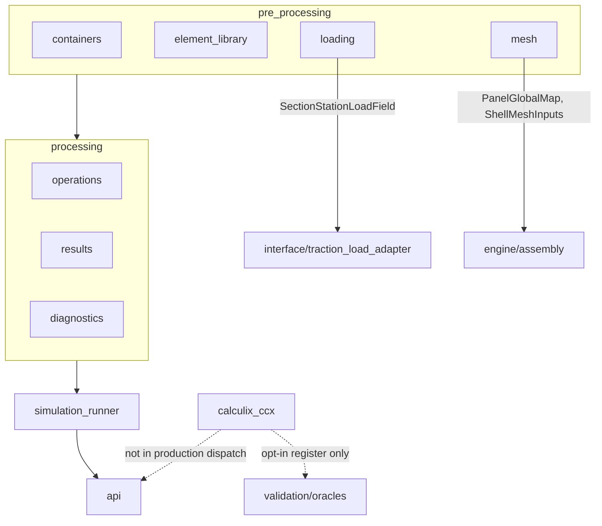

# Pre-processing architecture extension proposal

**Status:** Phases 0–8 implemented (layout, shim removal, FSDT registry, CCX quarantine).  
**Last updated:** 2026-07-14

> **Post-completion amendments (authoritative over body text dated 2026-07-08):**
>
> | Topic | Current code state |
> |-------|--------------------|
> | **HSDT** | Package `pre_processing/element_library/hsdt/`, `ShellTheory.HSDT`, `register_hsdt_backend()`, and HSDT periodic/station solvers were **deleted** (not merely quarantined). `ProvenanceKind.HSDT` remains as provenance vocabulary. Treat historical Phase 8 “opt-in HSDT” rows as archaeology. |
> | **Clamped FE** | `api/legacy_clamped.py`, `panel_mitc4_model`, and Path-B FE are **deleted**. |
> | **Channel-A periodic** | `api/periodic`, `api/k6`, `operations/periodic/`, and `section_optimisation` are **deleted** (Phase 0). Production is contour-supported linear-static (`run_section_linear_static_from_resultants`). |
> | **CCX tests** | Live under `calculix_ccx/tests/`; gated with `@pytest.mark.ccx`. Deferred `testpaths` relocation from acceptance #4 is **done**. |
> | **Theory support** | `SUPPORTED_SHELL_THEORY_BY_REGIME[LINEAR] = (FSDT,)`. CCX remains enum + opt-in `register_calculix_ccx_backend()`. |
> | **Canonical live contract** | [SHELL_MODEL.md](SHELL_MODEL.md), [ELEMENT_AGNOSTIC_ARCHITECTURE.md](ELEMENT_AGNOSTIC_ARCHITECTURE.md), [NEXT_STEPS_PERF_AND_MAINTAINABILITY.md](NEXT_STEPS_PERF_AND_MAINTAINABILITY.md). |

This document is the **historical migration record** for extending `section_shell_model` with a physical `pre_processing/` package and `processing/diagnostics`, quarantining CalculiX as an opt-in validation backend, and completing the FSDT/MITC4 element-agnostic registry. Body sections below retain the 2026-07-08 proposal wording for auditability; where they conflict with the amendments table, **the amendments win**.

**Related docs**

| Doc | Role |
|-----|------|
| [ELEMENT_AGNOSTIC_ARCHITECTURE.md](ELEMENT_AGNOSTIC_ARCHITECTURE.md) | Live 1d-fem concept mapping; FSDT-only + CCX opt-in |
| [FEM_ARCHITECTURE_1DFEM_ALIGNMENT.md](FEM_ARCHITECTURE_1DFEM_ALIGNMENT.md) | Layer-by-layer evaluation of `section_shell_model` against the 1d-fem computational philosophy |
| [SHELL_MODEL.md](SHELL_MODEL.md) | Handoff contract, periodic solve policy, conceptual layer table |
| [PROCESSING_ARCHITECTURE_PROPOSAL.md](PROCESSING_ARCHITECTURE_PROPOSAL.md) | Four-tier results pipeline; quaternary tier scoped to Hashin + Von Mises FI |
| [processing/static/results/RESULTS_DESIGN.md](../processing/static/results/RESULTS_DESIGN.md) | Post-solve results taxonomy (already mirrors 1d-fem) |
| [CALCULIX_CCX_ELEMENT_LIBRARY_RESTRUCTURE.md](CALCULIX_CCX_ELEMENT_LIBRARY_RESTRUCTURE.md) | Completed `element_library/` convention |
| [docs/architecture/DEPRECATION_REGISTER.md](../../../docs/architecture/DEPRECATION_REGISTER.md) | Shim and removal policy |

---

## Motivation

Today, the pre-solve role is **conceptual** rather than physical:

| Layer | Current location | Notes |
|-------|------------------|-------|
| pre_processing | `core/`, `element_library/`, parts of `engine/` | DTOs, meshing, element kernels spread across three top-level dirs |
| processing | `processing/static/operations/`, `processing/static/results/` | Already mirrors 1d-fem (stage ops + results containers) |
| simulation_runner | `simulation_runner/` | `SectionLinearStaticRunner` owns threaded solve state |
| api | `api/` | Thin wrappers over runner + recovery |

Additionally, `blade_precompute/section_loads` is a sibling package that logically belongs upstream of the shell solve but lives outside `section_shell_model`. Meshing logic is similarly split across `core/` and `engine/shell_mesh_map.py`. CalculiX logic is already physically under `calculix_ccx/`, but dispatch adapters and registry entries in `api/`, `engine/`, and `element_library/mitc4/` still assimilate it into the production theory plumbing.

Making `pre_processing/` a real package clarifies boundaries, aligns with the 1d-fem mental model where it already applies, and gives blade_precompute-specific logic (mesh, loading) a single discoverable home. Quarantining `calculix_ccx/` makes the production path (FSDT / HSDT) clearly separable from the external validation backend.

---

## Fidelity to 1d-fem

Not every proposed subdirectory is a faithful 1d-fem analogue. The proposal distinguishes two categories:

| Subdirectory | Analogy fidelity | Meaning |
|--------------|------------------|---------|
| `pre_processing/containers` | **Direct (revised)** | Named the same as 1d-fem `pre_processing/containers`, but a full audit (see [FEM_ARCHITECTURE_1DFEM_ALIGNMENT.md](FEM_ARCHITECTURE_1DFEM_ALIGNMENT.md)) found 1d-fem's own `pre_processing/containers/` (`MeshContainer`, `ElementContainer`, …) is legacy and **unwired** — its active formulation cache lives in `element_library/gauss_point_data.py`, and its solve-state fields (`GlobalResults`, `IndexMapSet`) live under `processing/static/results/containers/`, not `pre_processing/`. `section_shell_model`'s `pre_processing/containers/formulation_objects.py` (`ShellFormulationCache`) is the faithful analogue; `solve_states.py` is **not** — it relocates to `processing/static/operations/` in Phase 6 below to match 1d-fem's actual placement |
| `pre_processing/element_library` | **Direct** | Same role as 1d-fem `pre_processing/element_library` — native element kernels and co-located utilities |
| `pre_processing/mesh` | **Convention only** | Borrows 1d-fem placement/naming; **does not** claim role-parity with how mesh directories relate to the wider 1d-fem package. Becomes the home for existing section_shell_model meshing logic |
| `pre_processing/loading` | **Convention only** | Borrows 1d-fem placement/naming; **does not** claim role-parity with 1d-fem loading. Becomes the home for the existing `blade_precompute/section_loads` package |

**Correction (2026-07-08):** `processing/diagnostics` is **not** a blade_precompute-only extension — 1d-fem has a direct counterpart at `processing/static/diagnostics/` (`DiagnoseLinearStaticSystem`, `RuntimeMonitorTelemetry`). The table above previously understated this fidelity; `processing/diagnostics` groups diagnostic-flavoured code currently scattered across validation, provenance helpers, and opt-in strict checks, same as its 1d-fem counterpart groups per-stage checks and telemetry. See [FEM_ARCHITECTURE_1DFEM_ALIGNMENT.md](FEM_ARCHITECTURE_1DFEM_ALIGNMENT.md) for the full corrected fidelity table.

---

## Proposed target structure

```text
section_shell_model/
├── pre_processing/
│   ├── containers/          # agnostic pre-solve DTOs (direct 1d-fem analogue)
│   ├── element_library/     # mitc4, hsdt, factories (direct 1d-fem analogue)
│   ├── mesh/                # consolidated meshing logic (convention-only home)
│   └── loading/             # absorbed section_loads (convention-only home)
├── processing/
│   ├── operations/          # existing stage ops
│   ├── results/             # existing results tiers + containers
│   └── diagnostics/         # NEW — diagnostic helpers and provenance tooling
├── simulation_runner/       # unchanged
├── engine/                  # assembly, constraints, homogenisation (mixed; see below)
├── api/                     # unchanged role — production FSDT/HSDT only by default
├── calculix_ccx/            # quarantined validation backend example (opt-in registration)
├── validation/              # cross-solver oracles (primary CCX consumer)
├── interface/               # unchanged — traction adapter, recovery builders
└── ...
```



---

## 1d-fem mapping (extended)

| 1d-fem | Proposed `section_shell_model` | Analogy fidelity | Current location |
|--------|-------------------------------|------------------|------------------|
| `pre_processing/containers` | `pre_processing/containers/` | Direct (excludes solve state) | `core/types.py`, `core/formulation_objects.py`, `core/fem_config.py`. `core/solve_states.py` is **not** a containers-analogue — it moves to `processing/static/operations/solve_states.py` (Phase 7) |
| `pre_processing/element_library` | `pre_processing/element_library/` | Direct | `element_library/` (top-level) |
| `pre_processing/mesh` (naming only) | `pre_processing/mesh/` | Convention only | `core/section_strip_mesh.py`, `core/strip_discretise.py`, `core/panel_discretise.py`, `core/topology.py`, `core/mesh_topology.py`, `core/shell_inputs_from_section.py`, `engine/shell_mesh_map.py` |
| `pre_processing/loading` (naming only) | `pre_processing/loading/` | Convention only | `blade_precompute/section_loads/` (entire package) |
| Stage operations | `processing/static/operations/` | Direct | Already in place |
| Results containers | `processing/static/results/containers/` | Direct | Already in place |
| Diagnostics | `processing/static/diagnostics/` | blade_precompute extension | `processing/validation.py`, provenance helpers, equilibrium checks (see §5) |
| `LinearStaticSimulationRunner` | `simulation_runner/section_linear_static_runner.py` | Direct | Already in place |
| External validation backend | `calculix_ccx/` (quarantined) | blade_precompute extension | Implementation already in `calculix_ccx/`; dispatch wiring currently in `api/periodic.py`, `engine/shell_solve_registry.py`, `engine/station_theory_dispatch.py`, `element_library/mitc4/utilities/mitc4_solve_orchestrator.py` (see §6) |

Existing mappings from [ELEMENT_AGNOSTIC_ARCHITECTURE.md](ELEMENT_AGNOSTIC_ARCHITECTURE.md) (`ShellElementBase`, `assemble_section_system`, etc.) remain valid; this proposal only adds the physical package layout for the pre-solve half.

---

## Relocation tables

### `pre_processing/containers` (direct analogue)

Pre-solve DTOs and formulation state objects — the mirror of `processing/static/results/containers/` on the input side.

| From | To (proposed) | Notes |
|------|---------------|-------|
| `core/types.py` | `pre_processing/containers/types.py` | `ShellMeshInputs`, `ShellTheory`, `FieldProvenance`, panel/station DTOs |
| `core/formulation_objects.py` | `pre_processing/containers/formulation_objects.py` | `ShellStiffnessObject`, `ShellForceObject` |
| `core/solve_states.py` | ~~`pre_processing/containers/solve_states.py`~~ → **`processing/static/operations/solve_states.py`** (Phase 5/7, see [relocation note](#phase-5--shim-removal-concrete-plan-supersedes-the-previous-placeholder)) | Stage-state DTOs: `GlobalShellSystem`, `ConstrainedShellSystem`, `ReducedShellSystem`, `SolvedReducedShellSystem`, `ReconstructedShellField`, `ShellDofProvenanceEntry`. Superseded destination — matches 1d-fem's actual placement of equivalent state under `processing/static/results/containers/`, not `pre_processing/` |
| `core/fem_config.py` | `pre_processing/containers/fem_config.py` | FEM discretisation config DTOs |

**Shim:** `core/__init__.py` re-exports for one deprecation cycle.

**Not moved:** `core/panel_identity.py` (recovery identity contract — stays near `interface/` or moves to `processing/results` in a later pass).

---

### `pre_processing/element_library` (direct analogue)

Physical move of the existing top-level `element_library/` package. Content unchanged; only the import root changes.

| From | To (proposed) | Notes |
|------|---------------|-------|
| `element_library/` (entire tree) | `pre_processing/element_library/` | `mitc4/`, `hsdt/`, `shell_element_base.py`, `formulation_factory.py`, `kernel.py` |

**Shim:** top-level `element_library/` becomes a re-export package for one cycle (same pattern as the completed CCX restructure in [CALCULIX_CCX_ELEMENT_LIBRARY_RESTRUCTURE.md](CALCULIX_CCX_ELEMENT_LIBRARY_RESTRUCTURE.md)).

**Not moved:** `calculix_ccx/` — quarantined validation backend (see §6); not part of `pre_processing/element_library`.

---

### `pre_processing/mesh` (convention-only home)

Consolidates the extensive meshing logic already in `section_shell_model`. Does **not** imply the same responsibilities as 1d-fem mesh directories relative to their package.

| From | To (proposed) | Role |
|------|---------------|------|
| `core/shell_inputs_from_section.py` | `pre_processing/mesh/shell_inputs_from_section.py` | Geometry → `ShellMeshInputs` handoff |
| `core/topology.py` | `pre_processing/mesh/topology.py` | `build_section_v2` — one panel per midline |
| `core/mesh_topology.py` | `pre_processing/mesh/mesh_topology.py` | Kernel-agnostic topology primitives |
| `core/section_strip_mesh.py` | `pre_processing/mesh/section_strip_mesh.py` | Strip mesh: arc-length nodes, quads, junction clusters |
| `core/strip_discretise.py` | `pre_processing/mesh/strip_discretise.py` | Shared strip discretisation |
| `core/panel_discretise.py` | `pre_processing/mesh/panel_discretise.py` | Backward-compatible re-export shim (may fold into `strip_discretise`) |
| `engine/shell_mesh_map.py` | `pre_processing/mesh/shell_mesh_map.py` | `PanelGlobalMap`, `build_panel_mesh_maps`, global node meta |

**Stays in place (mixed mesh + solve):**

| Module | Reason |
|--------|--------|
| `engine/connected_assembly_core.py` | Global node numbering + MPC + reduced solve |
| `engine/global_shell_assembly.py` | Production MITC4 assembly/solve/recovery |
| `calculix_ccx/mesh.py` | CCX export mesh builder (stays in quarantined backend) |
| `element_library/mitc4/utilities/mitc4_mesh.py` | Re-export shim retargeted to `pre_processing/mesh/section_strip_mesh.py`; moved with the rest of `mitc4/` in Phase 2 (now `pre_processing/element_library/mitc4/utilities/mitc4_mesh.py`). Its name is a flagged follow-up — see [Open questions](#open-questions) #5. |

**Canonical public entry points** (unchanged names, new paths):

1. `build_shell_mesh_inputs` — `pre_processing/mesh/shell_inputs_from_section.py`
2. `build_section_v2` — `pre_processing/mesh/topology.py`
3. `build_section_strip_mesh` — `pre_processing/mesh/section_strip_mesh.py`
4. `build_panel_mesh_maps` — `pre_processing/mesh/shell_mesh_map.py`

**Shim:** `core/` modules re-export mesh functions for one cycle; update `section_shell_model/__init__.py` to import from new paths.

---

### `pre_processing/loading` (convention-only home)

Absorbs the entire `blade_precompute/section_loads` package. Does **not** imply the same responsibilities as 1d-fem loading directories relative to their package.

| From (`section_loads/`) | To (proposed) | Role |
|-------------------------|---------------|------|
| `api/build_station_load_field.py` | `pre_processing/loading/api/build_station_load_field.py` | Public API: mesh inputs + aero spec → load field |
| `core/types.py` | `pre_processing/loading/containers/types.py` | `SectionStationLoadField`, job config, provenance DTOs |
| `engine/station_load_builder.py` | `pre_processing/loading/builders/station_load_builder.py` | XFOIL/synthetic aero → surface traction |
| `engine/incident_aero.py` | `pre_processing/loading/builders/incident_aero.py` | Re, Ma, alpha derivation |
| `engine/outline_frames.py` | `pre_processing/loading/builders/outline_frames.py` | B-frame ↔ S-frame transforms |
| `io/load_field_json.py` | `pre_processing/loading/io/load_field_json.py` | JSON serialization |
| `vis.py` | `pre_processing/loading/vis.py` | Station load PNG diagnostics |
| `tests/` | `pre_processing/loading/tests/` | Existing test suite (paths updated) |
| `README.md` | `pre_processing/loading/README.md` | Pipeline position doc (updated import paths) |

**External consumers to update:**

| Consumer | Current import | Action |
|----------|----------------|--------|
| `orchestration/precompute/stages_pkg/loads.py` | `section_loads.*`, `build_shell_mesh_inputs` | Retarget to `pre_processing/loading` + `pre_processing/mesh` |
| `orchestration/precompute/containers.py` | `SectionLoadsJobConfig`, `SectionStationLoadField` | Retarget |
| `orchestration/precompute/pipeline.py` | `write_station_load_pngs` | Retarget |
| `orchestration/precompute/shell_runtime.py` | `SectionStationLoadField` (type) | Retarget |
| `section_shell_model/interface/traction_load_adapter.py` | `SectionStationLoadField` | Retarget (same package — shorter import) |

**Shim:** `blade_precompute/section_loads/` becomes a thin re-export package for one deprecation cycle with a row in [DEPRECATION_REGISTER.md](../../../docs/architecture/DEPRECATION_REGISTER.md).

**Pipeline position** (unchanged semantics):

```text
section_geometry  →  pre_processing/mesh  →  pre_processing/loading  →  section_shell_model solve
                         ShellMeshInputs         SectionStationLoadField
```

---

### `processing/diagnostics` (new)

Groups diagnostic-flavoured code that supports the solve pipeline but is not a stage operation or a results container. Cross-validation oracles remain in top-level `validation/`.

| From | To (proposed) | Role |
|------|---------------|------|
| `processing/validation.py` | `processing/static/diagnostics/formulation_validation.py` | Opt-in strict `ShellFormulationCache` shape checks (`SHELL_FORMULATION_CACHE_STRICT_SHAPE`) |
| `core/topology.py` (`TopologyV2Diagnostics`) | `processing/static/diagnostics/topology_diagnostics.py` | Per-panel topology summary (extract type + helpers) |
| `engine/shell_recovery_builder.py` (`check_cluster_equilibrium`) | `processing/static/diagnostics/equilibrium_checks.py` | Edge-traction equilibrium diagnostic (gated by `SECTION_SHELL_EDGE_TRACTION_DIAG`) |
| Provenance dump helpers | `processing/static/diagnostics/dof_provenance.py` | `SHELL_DOF_PROVENANCE_DUMP` tooling |
| `io/centerline_mesh_plots.py` | `processing/static/diagnostics/mesh_plots.py` | Mesh/junction PNG diagnostics (optional move) |

**Stays separate:**

| Location | Reason |
|----------|--------|
| `validation/` | Cross-solver oracles (HSDT benchmark, periodic K6 oracle) — research/regression, not production diagnostics |
| `examples/repro_*.py` | One-off repro scripts (already removed from production surface) |

---

## `engine/` package — **removed**

The former `engine/` mixed spine has been relocated into the three authoritative layers:

| Former `engine/` module | Current home |
|-------------------------|--------------|
| `section_assembly`, `global_shell_assembly`, `connected_*` | `processing/static/operations/` |
| `homogenisation`, `periodic_*` (cache/BVP/traction) | `processing/static/operations/periodic/` |
| `periodic_secondary_recovery` | `processing/static/results/compute_secondary/` |
| `local_clpt_shell` | `processing/static/results/compute_tertiary/` |
| `section_vlasov`, `sectorial_warping` | `processing/static/operations/` |
| `shell_theory_registry`, `shell_solve_registry`, `station_theory_dispatch` | `pre_processing/element_library/` |
| `shell_geometric_nonlinear` | deleted (out of scope) |

Historical rows below that still say `engine/` describe the pre-relocation layout.

---

## CalculiX quarantine (`calculix_ccx/` as validation backend example)

### Problem

The CalculiX (ccx) implementation files already live under `calculix_ccx/` (`mesh.py`, `solve.py`, `results.py`, `periodic.py`, `section_export.py`, `strip_export.py`, `orientation.py`). However, CCX is still **assimilated into production plumbing** via eager imports and hard-coded registry entries in the main package. This blurs the boundary between the authoritative native kernels (FSDT MITC4, HSDT) and an external subprocess backend used primarily for cross-validation.

**Primary CCX consumer today:** `validation/periodic_k6_oracle.py` — MITC4/ccx periodic K6 oracles. CCX should be treated as a **validation backend example**, not a third production theory alongside FSDT and HSDT.

### Principle

- `calculix_ccx/` is self-contained: mesh export → `ccx` subprocess → FRD/results parsing → periodic homogenisation.
- Production dispatch (`api/`, `engine/shell_solve_registry.py`, `engine/station_theory_dispatch.py`) does **not** import or register CCX at module load.
- CCX remains fully functional for validation runs that explicitly opt in via registration (e.g. `calculix_ccx.register()` or a validation harness entry point).
- Enum values `ShellTheory.CALCULIX_CCX` and `ProvenanceKind.CALCULIX_CCX` remain as shared vocabulary for provenance contracts, but CCX is removed from the production `SUPPORTED_SHELL_THEORY_BY_REGIME` tuple (or gated behind an explicit opt-in capability flag).

### Current CCX hooks in main plumbing

| Location | Current CCX coupling | Proposed change |
|----------|---------------------|-----------------|
| `api/periodic.py` | Eager `from ..calculix_ccx.periodic import run_section_periodic_bc_ccx`; hard-coded `_PERIODIC_SOLVERS[CALCULIX_CCX]`; `ccx_work_dir` / `ccx_exe` kwargs on public API | Remove eager import and hard-coded map entry; opt-in registration populates solver map; replace ccx-specific kwargs with generic `external_backend_options: dict[str, Any] \| None` |
| `engine/shell_solve_registry.py` | Eager `from ..calculix_ccx.solve import solve_global_coupled_ccx`; `BACKENDS[CALCULIX_CCX]` | Remove eager import and default backend entry; registration hook only |
| `engine/station_theory_dispatch.py` | `ccx_station_solve_from_thin_wall`, `_dispatch_ccx`, `_STATION_SOLVERS[CALCULIX_CCX]`; `ccx_exe` / `ccx_work_subdir` on `StationTheorySolveRequest`; `ccx_extra` on `StationTheorySolveResult` | Move adapter functions to `calculix_ccx/station_dispatch_adapter.py`; register via opt-in hook; generic `external_backend_options` / `backend_extra` on DTOs |
| `element_library/mitc4/utilities/mitc4_solve_orchestrator.py` | `_ccx_global_coupled_solve_from_thin_wall` imports `calculix_ccx.solve` | Move thin-wall CCX adapter into `calculix_ccx/thin_wall_adapter.py`; remove from MITC4 orchestrator |
| `interface/traction_load_adapter.py` | `ccx_work_dir` / `ccx_exe` passthrough to `run_section_periodic_bc` | Generic `external_backend_options` passthrough |
| `core/types.py` | `ShellTheory.CALCULIX_CCX`, `ProvenanceKind.CALCULIX_CCX`, capability row, inclusion in `SUPPORTED_SHELL_THEORY_BY_REGIME[LINEAR]` | Keep enum values; mark capability as validation-only; remove from production regime tuple |
| `tests/test_calculix_*.py`, `tests/test_ccx_*.py` | CCX tests in main `tests/` dir (already `ccx`-marked, CI-excluded) | Relocate to `calculix_ccx/tests/` |
| Orchestration (`containers.py`, `stage_facade.py`, `stages_pkg/shell.py`, `shell_runtime.py`) | `ccx_exe`, `ccx_work_subdir` threaded through params and worker tasks; `ccx_extra` in station results | Genericise to `external_backend_options` mapping; CCX-specific keys live in `calculix_ccx` registration docs, not orchestration DTOs |

### Proposed `calculix_ccx/` layout (after quarantine)

```text
calculix_ccx/
├── __init__.py                  # public surface + register() hook
├── mesh.py                      # existing — CCX section mesh export
├── solve.py                     # existing — subprocess orchestration
├── results.py                   # existing — FRD parsing
├── periodic.py                  # existing — periodic BC homogenisation
├── section_export.py            # existing — deck export
├── strip_export.py              # existing — strip validation decks
├── orientation.py               # existing — shell basis vectors
├── station_dispatch_adapter.py  # NEW — moved from engine/station_theory_dispatch.py
├── thin_wall_adapter.py         # NEW — moved from mitc4_solve_orchestrator.py
├── register.py                  # NEW — opt-in registration into solver maps
├── README.md                    # NEW — validation backend usage, not production path
└── tests/                       # NEW — relocated from section_shell_model/tests/
    ├── test_calculix_ccx_periodic.py
    ├── test_calculix_ccx_section.py
    ├── test_calculix_ccx_strip.py
    ├── test_calculix_frd_parser.py
    ├── test_ccx_frd_coverage.py
    └── test_ccx_periodic_acceptance.py
```

### Opt-in registration pattern (sketch)

```python
# calculix_ccx/register.py — called explicitly by validation harnesses, not at import time
def register_calculix_ccx_backend() -> None:
    from .periodic import run_section_periodic_bc_ccx
    from .station_dispatch_adapter import ccx_station_solve_from_thin_wall
    # populate _PERIODIC_SOLVERS, BACKENDS, _STATION_SOLVERS via registry hooks
```

Validation oracles (`validation/periodic_k6_oracle.py`) call `register_calculix_ccx_backend()` before invoking CCX paths. Production orchestration and optimiser never call registration.

### What stays in `validation/`

Cross-solver oracles remain in top-level `validation/` — they are the intended consumers of the quarantined backend:

| Module | CCX role |
|--------|----------|
| `validation/periodic_k6_oracle.py` | MITC4 vs ccx periodic K6 cross-check |
| `validation/hsdt_benchmark.py` | HSDT equilibrium integrals (may reference ccx indirectly) |

These modules import from `calculix_ccx/` directly; they do not route through production `api/periodic.py` dispatch unless explicitly testing that integration path.

---

## FSDT/MITC4 through the element-agnostic architecture (Phase 7)

### Problem

FSDT production solves (`api/periodic.py` → `engine/global_shell_assembly.py`) already assemble via `build_formulation_cache()` and `Mitc4Quad4Element` (confirmed by audit — see call chain in [FEM_ARCHITECTURE_1DFEM_ALIGNMENT.md](FEM_ARCHITECTURE_1DFEM_ALIGNMENT.md)), so the element-agnostic spine is real, not aspirational. Two gaps remain:

1. **`resolve_element_factory()`** (`pre_processing/element_library/formulation_factory.py`) is a hard-coded `if/elif` over `ShellTheory`, not a registry. Adding a new element theory means editing this function; HSDT is already special-cased inside it even though production never calls it that way (see Phase 8).
2. **~~Legacy monolithic MITC4 paths~~ (superseded 2026-07-14):** `panel_mitc4_model`, thin-wall MITC4 orchestrator wrappers, and `api/legacy_clamped.py` have been **deleted**. Production is periodic-only via `build_formulation_cache` / `assemble_section_from_panels`. Historical rows below are retained for archaeology only.

### Principle

`resolve_element_factory` becomes a **registration map** keyed by `ShellTheory` — the direct analogue of 1d-fem's `ElementFactory.ELEMENT_CLASS_MAP`. FSDT/MITC4 registers unconditionally (it is the only production default theory); HSDT (Phase 8) and CalculiX (§6) register via their own opt-in `register_*_backend()` hooks, sharing the same map. Adding a future element type becomes: new package under `pre_processing/element_library/`, one `register_element_factory(theory, factory_cls)` call, one `ShellTheoryCapability` row — no edits to `formulation_factory.py` itself.

### Proposed changes

| Item | From | To |
|------|------|----|
| Element factory resolution | `resolve_element_factory()` if/elif | `register_element_factory(ShellTheory.FSDT, Mitc4ElementFactory)` at module import; `resolve_element_factory()` becomes a pure map lookup raising on unregistered theories |
| `global_shell_assembly.py` | Imports `pre_processing.element_library.mitc4.element` directly for assembly-adjacent helpers | Slimmed to constraint/BC/periodic-homogenisation handling; all element construction goes through the registry + `build_formulation_cache` |
| `panel_mitc4_model.solve_panel_mitc4` | Serial per-panel MITC4 solve, reachable via `_mitc4_solve_from_thin_wall` | Deprecated; earmarked for deletion (see [DEPRECATION_REGISTER.md](../../../docs/architecture/DEPRECATION_REGISTER.md)) |
| `mitc4_solve_orchestrator._mitc4_solve_from_thin_wall` | Legacy per-panel thin-wall path (`api/legacy_clamped.py` when `use_global_coupled=False`) | Deprecated; tests migrate to Path C periodic equivalents or are marked `legacy` |
| `mitc4_solve_orchestrator._mitc4_global_coupled_solve_from_thin_wall` | Legacy global-coupled thin-wall path (`api/legacy_clamped.py` when `use_global_coupled=True`) | Deprecated; superseded by `solve_global_coupled_shell` via the registry seam — same underlying function, thin-wall-specific wrapper removed |
| `mitc4_mesh.py` naming (open question #5, deferred since Phase 2) | `pre_processing/element_library/mitc4/utilities/mitc4_mesh.py` — element-theory-prescriptive name for an element-agnostic strip-mesh re-export | Promoted into this phase since the element library is being touched anyway: fold into `pre_processing/mesh/section_strip_mesh.py` directly, or rename to a theory-neutral name |
| `collect_panel_abd_stack` (`mitc4_solve_orchestrator.py`) | Still imported by `api/periodic.py` for periodic ABD bundling — this **is** on the production path | Stays; not part of the legacy-deletion set |

**Not on Path C today (confirmed by audit), earmarked for deletion once tests migrate:** `solve_panel_mitc4`, `_mitc4_solve_from_thin_wall`, `_mitc4_global_coupled_solve_from_thin_wall`, and their sole caller `api/legacy_clamped.py::run_section_with_mitc4_shell`.

**Unaffected (already on Path C):** `build_formulation_cache`, `Mitc4Quad4Element`, `assemble_global_shell`, `solve_global_coupled_shell` (called via the registry, not the thin-wall wrapper), `SectionLinearStaticRunner`.

---

## HSDT quarantine (Phase 8, CCX-style)

### Problem

Unlike FSDT, HSDT does **not** route through the element-agnostic path. `HsdtElementFactory` / `build_formulation_cache(shell_theory=ShellTheory.HSDT)` is wired but has **zero production callers**. All production HSDT solves instead go through a parallel monolith:

```text
shell_runtime → dispatch_station_theory(HSDT) → hsdt_station_solve
  → hsdt_connected_solve (utilities/hsdt_solve_orchestrator.py)
    → run_section_periodic_bc_hsdt (api/periodic.py)
      → solve_global_coupled_hsdt_quad4 (element_library/hsdt/assembly.py)
        → reduce_propagate_solve → SectionLinearStaticRunner
      → compute_k6_periodic_bc + HSDT-specific homogenisation recovery
```

HSDT is hard-registered in three separate production maps: `_STATION_SOLVERS` (`engine/station_theory_dispatch.py`), `BACKENDS` (`engine/shell_solve_registry.py`), and `_PERIODIC_SOLVERS` (`api/periodic.py`) — the same assimilation pattern CCX had before its quarantine (§6). HSDT is already flagged `EXPERIMENTAL_SHELL_THEORIES_BY_REGIME`, so quarantining it does not change its support tier, only its dispatch plumbing.

### Principle

Mirror the CCX quarantine principle exactly: `pre_processing/element_library/hsdt/` becomes self-contained; production dispatch does not import or register it at module load; HSDT remains fully functional for opt-in experimental/validation runs via an explicit `register_hsdt_backend()` hook, built on the same registry mechanism introduced in Phase 7.

### Current HSDT hooks in main plumbing

| Location | Current HSDT coupling | Proposed change |
|----------|----------------------|-----------------|
| `engine/station_theory_dispatch.py` | Eager `hsdt_station_solve`; hard-coded `_STATION_SOLVERS[ShellTheory.HSDT]`; `StationTheorySolveResult.hsdt_extra` field | Remove eager import and hard-coded map entry; opt-in registration populates `_STATION_SOLVERS`; genericise `hsdt_extra` → `backend_extra` (shared with CCX's `ccx_extra` genericisation in §6) |
| `engine/shell_solve_registry.py` | Eager `from ..pre_processing.element_library.hsdt.assembly import solve_global_coupled_hsdt_quad4`; `BACKENDS[ShellTheory.HSDT]` | Remove eager import and default backend entry; registration hook only |
| `api/periodic.py` | Eager `from ..pre_processing.element_library.hsdt.assembly import solve_global_coupled_hsdt_quad4`; hard-coded `_PERIODIC_SOLVERS[ShellTheory.HSDT]`; `run_section_periodic_bc_hsdt`, `run_section_tapered_periodic_bc_hsdt`, alias `run_section_with_kinematic_bc_hsdt` | Move solve/dispatch functions into `pre_processing/element_library/hsdt/` (or a `register.py` adapter alongside it); opt-in registration populates `_PERIODIC_SOLVERS` |
| `engine/homogenisation.py` | `if theory is ShellTheory.HSDT: from ..pre_processing.element_library.hsdt.utilities.hsdt_homogenisation import compute_resultants_from_modes_hsdt` | Move the HSDT branch into the quarantined package; homogenisation dispatch resolves via the same opt-in registry |
| `pre_processing/containers/types.py` | `ShellTheory.HSDT`, `ProvenanceKind.HSDT`, capability row (`supports_station_dispatch=True`) | Keep enum values as provenance vocabulary; HSDT stays only in `EXPERIMENTAL_SHELL_THEORIES_BY_REGIME`, never in `SUPPORTED_SHELL_THEORY_BY_REGIME` |
| Orchestration: `orchestration/precompute/containers.py`, `pipeline.py`, `stages_pkg/optimisation.py` | `use_hsdt_interlaminar: bool` flag threaded through config → pipeline → evaluator kwargs → summary JSON | Deprecated and earmarked for deletion; interlaminar failure evaluation becomes a mode of the quaternary Hashin computer (see [PROCESSING_ARCHITECTURE_PROPOSAL.md](PROCESSING_ARCHITECTURE_PROPOSAL.md)), not an HSDT-specific path |
| `section_optimisation/engine/shell_fi_eval.py` | `USE_HSDT_INTERLAMINAR`; `_run_tapered_interlaminar_solve(..., use_hsdt)` imports `run_section_tapered_periodic_bc_hsdt` | Deprecated alongside the orchestration flag chain; earmarked for deletion |
| `section_optimisation/engine/evaluator.py`, `core/types.py` | `use_hsdt_interlaminar` plumbing, KS-constraint docstrings | Deprecated; earmarked for deletion |
| `io/station_json.py`, `io/v2_station_json.py` | `hsdt_extra: Mapping[str, Any] \| None` written as `payload["hsdt"]` | Genericise to `backend_extra` alongside CCX (§6) |

### Proposed `pre_processing/element_library/hsdt/` layout (after quarantine)

```text
pre_processing/element_library/hsdt/
├── __init__.py                  # public surface + register_hsdt_backend() hook
├── assembly.py                  # existing — solve_global_coupled_hsdt_quad4
├── hsdt_element_kernel.py       # existing — 8-DOF stiffness + resultants
├── hsdt_laminate.py             # existing — laminate stiffness
├── hsdt_quad4_element.py        # existing — HsdtQuad4Element, HsdtElementFactory (registry entry point)
├── register.py                  # NEW — opt-in registration into _STATION_SOLVERS / BACKENDS / _PERIODIC_SOLVERS
├── station_dispatch_adapter.py  # NEW — moved from engine/station_theory_dispatch.py (hsdt_station_solve)
├── periodic_adapter.py          # NEW — moved from api/periodic.py (run_section_periodic_bc_hsdt, run_section_tapered_periodic_bc_hsdt)
├── utilities/
│   ├── hsdt_homogenisation.py   # existing — moved HSDT branch from engine/homogenisation.py
│   ├── hsdt_recovery.py         # existing
│   └── hsdt_solve_orchestrator.py  # existing — hsdt_connected_solve, retargeted to periodic_adapter.py
└── README.md                    # NEW — experimental backend usage, not production path
```

`element.py` (the Stage-H2 prototype API, `implemented=False`) and the parallel `test_hsdt_*.py` suite (12 dedicated files) stay under quarantine; all `hsdt`-touching tests gain an `hsdt` pytest marker, CI-excluded like `ccx`. `validation/hsdt_benchmark.py` remains the quarantined backend's primary consumer, mirroring `validation/periodic_k6_oracle.py` for CCX.

### Opt-in registration pattern (sketch)

```python
# pre_processing/element_library/hsdt/register.py — called explicitly, not at import time
def register_hsdt_backend() -> None:
    from .station_dispatch_adapter import hsdt_station_solve
    from .periodic_adapter import run_section_periodic_bc_hsdt, run_section_tapered_periodic_bc_hsdt
    from .hsdt_quad4_element import HsdtElementFactory
    from ..formulation_factory import register_element_factory
    # populate _STATION_SOLVERS, BACKENDS, _PERIODIC_SOLVERS via registry hooks
    register_element_factory(ShellTheory.HSDT, HsdtElementFactory)
```

Experimental/validation callers (`validation/hsdt_benchmark.py`, `test_hsdt_*.py`) call `register_hsdt_backend()` before invoking HSDT paths. Production orchestration and the optimiser never call registration, so HSDT is absent from default dispatch — consistent with its existing `EXPERIMENTAL_SHELL_THEORIES_BY_REGIME` status.

**Whole-package fate:** `pre_processing/element_library/hsdt/` is earmarked for deletion after one deprecation cycle unless explicitly promoted to a supported production theory with a scoped milestone (per `docs/architecture/REFACTOR_BACKLOG_blade_precompute.md` policy, referenced in [ELEMENT_AGNOSTIC_ARCHITECTURE.md](ELEMENT_AGNOSTIC_ARCHITECTURE.md)).

---

## Implementation status

Phases 0–4 are implemented (2026-07-07). Notes on where the implementation
refined or deviated from the original proposal below:

- **Element library / loading shims are flat-name only.** A plain
  `__init__.py` re-export cannot resolve deep dotted submodule imports
  (e.g. `element_library.mitc4.element`, `section_loads.core.types`)
  because Python's import system requires real on-disk packages for
  submodule lookups. All internal and external call sites using deep
  paths were migrated directly to the canonical `pre_processing.*`
  locations instead of relying on the shim; the top-level shims
  (`element_library/__init__.py`, `section_loads/__init__.py`) only
  cover the flat names re-exported by each canonical package's
  `__init__.py`.
- **`element_library/mitc4/utilities/mitc4_mesh.py` naming.** This file
  moved with the rest of `mitc4/` in Phase 2 (it now lives at
  `pre_processing/element_library/mitc4/utilities/mitc4_mesh.py`), but its
  *name* is element-theory-prescriptive for what is largely a re-export of
  element-agnostic strip-mesh helpers from `pre_processing/mesh/`.
  Renaming it is deliberately deferred as a follow-up (not part of this
  plan) per explicit user decision.
- **Phase 4 diagnostics extraction went slightly wider than the table
  below.** `engine/shell_recovery_builder.py`'s entire public surface
  (`check_panel_equilibrium`, `check_cluster_equilibrium`,
  `build_load_reaction_audit`) was already diagnostics-only in practice
  (consumed only by tests), so the whole file moved to
  `processing/static/diagnostics/equilibrium_checks.py` rather than extracting
  just `check_cluster_equilibrium` — the private helpers the three public
  functions share would otherwise have needed duplicating across two
  files. `io/centerline_mesh_plots.py` (listed as an "optional move") was
  also moved to `processing/static/diagnostics/mesh_plots.py`. The DOF
  provenance dump (`SectionLinearStaticRunner._dump_index_maps`) was
  extracted into a pure function in
  `processing/static/diagnostics/dof_provenance.py`, with the runner method now
  a one-line delegator.
- **All moves kept one-deprecation-cycle backward-compatible shims** at
  the old import paths (see [DEPRECATION_REGISTER.md](../../../docs/architecture/DEPRECATION_REGISTER.md)),
  and the full test suite (269 `section_shell_model` tests + 9 absorbed
  `section_loads` tests + downstream `section_optimisation` /
  `materials` / `orchestration` suites, 308 total) passes unchanged.
- **Phase 5 (shim removal) is implemented (2026-07-08)**, in three waves
  (Wave A zero-inbound deletions, Wave B migrate-then-delete, Wave C `core/`
  retirement) — see [DEPRECATION_REGISTER.md](../../../docs/architecture/DEPRECATION_REGISTER.md)
  for the per-item rows flipped from `deprecated` to `removed`.
- **Phase 7 (FSDT element-agnostic registry) is implemented (2026-07-08)**,
  with one scope clarification: `global_shell_assembly.py`'s remaining direct
  `pre_processing.element_library.mitc4.element` imports
  (`mitc4_resultants`, `mitc4_shear_resultants`, `mitc4_edge_resultants`,
  `mitc4_edge_shear_traction_integrated`) are post-solve **recovery** helpers,
  not element **construction** — this file already hard-codes
  `shell_theory=ShellTheory.FSDT` and is not a multi-theory dispatcher, so
  these theory-specific recovery calls are correct as-is. Element
  construction (the actual target of the "slim to registry" item) already
  routes entirely through `build_formulation_cache()`, which now resolves
  `Mitc4ElementFactory` via the Phase 7 registry rather than an if/elif — no
  further code movement was needed in this file. `mitc4_mesh.py` was folded
  into `pre_processing/mesh/section_strip_mesh.py` (its sole importer,
  `mitc4/utilities/__init__.py`, now imports the `Mitc4*` aliases directly
  from the canonical module). Legacy MITC4 paths (`solve_panel_mitc4`,
  `_mitc4_solve_from_thin_wall`, `_mitc4_global_coupled_solve_from_thin_wall`)
  were docstring-deprecated and registered in
  [DEPRECATION_REGISTER.md](../../../docs/architecture/DEPRECATION_REGISTER.md);
  `test_section_shell_model.py`'s six tests with direct `solve_panel_mitc4` /
  `use_global_coupled=False` usage were gated `@pytest.mark.legacy` (the
  existing Path B / MVP marker) rather than migrated to Path C, since they
  are unit patch-tests of that specific kernel with no periodic equivalent;
  the much larger set of `use_global_coupled=True` B-vs-C oracle tests calls
  the non-deprecated `solve_global_coupled_shell` under the hood and was left
  untouched. Full suite green; both protected example scripts
  (`benchmark_shell_elements.py`, `repro_section_centerline_mesh_v2.py`)
  reproduce bit-identical FSDT numerics.
- **Phase 8 (HSDT quarantine) is implemented (2026-07-08)**, following the
  CCX-style opt-in registration pattern exactly: `pre_processing/element_library/hsdt/register.py::register_hsdt_backend()`
  populates `_STATION_SOLVERS`, `BACKENDS`, and `_PERIODIC_SOLVERS` (each via a
  small new `register_*` hook function alongside the existing map, mirroring
  `register_element_factory`) plus the Phase 7 element-factory registry
  (`HsdtElementFactory`). `hsdt_station_solve` moved to
  `hsdt/station_dispatch_adapter.py`; `run_section_periodic_bc_hsdt` /
  `run_section_tapered_periodic_bc_hsdt` moved to `hsdt/periodic_adapter.py`.
  `api/periodic.py` keeps a module-level `__getattr__` (PEP 562) lazy
  re-export of the three moved names so existing direct-import callers need no
  changes — only the theory-dispatched `run_section_periodic_bc(shell_theory=HSDT)`
  path requires registration. `engine/homogenisation.py`'s HSDT branch was
  **not** moved: it was already a lazy, function-local import gated on
  `theory is ShellTheory.HSDT`, imposing zero eager coupling — moving it would
  have added a homogenisation-dispatch registry dimension with no quarantine
  benefit, so it was left in place (documented in
  [DEPRECATION_REGISTER.md](../../../docs/architecture/DEPRECATION_REGISTER.md)).
  `StationTheorySolveResult.hsdt_extra` renamed to the generic `backend_extra`
  (threaded through `shell_runtime.py` and `io/station_json.py`); the on-disk
  JSON key stays `"hsdt"` until the Phase 6 CCX quarantine unifies it with
  `ccx_extra` onto the same field (`io/v2_station_json.py` mentioned in the
  original proposal table does not exist in this codebase). `SUPPORTED_SHELL_THEORY_BY_REGIME`
  already excluded HSDT (Phases 0–4), so no change was needed there. All 12
  `test_hsdt_*.py` files plus five other HSDT-touching test functions
  (`test_station_theory_dispatch.py`, `test_periodic_traction_superposition.py`,
  `test_periodic_cluster_basis.py`, `test_recovery_fi_acceptance.py`,
  `test_tapered_interlaminar_fi.py`, `test_ccx_periodic_acceptance.py`) are
  marked `@pytest.mark.hsdt` (new marker registered in `pyproject.toml`) and
  excluded from the default gate, matching `ccx`; the marked dispatch/registry
  tests call `register_hsdt_backend()` explicitly. Added `hsdt/README.md`.
  Full default-gate suite green (222 passed) and the `hsdt`-marked suite green
  in isolation (49 passed); both protected example scripts are unaffected
  (`benchmark_shell_elements.py` no longer references HSDT since the Step 0
  restructure).
- **Phase 6 (CalculiX quarantine) is implemented (2026-07-08)**, reusing the
  Phase 8 registration pattern exactly: `calculix_ccx/register.py::register_calculix_ccx_backend()`
  populates `_STATION_SOLVERS`, `BACKENDS`, and `_PERIODIC_SOLVERS` via the same
  `register_station_solver()` / `register_backend()` / `register_periodic_solver()`
  hooks Phase 8 introduced (no new hook plumbing needed — CCX is simply a second
  registrant). `ccx_station_solve_from_thin_wall` moved to
  `calculix_ccx/station_dispatch_adapter.py`; `_ccx_global_coupled_solve_from_thin_wall`
  moved to `calculix_ccx/thin_wall_adapter.py` (renamed
  `ccx_global_coupled_solve_from_thin_wall`), out of the MITC4-specific
  orchestrator module it previously lived in. `api/periodic.py` keeps a
  module-level `__getattr__` (PEP 562) lazy re-export of
  `run_section_periodic_bc_ccx` (extending the existing HSDT re-export set) so
  the benchmark, the k6 oracle, and other direct-import callers need no
  changes — only the theory-dispatched
  `run_section_periodic_bc(shell_theory=CALCULIX_CCX)` path requires
  registration. `orchestration/precompute/shell_runtime.py` now calls
  `register_calculix_ccx_backend()` immediately before dispatch whenever
  `shell_theory="calculix_ccx"` is selected, so the orchestration entry point
  is unaffected end-to-end. `api/legacy_clamped.py`'s thin-wall
  `shell_theory=CALCULIX_CCX` route now lazy-imports
  `ccx_global_coupled_solve_from_thin_wall` instead of importing it eagerly at
  module load. `SUPPORTED_SHELL_THEORY_BY_REGIME[LINEAR]` no longer includes
  `ShellTheory.CALCULIX_CCX` (verified zero production `ShellStationProvenance`
  / `ShellStationBucklingBundle` construction sites pass
  `shell_theory=CALCULIX_CCX`, so this is a pure config-surface tightening);
  the enum value, `ProvenanceKind.CALCULIX_CCX`, and the
  `SHELL_THEORY_CAPABILITIES` row are unchanged. Two deliberate scope
  deferrals (documented in `calculix_ccx/README.md` and
  [DEPRECATION_REGISTER.md](../../../docs/architecture/DEPRECATION_REGISTER.md)):
  `ccx_extra` stays a dedicated `StationTheorySolveResult` field rather than
  folding onto the generic `backend_extra` slot (full `external_backend_options`
  genericisation of `ccx_work_dir`/`ccx_exe`/`ccx_work_subdir` is a follow-up,
  given its wide blast radius across `io/station_json.py`, `shell_runtime.py`,
  the benchmark, and the k6 oracle); and physical relocation of
  `test_calculix_ccx_*.py` / `test_ccx_*.py` into `calculix_ccx/tests/` is
  deferred since `pyproject.toml`'s `testpaths` allowlist would need a matching
  update to avoid silently dropping those tests from collection — they remain
  correctly quarantined in place via `@pytest.mark.ccx`. Added
  `calculix_ccx/README.md`. Full default-gate suite green (293 passed) and the
  `ccx`-marked suite green in isolation (10 passed, most xfail/xpass without a
  live `ccx` executable exercising full solves); both protected example
  scripts reproduce (the benchmark against a live `ccx.exe` on `PATH`).

## Migration strategy

Phased rollout with one-deprecation-cycle shims (consistent with `engine/section_solve/` precedent and [DEPRECATION_REGISTER.md](../../../docs/architecture/DEPRECATION_REGISTER.md) policy).

### Phase 0 — Scaffold (no moves) ✅ done

1. Create `pre_processing/` with `__init__.py` and empty subpackage stubs.
2. Create `processing/static/diagnostics/` with `__init__.py`.
3. Add this proposal doc and cross-reference from [ELEMENT_AGNOSTIC_ARCHITECTURE.md](ELEMENT_AGNOSTIC_ARCHITECTURE.md).

### Phase 1 — Containers + mesh ✅ done

1. Move `core/` DTO modules → `pre_processing/containers/`.
2. Move mesh modules → `pre_processing/mesh/`.
3. Add `core/` re-export shims; update `section_shell_model/__init__.py`.
4. Run full test suite (~242 `section_shell_model` tests).

### Phase 2 — Element library ✅ done

1. Move `element_library/` → `pre_processing/element_library/`.
2. Add top-level `element_library/` re-export shim (flat names only; see [Implementation status](#implementation-status)).
3. Update import-boundary tests and factory resolution paths.

### Phase 3 — Loading absorption ✅ done

1. Move `blade_precompute/section_loads/` → `pre_processing/loading/`.
2. Add `section_loads/` re-export shim at old path (flat names only; see [Implementation status](#implementation-status)).
3. Update orchestration imports (`stages_pkg/loads.py`, `containers.py`, `pipeline.py`, `shell_runtime.py`).
4. Move `section_loads/tests/` → `pre_processing/loading/tests/`.
5. Register deprecation row in [DEPRECATION_REGISTER.md](../../../docs/architecture/DEPRECATION_REGISTER.md).

### Phase 4 — Diagnostics ✅ done

1. Extract diagnostic helpers into `processing/static/diagnostics/`.
2. Add `processing/validation.py` re-export shim.
3. Document opt-in env vars in diagnostics README section.

### Phase 5 — Shim removal (concrete plan; supersedes the previous placeholder) ✅ done

Audited against actual inbound imports repo-wide (see [FEM_ARCHITECTURE_1DFEM_ALIGNMENT.md](FEM_ARCHITECTURE_1DFEM_ALIGNMENT.md) and [DEPRECATION_REGISTER.md](../../../docs/architecture/DEPRECATION_REGISTER.md)). Splits into two waves:

**Wave A — delete immediately (zero inbound imports confirmed by grep + import-boundary test):**

1. `section_shell_model/processing/validation.py` — no importers found anywhere; delete.
2. `section_shell_model/io/centerline_mesh_plots.py` — no importers found anywhere; delete.
3. `section_shell_model/engine/section_solve/` (`__init__.py`, `deprecated.py`) — no importers outside the shim itself; delete.
4. `section_shell_model/element_library/` top-level flat-name shim (`__init__.py`) **and** the duplicated on-disk deep-import compat trees `element_library/hsdt/`, `element_library/mitc4/` — no importers of `section_shell_model.element_library` found; delete the whole tree.

**Wave B — migrate call sites, then delete:**

5. `core/*` shims (`types.py`, `fem_config.py`, `formulation_objects.py`, `solve_states.py`, `mesh_topology.py`, `section_strip_mesh.py`, `topology.py`, `panel_discretise.py`, `strip_discretise.py`, `shell_inputs_from_section.py`) — ~20 production importers confirmed, including `api/periodic.py`, `api/pipeline_b.py`, `api/legacy_clamped.py`, `api/station_recovery.py`, `engine/homogenisation.py`, `engine/station_theory_dispatch.py`, `engine/shell_solve_registry.py`, `io/job_outputs.py`, `orchestration/precompute/shell_runtime.py`, `orchestration/precompute/stages_pkg/{loads,shell}.py`, `section_optimisation/core/types.py`, `section_optimisation/engine/{evaluator,shell_fi_eval}.py`, `section_loads/api/build_station_load_field.py`, `section_loads/engine/station_load_builder.py`, `blade_analysis/fatigue_damage/section_field/*`, plus 30+ test files. Migrate each to `pre_processing.containers.*` / `pre_processing.mesh.*` directly, then delete the shim files.
6. `engine/shell_mesh_map.py` — importers: `calculix_ccx/{periodic,mesh,solve,section_export}.py`, `pre_processing/loading/traction_face_load.py`, `validation/{hsdt_benchmark,periodic_k6_oracle}.py`, `blade_analysis/fatigue_damage/section_field/engine/element_recovery.py`, plus tests. Migrate to `pre_processing.mesh.shell_mesh_map`, then delete.
7. `engine/shell_recovery_builder.py` — sole importer `api/recovery_adapter.py`. Migrate to `processing.diagnostics.equilibrium_checks`, then delete.
8. `blade_precompute/section_loads/` deep paths — importers: `orchestration/precompute/stage_facade.py`, `stages_pkg/loads.py`, and `section_loads/`'s own internal engine/api modules (which still use deep `section_loads.*` paths internally rather than `pre_processing.loading.*`). Migrate all to `pre_processing.loading.*`, then delete the entire `section_loads/` package (top-level shim included).
9. `pre_processing/containers/solve_states.py` — canonical solve-state dataclasses relocate to `processing/static/operations/solve_states.py` (see the dedicated relocation note below); `pre_processing/containers/solve_states.py` becomes a one-cycle re-export shim for this new location, then joins the Wave B deletion batch.

**Wave C — `core/` package retirement:**

10. After Wave B, `core/` retains only its two non-shim modules: `panel_identity.py` (recovery identity contract) and `_stress_model_path.py` (`_ensure_stress_imports()` vendor bootstrap). Relocate `panel_identity.py` → `processing/static/results/` (or `interface/`, matching its consumer) and `_stress_model_path.py` → `_utils/` (or `interface/`). Delete `core/` entirely, resolving [Open questions](#open-questions) #1 in favour of full removal rather than a retained compatibility namespace.
11. Update [SHELL_MODEL.md](SHELL_MODEL.md) layer table to reference physical paths only; retire conceptual "pre_processing role" wording.
12. Flip [DEPRECATION_REGISTER.md](../../../docs/architecture/DEPRECATION_REGISTER.md) rows for all of the above from `deprecated` to `removed`.

**`solve_states.py` relocation (rides with Wave B import churn):**

Move `pre_processing/containers/solve_states.py` → `processing/static/operations/solve_states.py`. Rationale: the 1d-fem alignment audit found that 1d-fem carries **no** solve-state dataclasses under `pre_processing/containers/` at all — its equivalent fields (`K_global`/`F_global`/`K_mod`/`U_cond`/…) live in `GlobalResults` under `processing/static/results/containers/`. `GlobalShellSystem`, `ConstrainedShellSystem`, `ReducedShellSystem`, `SolvedReducedShellSystem`, and `ReconstructedShellField` are consumed exclusively by `processing/static/operations/*` stage classes and the runner, never by anything upstream of the solve — `processing/static/operations/` is their correct home. Update the containers relocation table above: the `core/solve_states.py → pre_processing/containers/solve_states.py` row is superseded by `core/solve_states.py → processing/static/operations/solve_states.py` (via the Wave B `pre_processing/containers/solve_states.py` shim in the interim).

### Phase 6 — CalculiX quarantine (unchanged scope; executed after Phase 7/8 — see [Recommended execution order](#recommended-execution-order)) ✅ done

1. ✅ Move CCX dispatch adapters from `engine/station_theory_dispatch.py` and `element_library/mitc4/utilities/mitc4_solve_orchestrator.py` into `calculix_ccx/` (`station_dispatch_adapter.py`, `thin_wall_adapter.py`).
2. ✅ Remove eager CCX imports and hard-coded registry entries from `api/periodic.py`, `engine/shell_solve_registry.py`, `engine/station_theory_dispatch.py`.
3. ✅ Implement `calculix_ccx/register.py` opt-in registration hook — reuses the Phase 8 `register_station_solver` / `register_backend` / `register_periodic_solver` hooks directly (no new hook plumbing needed). **Deviation:** `validation/periodic_k6_oracle.py` was *not* updated to call it — it imports `calculix_ccx.{periodic,results,section_export,mesh}` directly and never touches the dispatch-registry maps, so it needs no registration (same reasoning applies to `examples/benchmark_shell_elements.py`).
4. ⬜ **Deferred** (not this pass): replacing `ccx_work_dir`/`ccx_exe`/`ccx_work_subdir`/`ccx_extra` with generic `external_backend_options`/`backend_extra` — wide blast radius across `io/station_json.py`, `shell_runtime.py`, the benchmark, and the k6 oracle; `ccx_extra` stays a dedicated `StationTheorySolveResult` field. See `calculix_ccx/README.md` "Deferred scope".
5. ✅ Removed `ShellTheory.CALCULIX_CCX` from `SUPPORTED_SHELL_THEORY_BY_REGIME[LINEAR]`; enum, `ProvenanceKind.CALCULIX_CCX`, and the `SHELL_THEORY_CAPABILITIES` row retained unchanged.
6. ⬜ **Deferred** (not this pass): relocating `tests/test_calculix_*.py` / `tests/test_ccx_*.py` to `calculix_ccx/tests/` — would require a matching `pyproject.toml` `testpaths` update to keep them collected; deferred alongside step 4 to avoid a silent test-collection regression. Tests remain correctly quarantined via `@pytest.mark.ccx` in place.
7. ⬜ **Deferred** (not this pass, tracks step 4): genericising orchestration CCX params in `shell_runtime.py` beyond the registration call added there — `orchestration/precompute/containers.py`/`stage_facade.py`/`stages_pkg/shell.py` are unchanged.
8. ✅ Added `calculix_ccx/README.md` documenting validation-only, opt-in usage and the deferred-scope items.
9. ✅ Registered deprecation rows for removed CCX dispatch paths, the `SUPPORTED_SHELL_THEORY_BY_REGIME` tightening, and the deferred-scope items in [DEPRECATION_REGISTER.md](../../../docs/architecture/DEPRECATION_REGISTER.md).

### Phase 7 — FSDT element-agnostic registry + legacy MITC4 deprecation ✅ done

1. Introduce `register_element_factory(theory, factory_cls)` and a module-level registry dict in `pre_processing/element_library/formulation_factory.py`; register `Mitc4ElementFactory` for `ShellTheory.FSDT` unconditionally at import time.
2. Rewrite `resolve_element_factory()` as a pure registry lookup (raises `ValueError` for unregistered theories, same contract as today).
3. Remove direct `pre_processing.element_library.mitc4.element` imports from `engine/global_shell_assembly.py`; route all element construction through `build_formulation_cache` + the registry.
4. Deprecate `panel_mitc4_model.solve_panel_mitc4`, `mitc4_solve_orchestrator._mitc4_solve_from_thin_wall`, `mitc4_solve_orchestrator._mitc4_global_coupled_solve_from_thin_wall`, and `api/legacy_clamped.py::run_section_with_mitc4_shell`'s thin-wall MITC4 routes; add deprecation rows.
5. Migrate `test_section_shell_model.py`'s direct `solve_panel_mitc4` usage to Path C periodic equivalents, or mark remaining thin-wall-specific tests `legacy`.
6. Resolve `mitc4_mesh.py` naming (open question #5): fold into `pre_processing/mesh/section_strip_mesh.py` or rename to a theory-neutral module name.
7. Run full test suite; confirm no behavioural change to FSDT numerics (registry lookup is structurally identical to the if/elif it replaces).

### Phase 8 — HSDT quarantine (CCX-style; depends on Phase 7's registry) ✅ done

1. Register `HsdtElementFactory` for `ShellTheory.HSDT` via `register_element_factory` inside `pre_processing/element_library/hsdt/register.py` — **not** at module import time.
2. Move `hsdt_station_solve` into `pre_processing/element_library/hsdt/station_dispatch_adapter.py`; remove the eager import and `_STATION_SOLVERS[ShellTheory.HSDT]` entry from `engine/station_theory_dispatch.py`.
3. Move `run_section_periodic_bc_hsdt`, `run_section_tapered_periodic_bc_hsdt` into `pre_processing/element_library/hsdt/periodic_adapter.py`; remove the eager import and `_PERIODIC_SOLVERS[ShellTheory.HSDT]` entry from `api/periodic.py`.
4. Remove the eager `solve_global_coupled_hsdt_quad4` import and `BACKENDS[ShellTheory.HSDT]` entry from `engine/shell_solve_registry.py`; registration hook only.
5. Move the HSDT branch of `engine/homogenisation.py` into the quarantined package; homogenisation dispatch resolves via the same opt-in registry.
6. Implement `pre_processing/element_library/hsdt/register.py::register_hsdt_backend()`; update `validation/hsdt_benchmark.py` and `test_hsdt_*.py` fixtures to call it explicitly.
7. Genericise `hsdt_extra` → `backend_extra` on `StationTheorySolveResult`, `io/station_json.py`, `io/v2_station_json.py` (shared genericisation with CCX's `ccx_extra`, Phase 6 step 4).
8. Deprecate and earmark for deletion the `use_hsdt_interlaminar` flag chain: `orchestration/precompute/containers.py`, `pipeline.py`, `stages_pkg/optimisation.py`, `section_optimisation/engine/shell_fi_eval.py::_run_tapered_interlaminar_solve`, `evaluator.py`, `core/types.py` (the buckling config field). Interlaminar failure evaluation moves to the quaternary Hashin computer's transverse-shear mode (see [PROCESSING_ARCHITECTURE_PROPOSAL.md](PROCESSING_ARCHITECTURE_PROPOSAL.md)), independent of shell theory.
9. Mark all `test_hsdt_*.py` (12 files) and other HSDT-touching tests with an `hsdt` pytest marker; exclude from default CI runs like `ccx`.
10. Remove `ShellTheory.HSDT` from `SUPPORTED_SHELL_THEORY_BY_REGIME`; keep it in `EXPERIMENTAL_SHELL_THEORIES_BY_REGIME` only, and keep `ProvenanceKind.HSDT` as provenance vocabulary.
11. Add `pre_processing/element_library/hsdt/README.md` documenting experimental/opt-in usage.
12. Register deprecation rows for removed HSDT dispatch paths and the `use_hsdt_interlaminar` chain in [DEPRECATION_REGISTER.md](../../../docs/architecture/DEPRECATION_REGISTER.md); earmark the whole `hsdt/` package for deletion after one cycle unless promoted.

### Recommended execution order

Despite the doc's phase numbering (Phase 6 = CalculiX was scoped first), the dependency graph runs **5 → 7 → 8 → 6**:

1. **Phase 5** (shim removal) — Wave A deletions first (no dependencies), then Wave B migration (needed before anything else touches `core.*` import paths), then Wave C (`core/` retirement). The `solve_states.py` relocation rides along with Wave B's import churn.
2. **Phase 7** (FSDT registry) — introduces `register_element_factory`, the mechanism both later quarantine phases depend on.
3. **Phase 8** (HSDT quarantine) — becomes the registry's first opt-in registrant, proving the mechanism before CCX repeats the pattern.
4. **Phase 6** (CalculiX quarantine) — executed last so its `register.py` can reuse the exact registration pattern Phase 8 established, rather than inventing its own.

The quaternary Hashin + Von Mises rework ([PROCESSING_ARCHITECTURE_PROPOSAL.md](PROCESSING_ARCHITECTURE_PROPOSAL.md)) is independent of this ordering and may land in parallel with Phase 6/7/8.

---

## Risks and mitigations

| Risk | Impact | Mitigation |
|------|--------|------------|
| Import-boundary test failures | CI red | Update allowlists incrementally per phase; run `pytest -m "not slow and not ccx and not legacy"` after each phase |
| Pickled worker tasks (`shell_runtime.py`) | Windows spawn failures if module paths stale | Update `_section_shell_station_task` / `_v2_shell_station_task` imports in same PR as moves; test parallel path |
| Orchestration cross-package imports | Loads stage breakage | Phase 3 includes orchestration PR; keep `section_loads` shim until orchestration migrated |
| Test path churn | ~242+ tests + section_loads tests | Move tests with modules; use shims so old import paths pass during transition |
| Documentation drift | Stale import examples | Update README, SHELL_MODEL, orchestration docs in Phase 5 |
| Circular imports (loading ↔ mesh) | Import errors at startup | `loading` imports mesh DTOs from `pre_processing/containers` or `pre_processing/mesh`; mesh must not import loading |
| CCX deregistration breaks callers | Validation scripts or manual `shell_theory="calculix_ccx"` runs fail without registration | Document opt-in `register_calculix_ccx_backend()` in `calculix_ccx/README.md`; validation oracles call registration explicitly; orchestration defaults to FSDT only |
| HSDT deregistration breaks callers | Experimental scripts or manual `shell_theory="hsdt"` runs fail without registration | Document opt-in `register_hsdt_backend()` in `pre_processing/element_library/hsdt/README.md`; `validation/hsdt_benchmark.py` and `test_hsdt_*.py` call registration explicitly; orchestration/optimiser default to FSDT only |
| `solve_states.py` relocation breaks pickled worker imports | Windows spawn failures in `shell_runtime.py` if stale module paths are pickled | Update `processing/static/operations/*` imports in the same PR as the move; the runner never pickles `solve_states` types directly today (confirmed by audit), so risk is limited to direct test imports |
| Legacy MITC4 deletion removes test coverage silently | `panel_mitc4_model.solve_panel_mitc4` per-panel path has unique coverage in `test_section_shell_model.py` not otherwise exercised by Path C | Migrate (not delete) the numerically-meaningful assertions to Path C periodic equivalents before deleting the legacy functions; do not delete tests and code in the same PR |
| Registry indirection adds lookup overhead in tight per-station loops | `resolve_element_factory` called once per station solve inside `shell_runtime.py` worker tasks | Registry is a plain dict lookup (O(1)), same cost profile as the if/elif it replaces; no measurable regression expected |

---

## Non-goals

- **No behavioural changes to production FSDT numerics** — the registry, `global_shell_assembly.py` slimming, and legacy MITC4 deletions are structural; native kernel solve results unchanged.
- **No solver changes** — `SectionLinearStaticRunner`, stage operations, and results taxonomy unchanged for production theories.
- **CCX and HSDT remain fully functional but demoted** — neither is removed; both are quarantined with opt-in registration for validation/experimental runs only.
- **No validation/ oracle relocation** — `validation/` remains for cross-solver regression; `periodic_k6_oracle.py` and `hsdt_benchmark.py` become explicit opt-in-registration consumers.
- **No orchestration restructure** — only import path updates, `use_hsdt_interlaminar` deprecation, and genericisation of backend options in existing stage modules.
- **No numerics change to Hashin/interlaminar/Von Mises criteria** — the quaternary tier rework ([PROCESSING_ARCHITECTURE_PROPOSAL.md](PROCESSING_ARCHITECTURE_PROPOSAL.md)) relocates and renames computers; it does not change formulas.

---

## Acceptance criteria

1. ✅ Physical `pre_processing/` package exists with `containers/`, `element_library/`, `mesh/`, `loading/` subpackages.
2. ✅ `processing/static/diagnostics/` exists with extracted diagnostic helpers.
3. ✅ `calculix_ccx/` is self-contained with no eager CCX imports in production `api/` or `engine/` dispatch modules. *(Phase 6.)*
4. ✅ CCX validation tests live under `calculix_ccx/tests/`; production test suite excludes them via `@pytest.mark.ccx`. *(Done 2026-07-14.)*
5. ✅ Default fast gate green — see [NEXT_STEPS_PERF_AND_MAINTAINABILITY.md](NEXT_STEPS_PERF_AND_MAINTAINABILITY.md) § Production baseline gate (2026-07-14).
6. ✅ Warn-stage SoC / MITC4 aliases retired (Waves 1–5); remaining diagnostic helpers such as `.legacy_dict()` are retained deliberately — see [DEPRECATED_ALIASES.md](DEPRECATED_ALIASES.md).
7. ✅ Wave A shims (`processing/validation.py`, `io/centerline_mesh_plots.py`, `engine/section_solve/`, top-level `element_library/`) deleted outright; Wave B shims (`core/*`, `engine/shell_mesh_map.py`, `engine/shell_recovery_builder.py`, `section_loads/`) migrated then deleted; `core/` retired entirely (Wave C). *(Phase 5.)*
8. ✅ `resolve_element_factory` is a registry lookup, not an if/elif; adding a theory requires no edits to `formulation_factory.py`. *(Phase 7.)*
9. ✅ `panel_mitc4_model`, thin-wall MITC4 wrappers, and `api/legacy_clamped.py` **deleted** (2026-07-14). Production is periodic-only.
10. ✅ HSDT package and dispatch hooks **deleted** (2026-07-14); not present in registries at module load. CCX is absent until `register_calculix_ccx_backend()` (orchestration / CCX-dispatch tests). *(Phases 8/6 superseded by deletion + quarantine.)*
11. ✅ `use_hsdt_interlaminar` flag chain **removed**; interlaminar FI is theory-independent quaternary Hashin mode. *(Phase 8 / PROCESSING Phase 6.)*
12. ✅ [DEPRECATION_REGISTER.md](../../../docs/architecture/DEPRECATION_REGISTER.md) rows tracked for retired shims and CCX quarantine tightening.
13. ✅ [SHELL_MODEL.md](SHELL_MODEL.md) and [ELEMENT_AGNOSTIC_ARCHITECTURE.md](ELEMENT_AGNOSTIC_ARCHITECTURE.md) updated for FSDT-only production + CCX opt-in validation (2026-07-14).

---

## Open questions

1. ~~**Should `core/` be deleted entirely after Phase 5**, or retained as a thin compatibility namespace?~~ **Resolved (this update):** `core/` is deleted entirely (Wave C); its two non-shim modules relocate elsewhere.
2. **Should `pre_processing/loading/containers/` mirror `pre_processing/containers/` naming**, or flatten loading DTOs into `pre_processing/containers/` (cross-domain DTOs)? *(Implemented as `pre_processing/loading/containers/`, mirroring the direct-analogue naming; not revisited.)*
3. **Timing relative to optional follow-ups** in [NEXT_STEPS_PERF_AND_MAINTAINABILITY.md](NEXT_STEPS_PERF_AND_MAINTAINABILITY.md) — recommend scheduling after current perf tracks are stable (already complete as of 2026-07-07).
4. ~~**Phase ordering:** should CCX quarantine (Phase 6) precede or follow `pre_processing/` moves?~~ **Resolved (this update):** execution order is 5 → 7 → 8 → 6 — see [Recommended execution order](#recommended-execution-order). CCX (Phase 6) now follows HSDT (Phase 8) so it can reuse the registry mechanism Phase 7/8 establish, rather than preceding `pre_processing/` moves.
5. ~~**`mitc4_mesh.py` naming**~~ — **Resolved (this update):** promoted into Phase 7 (item 6) rather than deferred indefinitely.
6. ~~**HSDT promotion path**~~ — **Resolved (2026-07-08):** HSDT was deleted rather than promoted. The `pre_processing/element_library/hsdt/` package, validation harness, `use_hsdt_interlaminar` flag chain, and `ShellTheory.HSDT` capability/experimental entries are gone. `ProvenanceKind.HSDT` is retained as provenance vocabulary for old artifacts.

---

## Summary

| Proposed directory | 1d-fem fidelity | Purpose |
|--------------------|-----------------|---------|
| \pre_processing/containers\ | Direct analogue (excludes solve state) | Pre-solve DTOs and formulation cache; solve-state DTOs relocate to \processing/static/operations/\ |
| \pre_processing/element_library\ | Direct analogue | Shell element kernels (mitc4 / FSDT production) |
| \pre_processing/mesh\ | Convention only | Home for existing section_shell_model meshing logic |
| \pre_processing/loading\ | Convention only | Home for existing \section_loads\ package |
| \processing/diagnostics\ | **Direct analogue** (corrected) | Diagnostic helpers, provenance tooling, strict validation — mirrors 1d-fem \processing/static/diagnostics/\ |
| \processing/static/operations/solve_states.py\ | Direct analogue (new) | Stage-state DTOs, matching 1d-fem's \GlobalResults\/\IndexMapSet\ placement under \processing/\ |
| \calculix_ccx/\ | blade_precompute extension | Quarantined validation backend; opt-in registration only |
| ~~\pre_processing/element_library/hsdt/\~~ | — | **Deleted** (2026-07-14); not an opt-in backend |

This completes the physical mirror of the 1d-fem layering on the pre-solve side while honestly distinguishing direct analogues from blade_precompute-specific consolidation decisions; keeps CalculiX as an explicit opt-in validation backend; removes HSDT from the package; and completes the FSDT/MITC4 element-agnostic registry so future element theories register without editing the factory. See [FEM_ARCHITECTURE_1DFEM_ALIGNMENT.md](FEM_ARCHITECTURE_1DFEM_ALIGNMENT.md) for the full layer-by-layer fidelity evaluation.
