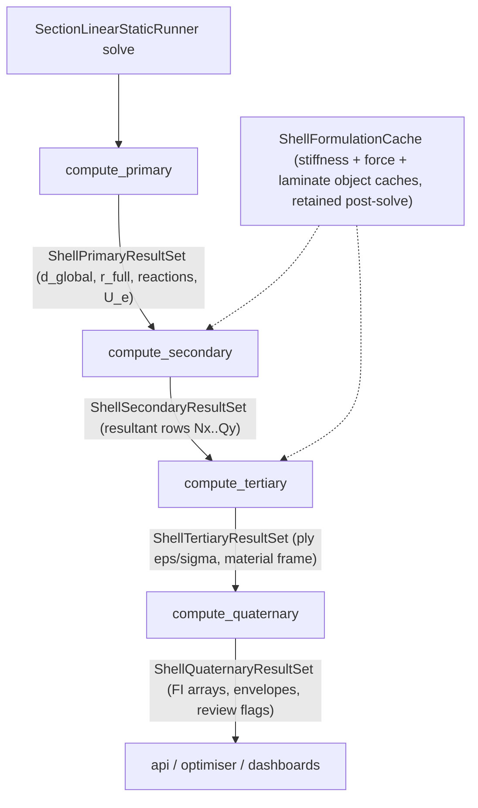

# Processing architecture proposal — four-tier results pipeline

**Status:** Phases 1–4 (four-tier split) implemented — `compute_quaternary/` exists with `compute_hashin_fi.py`, `compute_governing_element.py`, `quaternary_results_orchestrator.py`. **Phase 6 (quaternary scope tightening) implemented**: `ShellHashinFiResult` (`in_plane` + `interlaminar`) added to `container_hopper.py`; `compute_interlaminar_fi.py` removed, folded into `compute_hashin_fi.py`; new `compute_von_mises_fi.py`; `api/fi_recovery.von_mises_fi_from_row` facade added and wired into `section_optimisation/engine/shell_fi_eval.py`, replacing its inline call.  
**Last updated:** 2026-07-08

This document proposes restructuring `section_shell_model/processing/static/results/` from the current three-tier taxonomy (primary / secondary / tertiary) into a strict four-tier chain where each tier consumes only the result containers of the tier above it:

1. **`compute_primary`** — home of the primary FEM solve outputs (displacements, reactions, residuals).
2. **`compute_secondary`** — consumes primary result containers; computes shell element stress resultants.
3. **`compute_tertiary`** — consumes secondary result containers; home of CLT recovery at the material frame (ply mid-surface strains/stresses).
4. **`compute_quaternary`** — consumes tertiary result containers; **strictly hosts two failure criteria: Hashin FI (in-plane + transverse-shear/interlaminar mode) and Von Mises FI** — see [Phase 6](#phase-6--quaternary-scope-tightening-hashin--von-mises-only-new).

It is the post-solve companion to [PRE_PROCESSING_ARCHITECTURE_PROPOSAL.md](PRE_PROCESSING_ARCHITECTURE_PROPOSAL.md).

**Related docs**

| Doc | Role |
|-----|------|
| [PRE_PROCESSING_ARCHITECTURE_PROPOSAL.md](PRE_PROCESSING_ARCHITECTURE_PROPOSAL.md) | Pre-solve package proposal (containers, mesh, loading, diagnostics, CCX/HSDT quarantine, FSDT registry) |
| [FEM_ARCHITECTURE_1DFEM_ALIGNMENT.md](FEM_ARCHITECTURE_1DFEM_ALIGNMENT.md) | Layer-by-layer evaluation against 1d-fem's computational philosophy |
| [processing/static/results/RESULTS_DESIGN.md](../processing/static/results/RESULTS_DESIGN.md) | Current three-tier taxonomy — superseded by this proposal once accepted |
| [ELEMENT_AGNOSTIC_ARCHITECTURE.md](ELEMENT_AGNOSTIC_ARCHITECTURE.md) | 1d-fem concept mapping |
| [SHELL_MODEL.md](SHELL_MODEL.md) | Handoff contract and conceptual layer table |
| [docs/architecture/DEPRECATION_REGISTER.md](../../../docs/architecture/DEPRECATION_REGISTER.md) | Shim and removal policy |

---

## Motivation

The current three tiers do not have clean consumption boundaries:

| Tier | Current behaviour | Problem |
|------|-------------------|---------|
| `compute_primary` | `ShellPrimaryResultsOrchestrator` computes reactions, residual, `r_full` from `K, f, d_global, fixed` | Correct home already — no change to responsibilities |
| `compute_secondary` | `compute_secondary_from_cache(cache, U_e, ...)` recovers resultant rows | Consumes a **raw `U_e` list**, not the `ShellPrimaryResultSet` container that already carries `U_e` in `ShellElementalResults` |
| `compute_tertiary` | `compute_tertiary_hashin(rows, lam)` wraps `api/fi_recovery.hashin_fi_per_ply_from_rows_batch` | **Fuses two engineering steps in one call**: CLT recovery (ABD solve → ply mid stresses) *and* Hashin FI evaluation. Ply-level stress/strain in the material frame — the natural intermediate product — is never exposed as a result container |

The fused tertiary step means:

- Ply-level material-frame stresses (the input to *any* failure criterion) cannot be inspected, dumped, or reused without re-running the full FI path.
- Adding a second failure criterion (Puck, LaRC, max-stress) requires duplicating the CLT solve rather than consuming a shared ply-stress container.
- Interlaminar FI (`interlaminar_fi_from_row`) reaches back to secondary resultants (`Qx`, `Qy`) directly, bypassing tier ordering entirely.

Splitting CLT recovery (tier 3) from failure-index evaluation (tier 4) gives each engineering stage a container contract, mirrors how the physics actually layers (equilibrium → resultants → ply stress state → criteria), and makes the FI layer a pure consumer that can host multiple criteria and envelope statistics.

---

## Proposed tier contract

Each tier consumes **only** the result set of the tier above, plus exactly one static side input: the **`ShellFormulationCache`**, which is the single post-solve source of formulation objects (see the cache contract below). No tier takes ad-hoc lists or side-channel laminate arguments.



| Tier | Package | Consumes | Produces | Engineering meaning |
|------|---------|----------|----------|---------------------|
| 1 | `compute_primary` | Solve state (`K`, `f`, `d_global`, `fixed`) | `ShellPrimaryResultSet` | Equilibrium / kinematics: `d_global`, `r_full`, support reactions, element `U_e` |
| 2 | `compute_secondary` | `ShellPrimaryResultSet` + cache (`stiffness_objects`, ABD stacks) | `ShellSecondaryResultSet` | Shell element stress resultants (`Nx, Ny, Nxy, Mx, My, Mxy, Qx, Qy`) per element |
| 3 | `compute_tertiary` | `ShellSecondaryResultSet` + cache (`panel_laminates`) | `ShellTertiaryResultSet` | CLT recovery at the material frame: `eps0`/`kappa` per element, per-ply mid-surface strains/stresses in laminate axes, rotated to ply material axes |
| 4 | `compute_quaternary` | `ShellTertiaryResultSet` + cache (`panel_laminates` for strength vectors) | `ShellQuaternaryResultSet` | **Strictly two failure criteria** — Hashin FI (in-plane + transverse-shear/interlaminar mode) and Von Mises FI — plus governing-element selection, needs-review flags, envelope statistics |

---

## `ShellFormulationCache` contract (post-solve availability)

The formulation cache is the durable per-solve record of element formulation objects. It must contain **three object caches**, all of which remain available after the global solve:

| Object cache | Field | Status today | Contents |
|--------------|-------|--------------|----------|
| Element stiffness matrix objects | `stiffness_objects: list[ShellStiffnessObject]` | **exists** | `K_e`, gauss-point data, `global_dof_indices`, `panel_index`, `local_element_index` |
| Element force vector objects | `force_objects: list[ShellForceObject]` | **exists** | `F_e`, gauss-point data, `global_dof_indices`, `panel_index`, `local_element_index` |
| Laminate objects | `panel_laminates: list[LaminateDefinition]` | **NEW** — only derived `panel_abd_stacks` (ABD matrix + thickness tuple) exist today | Full per-panel `LaminateDefinition`: plies, `Q_bar`, ply depths, strength properties |

Notes on the current state and the gap:

- `SectionLinearStaticRunner` already retains `self.cache` for the whole solve lifecycle and threads it into `SectionLinearStaticResult` (`section_linear_static.py`), so post-solve availability of the stiffness and force object caches is already satisfied structurally.
- The laminate information is currently **lossy**: `element_library/formulation_factory.py` builds the cache with only `panel_abd_stacks` (the collapsed `(ABD, thickness, ...)` tuples). Tier 3 CLT recovery and tier 4 strength vectors need the full laminate object (`Q_bar` per ply, ply depths, `Xt/Xc/Yt/Yc/S12`), which is why today's `compute_tertiary_hashin` must take `lam` as a side argument.
- **Proposed change:** `build_formulation_cache` (and the `global_shell_assembly` builder path) populates `panel_laminates` indexed by `panel_index`, alongside the existing `panel_abd_stacks`. `panel_abd_stacks` stays as the fast path for tier 2 (resultant recovery needs only ABD + thickness); tiers 3 and 4 resolve laminates via `cache.panel_laminates[row.panel_index]`.

This makes the cache the single side input for every results tier and removes all laminate side-channel arguments from the tier orchestrators.

---

## Proposed package structure

```text
processing/
├── operations/                      # unchanged — stage ops
├── diagnostics/                     # per PRE_PROCESSING_ARCHITECTURE_PROPOSAL.md
└── results/
    ├── RESULTS_DESIGN.md            # updated to four tiers
    ├── containers/
    │   ├── container_hopper.py      # result-set dataclasses (all four tiers)
    │   ├── global_results.py        # unchanged
    │   ├── elemental_results.py     # unchanged
    │   ├── ply_results.py           # NEW — ply-resolution containers (tier 3 payload)
    │   ├── nodal_results.py         # unchanged (planned)
    │   ├── gaussian_results.py      # unchanged (planned)
    │   └── map_results.py           # unchanged
    ├── compute_primary/             # unchanged responsibilities
    │   ├── primary_results_orchestrator.py
    │   ├── compute_reaction_force.py
    │   └── compute_residual.py
    ├── compute_secondary/
    │   └── secondary_results_orchestrator.py   # signature change: consumes ShellPrimaryResultSet
    ├── compute_tertiary/
    │   ├── tertiary_results_orchestrator.py    # REWORKED — CLT recovery only
    │   ├── compute_clt_strains.py              # NEW — batched ABD solve (eps0, kappa)
    │   └── compute_ply_stresses.py             # NEW — ply mid stresses, material-frame rotation
    └── compute_quaternary/                     # exists; scope tightened in Phase 6
        ├── quaternary_results_orchestrator.py  # FI aggregation + envelopes (two criteria only)
        ├── compute_hashin_fi.py                # in-plane Hashin + transverse-shear/interlaminar mode (absorbs compute_interlaminar_fi.py)
        ├── compute_von_mises_fi.py             # NEW (Phase 6) — isotropic Von Mises FI
        └── compute_governing_element.py        # envelope / governing selection (unchanged — not a criterion)
```

**Removed in Phase 6:** `compute_interlaminar_fi.py` — its transverse-shear/delamination check becomes a mode of `compute_hashin_fi.py` rather than a standalone computer (per-mode breakdown preserved on `ShellQuaternaryResultSet` so optimiser KS aggregation is numerically unchanged).

---

## Tier-by-tier changes

### Tier 1 — `compute_primary` (no responsibility change)

`ShellPrimaryResultsOrchestrator`, `ComputeReactionForce`, and `ComputeResidual` stay as-is. One consolidation: the runner currently assembles `ShellPrimaryResultSet.elemental_results` (element `U_e` via `processing/static/operations/disassemble_field.py`) alongside the orchestrator output. The orchestrator should own populating the full `ShellPrimaryResultSet` (global + elemental) so tier 2 has a single authoritative input container.

| Item | Change |
|------|--------|
| `primary_results_orchestrator.py` | Return `ShellPrimaryResultSet` (not bare `PrimaryShellResults`) with `global_results` and `elemental_results` populated |
| `SectionLinearStaticRunner.compute_primary_results()` | Delegates container assembly to the orchestrator; keeps its public return type |

### Tier 2 — `compute_secondary` (input contract change)

`compute_secondary_from_cache(cache, U_e, ...)` becomes a container-driven, class-style orchestrator matching `ShellPrimaryResultsOrchestrator`, instantiated by the runner (see the runner orchestration section):

```python
class ShellSecondaryResultsOrchestrator:
    def __init__(
        self,
        *,
        primary: ShellPrimaryResultSet,
        cache: ShellFormulationCache,
        L_x: float = 1.0,
        theory: str | None = None,
        panel_meta: list[dict[str, Any]] | None = None,
    ) -> None: ...

    def compute(self) -> ShellSecondaryResultSet:
        U_e = self.primary.elemental_results.U_e
        ...
```

Recovery internals (kernel `recover_resultants`, provenance stamping, `ShellPanelResultants` rows) are unchanged. `compute_secondary_from_cache` remains as a thin shim for one deprecation cycle.

### Tier 3 — `compute_tertiary` (reworked: CLT recovery at the material frame)

Tertiary stops computing failure indices. It becomes the home of the CLT recovery currently buried inside `api/fi_recovery.hashin_fi_per_ply_from_rows_batch` (lines that solve `ABD · [eps0; kappa] = [N; M]` and call `ply_mid_stresses_laminate`), built on the existing primitives in `blade_precompute/materials/clpt_recovery.py`. Laminate objects are resolved from the formulation cache (`cache.panel_laminates[row.panel_index]`), not passed as side arguments:

| Step | Module | Existing primitive reused |
|------|--------|---------------------------|
| Batched ABD solve per trusted element row → `eps0`, `kappa` | `compute_clt_strains.py` | `laminate_midstrains_curvatures` (batched via `np.linalg.solve` as in `fi_recovery` today) |
| Ply mid-surface strains/stresses, laminate axes | `compute_ply_stresses.py` | `ply_mid_stresses_laminate`, `ply_mid_strains_laminate` |
| Rotation laminate frame → ply material frame | `compute_ply_stresses.py` | `rotate_plies_to_material` (`materials/clpt_recovery.py`) |
| Provenance gating (only trusted resultant rows enter CLT) | orchestrator | `clpt_inputs_trusted` (moves from `api/fi_recovery.py`) |

The redefined tertiary container carries the ply stress state plus the pass-through fields tier 4 needs, so quaternary never reaches back to tier 2:

```python
@dataclass
class ShellPlyResults:                      # containers/ply_results.py (NEW)
    eps0: np.ndarray                        # (n_elem, 3) mid-surface strains
    kappa: np.ndarray                       # (n_elem, 3) curvatures
    eps_ply_mat: np.ndarray                 # (n_elem, n_ply, 3) material-frame strains
    sig_ply_mat: np.ndarray                 # (n_elem, n_ply, 3) material-frame stresses
    trusted_mask: np.ndarray                # (n_elem,) provenance-trusted rows

@dataclass
class ShellTertiaryResultSet:               # redefined in container_hopper.py
    ply_results: ShellPlyResults | None = None
    transverse_shear: np.ndarray | None = None   # (n_elem, 2) Qx, Qy carried forward
    thickness_m: np.ndarray | None = None        # (n_elem,) for interlaminar peak stress
    element_index: np.ndarray | None = None      # panel/element identity for envelopes
    meta: dict[str, object] = field(default_factory=dict)
```

Carrying `Qx/Qy` and thickness forward is deliberate: interlaminar FI currently consumes secondary resultants directly (`interlaminar_fi_from_row`), which would otherwise break the strict tier-(n) → tier-(n+1) rule. A later refinement can replace the pass-through with a true per-ply transverse shear stress recovery (parabolic profile) inside tier 3 — see open questions.

### Tier 4 — `compute_quaternary` (implemented; scope tightened to Hashin + Von Mises in Phase 6)

Pure consumer of `ShellTertiaryResultSet`. **Strictly hosts two failure criteria** — no other criterion has a home here:

| Computer | Source (today) | Notes |
|----------|----------------|-------|
| `compute_hashin_fi.py` | FI-evaluation half of `api/fi_recovery.hashin_fi_per_ply_from_rows_batch`, **plus** the transverse-shear/interlaminar mode absorbed from `compute_interlaminar_fi.py` (Phase 6) | Calls `materials/failure_criteria.hashin_fi` on `sig_ply_mat` for the in-plane mode; strength vectors via `_ply_strength_vectors_from_lam`, resolved from `cache.panel_laminates`. The interlaminar mode reuses the parabolic-peak-shear formula previously in `compute_interlaminar_fi.py` unchanged — same `Qx/Qy` + thickness inputs, same peak factor — now exposed as `ShellHashinFiResult.interlaminar` alongside `.in_plane` rather than a separate quaternary field |
| `compute_von_mises_fi.py` *(NEW, Phase 6)* | Ad-hoc inline `von_mises_plane_stress_fi` call in `section_optimisation/engine/shell_fi_eval.py` | Wraps `materials.failure_criteria.von_mises_plane_stress_fi`; consumes tier-3 `sig_ply_mat` (or an isotropic-equivalent stress state for isotropic skins) + an allowable stress; becomes the canonical home for Von Mises FI instead of the inline optimiser call |
| `compute_governing_element.py` | `api/fi_recovery.select_governing_hashin_element`, `max_hashin_fi_from_bundle` | Governing panel × element × ply selection, provenance audit, `needs_review` aggregation across **both** criteria — not a criterion itself, stays as-is |

**Explicitly out of scope for quaternary (moved elsewhere):** HSDT-flavoured tapered interlaminar (`use_hsdt_interlaminar`) is quarantined with HSDT (see [PRE_PROCESSING_ARCHITECTURE_PROPOSAL.md](PRE_PROCESSING_ARCHITECTURE_PROPOSAL.md) Phase 8) rather than living in quaternary — interlaminar evaluation here is theory-independent (works from `Qx/Qy` + thickness regardless of FSDT vs HSDT origin), so the HSDT-specific flag chain has no reason to persist once the interlaminar mode is a plain Hashin computer input.

Container (per-mode breakdown preserved so the optimiser's KS aggregation is numerically unchanged by the Phase 6 fold):

```python
@dataclass
class ShellHashinFiResult:                  # NEW in container_hopper.py (Phase 6)
    in_plane: np.ndarray | None = None       # (n_elem, n_ply) — fibre/matrix tension/compression modes
    interlaminar: np.ndarray | None = None   # (n_elem,) — transverse-shear/delamination mode (absorbed from compute_interlaminar_fi.py)

@dataclass
class ShellQuaternaryResultSet:             # container_hopper.py — scope-tightened in Phase 6
    hashin_fi: ShellHashinFiResult | None = None      # replaces the old bare hashin_fi + interlaminar_fi arrays
    von_mises_fi: np.ndarray | None = None            # NEW (n_elem, n_ply) or (n_elem,) for isotropic skins
    governing: dict[str, object] = field(default_factory=dict)
    needs_review: np.ndarray | None = None  # (n_elem,) bool
    meta: dict[str, object] = field(default_factory=dict)
```

`ShellQuaternaryResultSet.hashin_fi` (bare `np.ndarray`, in-plane only) and `.interlaminar_fi` fields as they exist today become deprecated `@property` shims returning `.hashin_fi.in_plane` / `.hashin_fi.interlaminar` for one deprecation cycle, then are removed. `compute_tertiary_hashin` remains a shim chaining tier 3 → tier 4 as before.

**No other criteria are added here.** Any future criterion (Puck, LaRC, max-strain) is explicitly out of scope for `compute_quaternary` per this tightened proposal — a new tier or a differently-scoped extension point would be needed, not a third computer in this package.

---

## Runner orchestration (`SectionLinearStaticRunner`)

`SectionLinearStaticRunner` (`simulation_runner/section_linear_static_runner.py`) is the analogue of the 1d-fem `LinearStaticSimulationRunner` (`1d-fem/simulation_runner/static/linear_static_simulation.py`), and it is the **sole orchestrator of every `processing/` class** — stage operations and results tiers alike. The runner owns the element formulation caches for the whole solve lifecycle and constructs them into the instantiations of the operations / results classes; no processing class fetches its own inputs.

### 1d-fem reference structure

The 1d-fem runner establishes the exact conventions this proposal adopts:

| 1d-fem convention | Detail | `SectionLinearStaticRunner` status |
|-------------------|--------|-------------------------------------|
| Cache built in constructor | `__init__` constructs `FormulationResultSet(element_objects=..., force_objects=...)` from the element/force object lists, validates it, and retains it as `self.formulation_cache` for the whole lifecycle | Partial — `from_cache()` receives a pre-built `ShellFormulationCache`; validation happens upstream in `formulation_factory` |
| Result containers initialised empty, populated by stages | `__init__` creates empty `PrimaryResultSet` / `SecondaryResultSet` / `IndexMapSet`; each stage method writes into them (e.g. `assemble_global_system` caches `K_global`/`F_global` into `primary_results_set.global_results` and `assembly_map` into `self.maps`) | Equivalent — `self.index_maps` populated per stage; primary set built in `compute_primary_results()` |
| Numbered stage methods instantiating operation classes | `prepare_local_system` (0) → `assemble_global_system` (1) → `modify_global_system` (2) → `condense_modified_system` (3) → `solve_condensed_system` (4) → `reconstruct_global_system` (5); each instantiates its operation class with injected state and caches outputs to `self` + containers | Equivalent — prepare / assemble / constrain / reduce / solve / reconstruct |
| Results tiers as numbered runner methods | `compute_primary_results()` (6), `compute_secondary_results()` (7), `compute_tertiary_results()` (8) | Only tier 1 exists — **this proposal adds tiers 2–4** |
| Tier-(n) + cache injection | `compute_secondary_results()` passes `U_global` **and** `self.formulation_cache`; `compute_tertiary_results()` passes `self.secondary_results_set` **and** `self.formulation_cache` | The precedent for every tier receiving the upstream result set plus the cache |
| Two-level flow API | `solve_linear_system_only()` runs stages 0–5 only (buckling prestress reuse); `run()` executes solve → primary → save formulation cache → secondary → tertiary | `solve_linear_system_only()` exists; `solve()` stops at primary — **this proposal extends the full-depth flow** |

1d-fem features **not** adopted in this pass: per-tier `Save*` persistence classes and results directories (`primary_results/`, `secondary_results/`, ...), `RuntimeMonitorTelemetry` stage timing, and `DiagnoseLinearStaticSystem` checkpoints between stages. These are candidates for `processing/diagnostics` per [PRE_PROCESSING_ARCHITECTURE_PROPOSAL.md](PRE_PROCESSING_ARCHITECTURE_PROPOSAL.md); the section runner is invoked per-station inside tight orchestration loops (`shell_runtime.py`), so disk persistence per solve is not wanted by default.

### Existing wiring (stage operations and tier 1)

This pattern is already in place for the stage operations and tier 1:

| Runner method | Processing class instantiated | Cache / state injected |
|---------------|-------------------------------|------------------------|
| `prepare_local_system()` | `PrepareLocalShellSystem().run(self.cache)` | formulation cache |
| `assemble_global_system()` | `AssembleGlobalShellSystem().run(self.cache, self.n_gdof)` | formulation cache |
| `constrain_global_system()` | `ConstrainGlobalShellSystem().run(...)` | constraints, fixed set |
| `reduce_constrained_system()` | `ReduceConstrainedShellSystem().run(self.global_sys, self.constrained, ...)` | assembled + constrained state |
| `solve_reduced_system()` | `SolveReducedShellSystem(self.reduced, factor=self.factor)` | reduced system, reusable factor |
| `reconstruct_global_field()` | `ReconstructGlobalShellField().run(self.reduced, self.solved, ...)` | solved state |
| `compute_primary_results()` | `ShellPrimaryResultsOrchestrator(K=..., f=..., d_global=..., fixed=...)` + `DisassembleGlobalShellField().run(self.cache, ...)` | global system, field, formulation cache |

### Proposed extension (tiers 2–4)

The proposal extends the same pattern to tiers 2–4, mirroring the 1d-fem method sequence (`compute_primary_results` → `compute_secondary_results` → `compute_tertiary_results`, extended by one tier). The runner gains one method per tier, each instantiating that tier's orchestrator with `self.cache` plus the result set held on the runner from the tier above — exactly as the 1d-fem `compute_tertiary_results()` passes `self.secondary_results_set` + `self.formulation_cache`:

```python
def compute_secondary_results(self) -> ShellSecondaryResultSet:
    if self.primary_results is None or self.cache is None:
        raise RuntimeError("compute_secondary_results requires primary_results + cache")
    self.secondary_results = ShellSecondaryResultsOrchestrator(
        primary=self.primary_results, cache=self.cache,
    ).compute()
    return self.secondary_results

def compute_tertiary_results(self) -> ShellTertiaryResultSet:
    if self.secondary_results is None or self.cache is None:
        raise RuntimeError("compute_tertiary_results requires secondary_results + cache")
    self.tertiary_results = ShellTertiaryResultsOrchestrator(
        secondary=self.secondary_results, cache=self.cache,   # laminates via cache.panel_laminates
    ).compute()
    return self.tertiary_results

def compute_quaternary_results(self) -> ShellQuaternaryResultSet:
    if self.tertiary_results is None or self.cache is None:
        raise RuntimeError("compute_quaternary_results requires tertiary_results + cache")
    self.quaternary_results = ShellQuaternaryResultsOrchestrator(
        tertiary=self.tertiary_results, cache=self.cache,     # strength vectors via cache.panel_laminates
    ).compute()
    return self.quaternary_results
```

Consequences:

- Each tier package exposes a class-style orchestrator (matching `ShellPrimaryResultsOrchestrator`) so the runner instantiation pattern is uniform; the function entry points (`compute_secondary_from_primary`, etc.) become thin wrappers or are absorbed into the orchestrator classes.
- Runner state gains `secondary_results`, `tertiary_results`, `quaternary_results` attributes alongside the existing `primary_results`, and `SectionLinearStaticResult` gains the corresponding optional fields (populated only when the deeper tiers are requested).
- `solve()` continues to run through tier 1 only by default (unchanged production behaviour); tiers 2–4 are invoked on demand by `api/` facades, the optimiser path, or an opt-in full-depth entry point analogous to the 1d-fem split between `solve_linear_system_only()` (stages only) and `run()` (solve + all tiers) — matching today's opt-in status of secondary/tertiary in the RESULTS_DESIGN wired-computers table.
- Because the runner retains `self.cache` (all three object caches, including `panel_laminates` after Phase 1) and every tier result set, any tier can be recomputed post-solve without re-assembly — e.g. re-running quaternary with different strength assumptions reuses the retained tertiary container.

---

## `api/fi_recovery.py` decomposition

`api/fi_recovery.py` remains the stable public surface (external consumer: `section_optimisation/engine/shell_fi_eval.py`) but becomes a thin facade over tiers 3 + 4:

| Function | Disposition |
|----------|-------------|
| `hashin_fi_per_ply_from_rows_batch` | Facade: tier 3 CLT orchestrator → tier 4 Hashin computer; signature and return `(fi_out, needs_review)` unchanged |
| `hashin_fi_per_ply_from_row`, `hashin_fi_from_row` | Facade over the same tier 3 → tier 4 path (single-row) |
| `interlaminar_fi_from_row` | **(Phase 6)** Facade over `compute_quaternary/compute_hashin_fi.py`'s interlaminar mode — no longer a separate computer, same public signature/return |
| `von_mises_fi_from_row` *(NEW, Phase 6)* | Facade over `compute_quaternary/compute_von_mises_fi.py`, replacing the inline `von_mises_plane_stress_fi` call in `section_optimisation/engine/shell_fi_eval.py` |
| `clpt_inputs_trusted`, `interlaminar_inputs_trusted`, `resultant_field_trusted` | Move to tier 3 provenance gating (re-exported from `api` for compatibility) |
| `_ply_strength_vectors_from_lam` | Moves to `compute_quaternary` |
| `select_governing_hashin_element`, `max_hashin_fi_from_bundle` | Facade over `compute_quaternary/compute_governing_element.py`; governing selection now considers both Hashin and Von Mises FI arrays |
| `compare_path_resultants`, `section_integrals_from_bundle`, `PathCompareStats` | Stay in `api/fi_recovery.py` (path-comparison diagnostics, not tiered results) — candidate for `processing/static/diagnostics/` per the pre-processing proposal |

No behaviour change for `section_optimisation` or dashboard consumers on the Hashin/interlaminar path: identical numerics, identical signatures. Von Mises evaluation callers (`section_optimisation/engine/shell_fi_eval.py`) migrate their inline `von_mises_plane_stress_fi` call to `von_mises_fi_from_row` — numerics unchanged (same underlying `materials.failure_criteria.von_mises_plane_stress_fi`), call site changes from inline to facade.

---

## Container summary

| Container | Status | Contents |
|-----------|--------|----------|
| `ShellPrimaryResultSet` | unchanged shape | `global_results` (`d_global`, `r_full`, reactions), `elemental_results` (`U_e`, residual norms) |
| `ShellSecondaryResultSet` | unchanged shape | `elemental_results.resultant_rows` (`ShellPanelResultants`) |
| `ShellTertiaryResultSet` | **redefined** | `ply_results` (material-frame ply strains/stresses), carried-forward `Qx/Qy` + thickness, trusted mask |
| `ShellQuaternaryResultSet` | exists; **scope-tightened in Phase 6** | `hashin_fi` (`ShellHashinFiResult`: `in_plane` + `interlaminar` modes), `von_mises_fi` *(new)*, governing element, `needs_review`, meta — strictly these two criteria, no others |
| `ShellHashinFiResult` | **new** (Phase 6, `container_hopper.py`) | Per-mode Hashin breakdown (`in_plane`, `interlaminar`) — absorbs the standalone `interlaminar_fi` array |
| `ShellPlyResults` | **new** (`containers/ply_results.py`) | Ply-resolution payload — adds a "ply" resolution alongside global / elemental / nodal / gaussian |
| `ShellIndexMapSet` | unchanged | DOF provenance maps |

The resolutions table in [RESULTS_DESIGN.md](../processing/static/results/RESULTS_DESIGN.md) gains a **Ply** row (tier 3/4 native resolution) and a **Quaternary** column.

---

## Migration strategy

Phased, one-deprecation-cycle shims, consistent with [DEPRECATION_REGISTER.md](../../../docs/architecture/DEPRECATION_REGISTER.md) policy.

### Phase 1 — Containers and formulation cache

1. Add `panel_laminates: list[LaminateDefinition]` to `ShellFormulationCache` (`core/formulation_objects.py`); populate it in `element_library/formulation_factory.py` (`build_formulation_cache`) and the `engine/global_shell_assembly.py` builder path, alongside the existing `panel_abd_stacks`.
2. Add `containers/ply_results.py` (`ShellPlyResults`).
3. Add `ShellQuaternaryResultSet` to `container_hopper.py`; redefine `ShellTertiaryResultSet` (old FI fields deprecated with property shims emitting warnings).
4. Update `processing/static/results/__init__.py` exports.

### Phase 2 — Tier 3 rework

1. Extract CLT recovery from `api/fi_recovery.hashin_fi_per_ply_from_rows_batch` into `compute_tertiary/compute_clt_strains.py` and `compute_tertiary/compute_ply_stresses.py`.
2. Move provenance gating helpers (`clpt_inputs_trusted` etc.) into tier 3; re-export from `api/fi_recovery.py`.
3. New `tertiary_results_orchestrator.py` producing the redefined `ShellTertiaryResultSet`, resolving laminates from `cache.panel_laminates`.
4. Regression: material-frame ply stresses must reproduce the intermediate values of the current fused path bit-for-bit (same `np.linalg.solve` batching).

### Phase 3 — Tier 4 creation

1. Create `compute_quaternary/` with Hashin, interlaminar, and governing-element computers consuming `ShellTertiaryResultSet`.
2. Rewire `api/fi_recovery.py` public functions as facades over tier 3 → tier 4; keep signatures and `(fi, needs_review)` contracts identical.
3. `compute_tertiary_hashin` becomes a chaining shim with a deprecation row.
4. Regression: `fi_out` / `needs_review` arrays identical to pre-refactor for the existing test matrix (including `test_tapered_interlaminar_fi.py`) and `section_optimisation/engine/shell_fi_eval.py` outputs.

### Phase 4 — Tier 1/2 contract tightening and runner wiring

1. `ShellPrimaryResultsOrchestrator` returns a fully populated `ShellPrimaryResultSet`; runner delegates.
2. Add `ShellSecondaryResultsOrchestrator` (container-driven); `compute_secondary_from_cache` becomes a shim.
3. Add `compute_secondary_results()`, `compute_tertiary_results()`, `compute_quaternary_results()` to `SectionLinearStaticRunner`, each instantiating its tier orchestrator with `self.cache` + the retained upstream result set (see runner orchestration section).
4. Extend `SectionLinearStaticResult` with optional `secondary_results` / `tertiary_results` / `quaternary_results` fields.

### Phase 5 — Docs and shim removal

1. Update [RESULTS_DESIGN.md](../processing/static/results/RESULTS_DESIGN.md) to the four-tier × five-resolution taxonomy; update wired-computers and register tables.
2. Deprecation rows in [DEPRECATION_REGISTER.md](../../../docs/architecture/DEPRECATION_REGISTER.md) for `compute_tertiary_hashin`, `compute_secondary_from_cache`, and old `ShellTertiaryResultSet` fields.
3. Remove shims next release cycle after zero-inbound-reference grep + CI.

### Phase 6 — Quaternary scope tightening: Hashin + Von Mises only (new)

1. Add `ShellHashinFiResult` (`in_plane`, `interlaminar`) to `container_hopper.py`; redefine `ShellQuaternaryResultSet.hashin_fi` to hold it instead of a bare array, and add `von_mises_fi`.
2. Fold `compute_interlaminar_fi.py`'s parabolic-peak-shear logic into `compute_hashin_fi.py` as its transverse-shear/interlaminar mode; keep the formula and inputs (`Qx/Qy`, thickness) byte-for-byte identical — this is a relocation, not a reformulation.
3. Delete `compute_interlaminar_fi.py`; add a deprecation row.
4. Add `compute_von_mises_fi.py` wrapping `materials/failure_criteria.von_mises_plane_stress_fi`, consuming tier-3 `sig_ply_mat` (or the isotropic-equivalent stress state for isotropic skins/spar caps).
5. Update `quaternary_results_orchestrator.py` to call both computers and assemble the tightened `ShellQuaternaryResultSet`; governing-element selection (`compute_governing_element.py`) considers both FI arrays when selecting the worst-case panel/element/ply.
6. Add deprecated `@property` shims on `ShellQuaternaryResultSet` for the old bare `hashin_fi: np.ndarray` and `interlaminar_fi: np.ndarray` field names, returning `.hashin_fi.in_plane` / `.hashin_fi.interlaminar` respectively, for one deprecation cycle.
7. Migrate `section_optimisation/engine/shell_fi_eval.py`'s inline `von_mises_plane_stress_fi` call to the new `compute_von_mises_fi.py` / `api/fi_recovery.von_mises_fi_from_row` facade.
8. Deprecate and earmark for deletion the `use_hsdt_interlaminar` flag chain in orchestration and the optimiser (coordinated with [PRE_PROCESSING_ARCHITECTURE_PROPOSAL.md](PRE_PROCESSING_ARCHITECTURE_PROPOSAL.md) Phase 8) — interlaminar evaluation is now theory-independent, so the HSDT-specific gate has no remaining purpose.
9. Regression: `hashin_fi.in_plane` and `hashin_fi.interlaminar` arrays bit-identical to the pre-fold `hashin_fi` / `interlaminar_fi` arrays; new `von_mises_fi` array matches today's inline optimiser computation bit-for-bit.
10. Register deprecation rows for `compute_interlaminar_fi.py`, the old bare `ShellQuaternaryResultSet` field names, and the `use_hsdt_interlaminar` chain in [DEPRECATION_REGISTER.md](../../../docs/architecture/DEPRECATION_REGISTER.md).

---

## Risks and mitigations

| Risk | Impact | Mitigation |
|------|--------|------------|
| Numerical drift in split CLT → FI path | Optimiser constraint values shift | Phase 2/3 regression asserts bit-identical `fi_out` vs fused path; keep identical batched `np.linalg.solve` ordering |
| `section_optimisation/engine/shell_fi_eval.py` breakage | Optimiser FI evaluation fails | `api/fi_recovery.py` signatures frozen; facade-only change; run optimisation smoke tests per phase |
| Interlaminar tier violation re-introduced | Quaternary reaching back to secondary rows | Tertiary container carries `Qx/Qy` + thickness forward; import-boundary test forbids `compute_quaternary` → `compute_secondary` imports |
| Container redefinition breaks pickled/dumped results | Stale dumps unreadable | Old tertiary fields kept as deprecated properties for one cycle; dump schema version bump |
| Doc drift | RESULTS_DESIGN contradicts code | Phase 5 updates in same PR as shim removal |
| Optimiser KS aggregation shifts after the interlaminar fold | Constraint values change silently if the per-mode breakdown is lost | `ShellHashinFiResult` keeps `in_plane` and `interlaminar` as separate arrays; the optimiser's KS-aggregation call sites are updated to read both fields explicitly, not a single flattened array |
| Von Mises facade migration breaks optimiser | `shell_fi_eval.py` inline call site removed incorrectly | Phase 6 step 7 regression-tests bit-identical output between the old inline call and the new facade before removing the inline code |

---

## Non-goals

- **No numerics changes** — CLT solve, Hashin criterion, interlaminar peak-factor formula, and Von Mises formula are moved/wrapped, not modified.
- **No runner restructure** — `SectionLinearStaticRunner` stage sequence and default `solve()` behaviour unchanged; the change is additive (three new opt-in `compute_*_results()` methods and the container assembly moving inside `ShellPrimaryResultsOrchestrator`).
- **No production-recovery rewiring** — the inline dashboard recovery paths listed in the RESULTS_DESIGN unwired-computer register are out of scope (tracked separately).
- **No new failure criteria beyond Hashin and Von Mises** — Phase 6 deliberately narrows quaternary's scope rather than widening it; Puck/LaRC/max-strain remain explicitly out of scope, not "future sibling computers" as an earlier draft of this section implied.
- **No HSDT-specific interlaminar path retained** — `use_hsdt_interlaminar` is deprecated (Phase 6 step 8), not migrated; the theory-independent Hashin interlaminar mode replaces it functionally.

---

## Acceptance criteria

1. `processing/static/results/compute_quaternary/` exists and hosts **exactly two** criterion computers: `compute_hashin_fi.py` (in-plane + interlaminar modes) and `compute_von_mises_fi.py`. No `compute_interlaminar_fi.py`.
2. `compute_tertiary` produces material-frame ply strain/stress containers and contains no failure-criterion logic.
3. `compute_secondary` public entry consumes `ShellPrimaryResultSet`.
4. `ShellFormulationCache` carries all three object caches (`stiffness_objects`, `force_objects`, `panel_laminates`) and is retained post-global-solve; no tier orchestrator takes laminate side arguments.
5. `SectionLinearStaticRunner` exposes `compute_secondary_results()` / `compute_tertiary_results()` / `compute_quaternary_results()` and is the sole constructor of tier orchestrators, injecting `self.cache` and the retained upstream result sets (mirroring the 1d-fem `LinearStaticSimulationRunner` pattern).
6. Each tier imports only from the tier above (enforced by an import-boundary test).
7. `api/fi_recovery.py` signatures and outputs unchanged for the Hashin/interlaminar path; `von_mises_fi_from_row` added as a new facade; `section_optimisation` tests green.
8. `hashin_fi.in_plane` / `hashin_fi.interlaminar` / `von_mises_fi` regression-identical to the pre-Phase-6 fused/inline paths.
9. [RESULTS_DESIGN.md](../processing/static/results/RESULTS_DESIGN.md) updated to four tiers with the tightened quaternary scope; deprecation rows registered for `compute_interlaminar_fi.py`, old `ShellQuaternaryResultSet` field names, and `use_hsdt_interlaminar`.
10. `use_hsdt_interlaminar` absent from orchestration config, pipeline, and optimiser evaluator signatures.

---

## Open questions

1. ~~**Interlaminar recovery depth**~~ — **Resolved (2026-07-14):** tier 3 composes `InPlaneLaminateRecoveryOperator` + `FSDTInterfaceShearRecoveryOperator` (parabolic, resultant-consistent interface `τ13/τ23`); scalar `Qx/Qy` pass-through remains as quaternary fallback. See `compute_tertiary/recovery_operators.py`.
2. ~~**Ply resolution placement**~~ — **Resolved:** `ShellPlyResults` is a first-class **ply** resolution in the containers taxonomy (owned by tertiary); not a private tertiary-only payload. See [RESULTS_DESIGN.md](../processing/static/results/RESULTS_DESIGN.md).
3. ~~**Sequencing vs pre-processing proposal**~~ — **Resolved:** the four-tier split (Phases 1–4) is already implemented; Phase 6 (quaternary scope tightening) is independent of the `pre_processing/` phase ordering and may land in parallel — see [PRE_PROCESSING_ARCHITECTURE_PROPOSAL.md § Recommended execution order](PRE_PROCESSING_ARCHITECTURE_PROPOSAL.md#recommended-execution-order).
4. ~~**Cache memory footprint**~~ — **Resolved (2026-07-14):** station parallelism uses `ProcessPoolExecutor` (not threads), so cross-worker laminate object identity is impossible. Within one worker / station, orthotropic panels of the same role share a `LaminateDefinition` reference via topology + `ShellFormulationCache.panel_laminates`. The FI pool pickles a full `SectionDefinition` per station task (known overhead).
5. ~~**Von Mises input for anisotropic composite plies**~~ — **Resolved (2026-07-08):** isotropic constituents only (metal spar caps, adhesive layers); composite plies remain Hashin-only. Encoded in `compute_von_mises_fi.py`'s module docstring.

Resolved: laminate definition threading — the formulation cache carries `panel_laminates` (decided above); neither the secondary container nor the tier orchestrators take laminate side arguments.

---

## Summary

| Package | Fate | Responsibility after this proposal |
|---------|------|------------------------------------|
| `compute_primary` | kept | FEM solve outputs: `d_global`, `r_full`, reactions, `U_e` |
| `compute_secondary` | input contract change | Shell element resultants from `ShellPrimaryResultSet` |
| `compute_tertiary` | reworked | CLT recovery at the material frame (ply strains/stresses) from `ShellSecondaryResultSet` |
| `compute_quaternary` | **scope-tightened (Phase 6)** | Strictly Hashin FI (in-plane + interlaminar mode) and Von Mises FI, governing elements, review flags, envelopes from `ShellTertiaryResultSet` — no other criteria |
| `api/fi_recovery.py` | facade | Stable public FI surface delegating to tiers 3 + 4, plus the new `von_mises_fi_from_row` facade |

The result is a strict tier-(n) → tier-(n+1) container chain that matches the physics (equilibrium → resultants → ply stress state → criteria), exposes material-frame ply stresses as a first-class result, and gives the two required failure criteria a single, theory-independent home without re-running CLT or threading HSDT-specific flags through orchestration.
