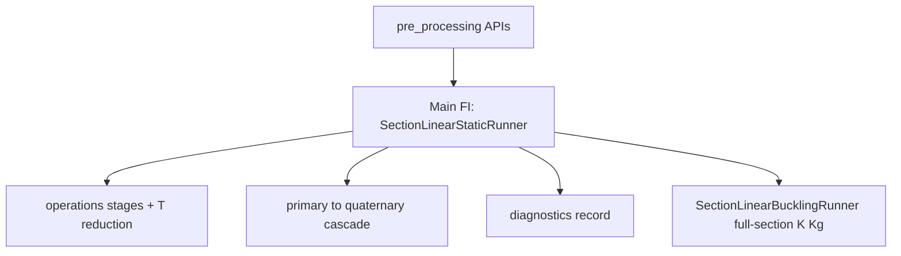

# Shell model design (MVP)

This package implements the **handoff layer** between global/section thin-wall recovery and **local CLPT shell** subcomponent analysis.

**Geometry / constitutive glossary:** [TAXONOMY.md](TAXONOMY.md) — station, section, subcomponent, strip, panel (constitutive region), element; material frame and isotropic vs orthotropic FI routing.

## MITC4 midsurface: `section_geometry` vs `section_shell_model`

**Where each stage belongs**

| Stage | Package | Responsibility |
|-------|---------|----------------|
| Implicit solids (offsets, clips, capsule, unions) | `section_geometry` | SDF subcomponents (`OuterSkin`, `ShearWeb`, `SparCap`, …). |
| Mid-surface locus as explicit polyline | `section_geometry` | `midline_polyline()` in chord frame; geometrically consistent with the SDF recipe (typically not level-set marching of `__call__`). |
| Chord (S) → blade (B) rotation for shell export | `section_geometry.interface.shell_midline_export.rotate_chord_to_blade` | Used when building strips (see plan *Implementation pack*). |
| Neutral strip record (polyline + thickness + role) | `blade_structure_utilities.section_contract.shell_midline_strip` | `ShellMidlineStrip` — **no** `Panel`, laminates, or `n_elements`; FE-agnostic. |
| Strip list from `MultiCellSection` | `section_geometry.interface.shell_midline_export` | `build_shell_midline_strips`; `build_shell_mesh_inputs` wraps strips + LE/TE into `ShellMeshInputs`. |
| `ShellMeshInputs` (strips + LE/TE diagnostics) | `section_shell_model` | `pre_processing/mesh/shell_inputs_from_section.py`. |
| One panel per strip, default laminates | `section_shell_model` | `pre_processing/mesh/topology.py` `build_section_v2` (panel order: **skin → caps → webs** — do not assume `panels[i]` matches raw `midlines[i]`). |
| Arc-length discretisation, quads, junction clustering | `section_shell_model` | `pre_processing/mesh/section_strip_mesh.py` `build_section_strip_mesh`, `processing/static/operations/global_shell_assembly.py` / `calculix_ccx/solve.py` (`n_elements`, `endpoint_tol`, DOFs). |

**Modularity rule:** `section_shell_model` meshes **B-frame polylines**; it should not use raw implicit SDF evaluation as the primary source of strip geometry. Optional later: geometry-neutral **junction/adjacency** hints in the shared contract if endpoint clustering is insufficient.

**Naming:** “Caching” the midline means **materialising the mid-surface locus as a polyline** for the mesh handoff, distinct from SDF **evaluation caches** inside `section_geometry`.

## References

> The former `section_stress_model` package has been retired; its responsibilities moved into this
> package and into `materials`. Links below point to the current owners.

- Section physics and equations: [../README.md](../README.md) (Methodology) — FSDT shell + CLT laminate model.
- Recovery implementation: [`../simulation_runner/api/linear_static.py`](../simulation_runner/api/linear_static.py), [`../simulation_runner/api/station_recovery.py`](../simulation_runner/api/station_recovery.py), [`../processing/static/results/api/fi_recovery.py`](../processing/static/results/api/fi_recovery.py), [`../processing/static/diagnostics/equilibrium_checks.py`](../processing/static/diagnostics/equilibrium_checks.py), and [`../interface/recovery_point_set_builder.py`](../interface/recovery_point_set_builder.py).
- CLPT primitives: [`blade_structure_utilities.section_materials`](../../materials/README.md) — `LaminateDefinition` (ABD) and ply-stress recovery.
- Section solve staged architecture and naming philosophy: [SECTION_SOLVE_STAGES.md](SECTION_SOLVE_STAGES.md) — educational, system-state stage decomposition of the local→global→reduced→recovered pipeline.
- Results tier × resolution taxonomy: [processing/static/results/RESULTS_DESIGN.md](../processing/static/results/RESULTS_DESIGN.md).
- FE geometry / constitutive hierarchy: [TAXONOMY.md](TAXONOMY.md).

## Solve pipeline layering (pre_processing / processing / simulation_runner)

**Layer contract:** `pre_processing` prepares inputs (each domain exposes its
own `*/api/` where needed); `simulation_runner` sequences `processing`
operations and result computers and **records diagnostic information**;
callers compose prep APIs into the runner API. Separation rule: pre_processing
*prepares*; processing *computes*; simulation_runner *sequences and records*.
There is **no** package-level `api/` façade.



| Layer | Location | Owns | Does not own |
|-------|----------|------|----------------|
| **pre_processing** | `containers/`, `element_library/`, `dispatch/`, `mesh/` (+ `mesh/api/`), `loading/` | Runner inputs | Solve orchestration, result tiers, diagnostics emission |
| **simulation_runner** | `section_linear_static_runner.py`, `section_linear_buckling_runner.py`, `api/` (`linear_static`, `linear_buckling`, `station_recovery`) | Orchestration; solve state; diagnostics recording | Element kernels, raw physics, cross-package adapters |
| **processing** | `static/` (ops, P→S→T→Q, diagnostics), `buckling/` (section/`panel` Kg eigen, P→S + fold) | Stage physics and result/diagnostic implementations | Public prep builders |
| **interface** | `interface/` | Cross-package adapters | Nodal force assembly, FE stages |

**Main production FI track:** [`SectionLinearStaticRunner`](../simulation_runner/section_linear_static_runner.py)
via [`simulation_runner/api/linear_static.py`](../simulation_runner/api/linear_static.py) —
`R → f` nodal loads → prepare → assemble → constrain → reduce(`T`) → solve →
**primary → secondary → tertiary → quaternary**. See
[LINEAR_STATIC_MAIN_TRACK_PHASE0.md](LINEAR_STATIC_MAIN_TRACK_PHASE0.md) and
[SECTION_SOLVE_STAGES.md](SECTION_SOLVE_STAGES.md).

**Buckling track (sibling):** [`SectionLinearBucklingRunner`](../simulation_runner/section_linear_buckling_runner.py)
via [`api/linear_buckling.py`](../simulation_runner/api/linear_buckling.py) — prestress from
**static secondary** → default **full-section** `K_r φ = λ (−Kg_r) φ` → P→S →
`ShellStationBucklingBundle`. Optional `eigen_track="panel"` keeps classical strip solves.
Not part of static quaternary FI.

**Channel-A / periodic:** **removed** (Phase 0). Do not reintroduce `api.periodic` /
`api.k6` / `operations/periodic/`.

Physical package layout background:
[PRE_PROCESSING_ARCHITECTURE_PROPOSAL.md](PRE_PROCESSING_ARCHITECTURE_PROPOSAL.md);
layer contract: [ELEMENT_AGNOSTIC_ARCHITECTURE.md](ELEMENT_AGNOSTIC_ARCHITECTURE.md).

## Multi-scale boundary conditions

Blade root clamp and section FE BCs live at **different scales**:

| Scale | Where | What is clamped / constrained |
|-------|-------|-------------------------------|
| **Blade / cantilever** | Upstream resultant integration (`beam_resultants` / distributed-load integrator) | Root clamp of the beam; produces station resultants \(R(z)\). |
| **Section FE** | `SectionLinearStaticRunner` / `run_section_linear_static_from_resultants` | Contour-supported strip BCs via `build_clamp_supports` (`bc_mode="contour_support"`). |

**Production root path:** station 0 (root station) uses the **same** contour-supported
linear-static cascade as any other station. Only the applied resultant vector
\(R(z_\mathrm{root})\) differs — there is no special “clamped section FE” path and no
periodic unit-cell RVE on the product track. A quarantined clamped multi-row CCX
diagnostic for root end effects lives in
[ROOT_SEGMENT_CCX_DIAGNOSTIC.md](ROOT_SEGMENT_CCX_DIAGNOSTIC.md); it does not
gate or replace production FI at the root.

> **Historical note:** Former clamped global-coupled (`api/legacy_clamped.py`) and
> Channel-A periodic (`run_section_periodic_bc`) product surfaces have been **deleted**
> (Phase 0). Do not revive them for production FI.

Assembly parameter `bc_mode="contour_support"` refers to **contour-end strip support**
inside `build_clamp_supports` (panel contour endpoints), not a spanwise cut-face clamp.
Production FI and face traction use the linear-static cascade under contour support
(`run_section_linear_static_from_resultants`). Contour supports also remain for CCX
thin-wall / diagnostic helpers.

**Beam resultant handoff:** prefer
[`BeamResultantVector`](../../contract/beam_resultant_vector.py) (canonical
`BEAM_IO_ORDER`, frame tag, `about_yz`) into
`run_section_linear_static_from_resultants(resultants=...)`.
See [LOAD_APPLICATION_DOUBLE_COUNTING.md](LOAD_APPLICATION_DOUBLE_COUNTING.md) for
exclusive beam vs face-traction ownership, and [DEFERRED_RESEARCH.md](DEFERRED_RESEARCH.md)
for axis-transport notes.

## Handoff contract (`ShellPanelResultants`)

Per panel contour station, mid-surface resultants use laminate axes consistent with `laminate_clpt`:

- **Membrane:** `Nx`, `Ny`, `Nxy` [N/m]
- **Bending:** `Mx`, `My`, `Mxy` [N·m/m]
- **Optional (FSDT):** `Qx`, `Qy` transverse shear [N/m]

### Resultant sources (by solve path)

| Path | Entry | N/M status | Provenance |
|------|-------|------------|------------|
| Linear-static cascade (authoritative production FI) | `run_section_linear_static_from_resultants` / `SectionLinearStaticRunner` | Full N, M from tier cascade | FSDT MITC4 |
| Classic FE staged solve (same as above) | `SectionLinearStaticRunner` | Full N, M via result tiers | runner-owned tiers |
| MVP thin-wall mapping (removed) | ~~`panel_station_shell_resultants`~~ | Nx, Nxy only; **M = 0 placeholders** | deleted |
| Channel-A periodic / Saint-Venant `K6` (removed) | ~~`api/k6`~~ / ~~`run_section_periodic_bc`~~ | — | **removed** (Phase 0) |

Every field carries a `FieldProvenance` entry. Use `FieldProvenance.is_trusted` / `provenance_is_trusted()` to gate failure indices — `PLACEHOLDER` fields must not govern Hashin FI.

## Authoritative production path (FI)

**Linear-static cascade** (`run_section_linear_static_from_resultants` /
`SectionLinearStaticRunner`) is the **authoritative production FI path**
(beam-resultant → equivalent nodal \(f\) → primary→…→quaternary). Channel-A
periodic product surfaces are **removed** (Phase 0). See
[LINEAR_STATIC_MAIN_TRACK_PHASE0.md](LINEAR_STATIC_MAIN_TRACK_PHASE0.md).

- **Provenance gate:** Hashin FI excludes fields where `FieldProvenance.is_trusted` is false; untrusted rows emit a separate `needs_review` flag (never NaN, never silently zero-governed).
- **Optimisation / orchestration:** call linear-static station Hashin APIs
  (`run_station_hashin` / `fi_track="linear_static"`). Do not reintroduce Channel-A.
- **Interlaminar FI:** prefer quaternary interlaminar modes on the linear-static
  track. (`pipeline_b` / Pipeline B here is **geometry**, unrelated to deleted FE paths.)

## Local solver

`solve_station_clpt_shell` builds `N_vec = [Nx, Ny, Nxy]` and `M_vec = [Mx, My, Mxy]`, then recovers ply stresses and evaluates Hashin via `blade_structure_utilities.section_materials.failure_criteria.hashin_fi`. Per-ply strengths are supported via `LaminateDefinition` / `lam=`.

## Limitations

- **MVP thin-wall mapping** (`panel_station_shell_resultants`) is removed; do not feed placeholders into Hashin FI.
- **Out of scope (will not feature):** 7th warping / bimoment mode;
  geometric nonlinear Newton loop — see [DEFERRED_RESEARCH.md](DEFERRED_RESEARCH.md).
- **Deferred research:** CCX reaction-K6 MPC redesign; permanently parked
  historical `transformed_basis` periodic K6; beam→section resultant/stiffness matching
  (contract in `blade_structure_utilities.section_contract.beam_resultant_vector`; F2.1 shell-seeded
  strip `K6` parked) — see [DEFERRED_RESEARCH.md](DEFERRED_RESEARCH.md).
- Production package code no longer imports `multi_cell_blade_section`; the vendor
  thin-wall `run_section` oracle was removed from package tests. Demo scripts under
  `examples/area-diagrams-FSDT-shell/*` may still bootstrap the vendor tree.

## Post-MVP refactor

1. ~~Replace runtime `sys.path` injection~~ — **Done** for production paths;
   only repo-root inserts remain on runnable scripts; demo vendor bootstrap is optional.
2. ~~Populate `Ny` and `Mx, My, Mxy` from shell kinematics~~ — **Done** on MITC4
   linear-static secondary recovery (trusted provenance).
3. ~~FSDT `Qx`/`Qy` + transverse-shear-aware failure~~ — **Done**: modular
   `FSDTInterfaceShearRecoveryOperator` recovers interface `τ13/τ23`; quaternary
   uses interface peak with scalar `1.5|Q|/t` fallback.

## Future shell kernels

**MITC4 is the production FSDT kernel** in `pre_processing/element_library/mitc4`. The external CalculiX (`ccx`) S4R backend (`calculix_ccx/`, quarantined validation backend) plugs in at the same registry seam. The former native pure-Python S4R kernel has been removed (see `docs/CALCULIX_CCX_ELEMENT_LIBRARY_RESTRUCTURE.md`).

The intended extension seam is:

```
ShellMeshInputs  ──►  build_section_v2  ──►  [panels, webs_geom, n_cells]
                                                     │
                                          kernel-specific mesh + assembly
                                          (e.g. build_section_strip_mesh → SectionStripMesh)
```

`ShellMeshInputs` and the `build_section_v2` panel list are **FE-kernel-agnostic**:
they carry only B-frame polylines, thicknesses, and laminate assignments.  A future
kernel (e.g. DST, DKMT, or a reduced-integration quad) would:

1. Accept the same `(panels, webs_geom, n_cells)` tuple from `build_section_v2`.
2. Implement its own mesh-and-assemble function (analogous to `build_section_strip_mesh` +
   `assemble_global_shell`), consuming `Panel.nodes` for arc-length
   parametrisation and `Panel.lam` for constitutive data.
3. Return a mesh DTO (analogous to `SectionStripMesh`) with a `panel_meshes`
   attribute following the same per-strip layout.

No changes to `shell_inputs_from_section`, `topology_v2`, or the contract module
(`blade_structure_utilities.section_contract.shell_midline_strip`) are needed to add a new kernel.

---

## Interface constraint modes

The global MITC4 assembly (`assemble_global_shell`) supports three modes
for enforcing displacement compatibility at panel junction clusters. Choose the mode
via the `interface_constraint_mode` parameter on mesh / runner construction.

> **Production default:** the **linear-static** cascade uses `shared` under contour support.
> Channel-A periodic product surfaces (including `assemble_for_periodic_k6` /
> `run_section_periodic_bc`) are **removed** (Phase 0). Historical notes on periodic ×
> `transformed_basis` wrong-K6 live in
> [PERIODIC_CLUSTER_BASIS_SINGULARITY.md](PERIODIC_CLUSTER_BASIS_SINGULARITY.md) (non-product).
> The `transformed_basis` / `shared_rotated` descriptions below remain useful for assembly
> diagnostics and fatigue singular-retry; they are not the production FI default.

### `shared` (production linear-static default)

Panel endpoints at each junction are merged into a **single global node** (the cluster node).
All five DOFs (UX, US, W, BETA_S, BETA_X) are shared as scalars.

- **Correct when**: all panels at a junction are collinear (e.g. single-panel or straight tube).
- **Incorrect for**: non-collinear junctions (T-junctions, L-junctions).  At a 90° skin–web
  joint, `U_S_skin ≠ U_S_web` physically, but `shared` equates them.  This is **Defect K**.
- **Boundary reactions**: `r_full` at the shared node includes contributions from all panels
  meeting there — cannot be split per-panel.

### `shared_rotated` (hybrid: uses 6-DOF cluster basis)

Equivalent to `transformed_basis` internally: allocates cluster master nodes and applies
6-DOF MPCs.  The label is stored in diagnostics to distinguish from an explicit
`transformed_basis` call, but the numerics are identical.

Use this when you want transformed-basis kinematics but prefer the `shared_rotated` label
in output (e.g. to track which runs used the auto-corrected path).

### `transformed_basis` (non-collinear-correct; not production default)

Each panel gets **unique endpoint nodes**.  Displacement compatibility is enforced via
multi-point constraints (MPCs) that transform between panel-local and cluster-reference frames:

```
u_panel_s  = ts * u_cluster_s + tn * w_cluster
w_panel    = ns * u_cluster_s + nn * w_cluster
beta_s     = ts * beta_cluster_t + tn * beta_cluster_n   (6-DOF basis)
```

where `ts = ŝ·t_ref`, `tn = ŝ·n_ref`, `ns = n̂·t_ref`, `nn = n̂·n_ref`.

- **Correct for**: arbitrary junction geometry including T-junctions and L-junctions.
- **Boundary reactions**: per-panel contribution extracted from edge-integrated tractions
  (not from `r_full` at cluster node, which carries aggregate reaction).
- **Primary metric**: `reaction_dNx_rel`, `reaction_dNxy_rel` < 0.10 (bounded, not machine-zero).
- **Fatigue note:** some recovery paths may retry `transformed_basis` after a singular
  `shared` solve; that retry is consumer-side, not a product default.
---

## Acceptance metrics

### Primary (authoritative)

| Metric | Source | Description | Acceptance |
|--------|--------|-------------|------------|
| `reaction_dNx_rel` | `r_full` (or edge tractions) | Spanwise force balance at junction | ≤ 0.05 skin, 0.10 web |
| `reaction_dNxy_rel` | same | Contour force balance at junction | ≤ 0.05 skin, 0.10 web |
| `global_force_balance_rel_at_fixed` | `r_full` at fixed UX DOFs | Global UX Newton's 3rd law | < 1e-6 |

### Secondary (diagnostic / informational)

| Metric | Source | Description | Note |
|--------|--------|-------------|------|
| `dTx_rel` | Edge line-integration | Spanwise traction continuity (Newton III) | < 0.05 (2-way) |
| `dT_yz_rel` | Edge line-integration | Contour traction vector continuity | < 0.10 (2-way) |
| `Tx_rel_cluster` | Cluster sum | N-way junction traction equilibrium | < 0.10 |
| `T_yz_rel_cluster` | Cluster sum | N-way junction YZ traction balance | < 0.15 |
| `resultant_dNx_rel` | Centroid resultant | Field Nx mismatch at boundary | informational |

The **cluster-sum metrics** (`Tx_rel_cluster`, `T_yz_rel_cluster`) are the authoritative
N-way equilibrium check; pair-wise secondary residuals are only meaningful for 2-way junctions.

### Known residuals

The secondary pair-wise residuals (`dTx_rel`, `dT_yz_rel`) may not converge to zero under
mesh refinement, especially at non-collinear junctions.  This is **Defect K**: the panel-local
shear gradient grows near the junction as elements shrink, inflating the recovered traction.
This is distinct from the primary reaction residuals which are governed by the MPC constraint
quality.

**Metric policy (2026-07-14):** primary `reaction_dNx_rel` / `reaction_dNxy_rel` (and
cluster sums) are **authoritative** for acceptance. Secondary pair-wise residuals stay
**informational** — Spike 1B parked the periodic `transformed_basis` K6 reformulation, so
production FI remains on `shared` and Defect K is an accepted limitation there. Do not gate
optimiser constraints on secondary `dTx_rel` / `dT_yz_rel`.

The old `global_force_balance_rel` panel-sum metric (≈ 0.5 for shared-DOF topology) is an
artefact of double-counting shared junction reactions and must **not** be used for acceptance.
Use `global_force_balance_rel_at_fixed` (< 1e-6 for a correctly solved assembly).

---

## Mesh-sweep comparison (Defect K harness)

Run with `SHELL_MODE_SWEEP=1`:

```powershell
$env:SHELL_MODE_SWEEP=1
python -m blade_structure_utilities.section_shell_model.benchmarks.run_defect_k_mesh_sweep
```

Writes `examples/output/mesh_sweep_secondary.csv` via
`processing/static/diagnostics/defect_k_mesh_sweep.py` (side-by-side `shared` vs
`transformed_basis`).

Example output (representative values, actual numbers vary with geometry):

```
mode                 n_elem  ss_f_dNx  sw_f_dNx    ss_dTx    sw_dTx  ss_dT_yz  sw_dT_yz   cl_Tx  cl_Tyz
transformed_basis         8    ...       ...        0.18      ...      ...        ...        ...    ...
transformed_basis        12    ...       ...        0.20      ...      ...        ...        ...    ...
transformed_basis        16    ...       ...        0.22      ...      ...        ...        ...    ...
transformed_basis        24    ...       ...        0.24      ...      ...        ...        ...    ...
shared                    8    ...       ...        1.28      ...      ...        ...        ...    ...
shared                   24    ...       ...        1.33      ...      ...        ...        ...    ...
```

The `transformed_basis` mode shows lower absolute secondary residuals (< 0.3 vs > 1.0 for `shared`)
because the magnitude-based scaling denominator (`sqrt(Tx^2+Ts^2)`) avoids inflation at
near-orthogonal junctions. The values remain bounded (< 1.0) across mesh refinements.

---

## Gauss integration order

Edge tractions are integrated with `gauss_n=4` (4-point Gauss-Legendre on each interface
edge).  The per-Gauss-point arrays `Tx_gps` and `Ts_gps` are returned by
`mitc4_edge_shear_traction_integrated` (via `resolve_kernel(...).recover_edge_shear_traction`
in the Defect K harness) for intra-edge variability inspection without re-solving the element.

---

## Production baseline & next steps (2026-07-14)

| Bucket | Status | Canonical doc |
|--------|--------|---------------|
| Performance A1–A4, maintainability B1–B2, SoC R1–R15 | **Complete** | [NEXT_STEPS_PERF_AND_MAINTAINABILITY.md](NEXT_STEPS_PERF_AND_MAINTAINABILITY.md) |
| Four-tier results + interface-shear optimiser FI | **Complete** | [processing/static/results/RESULTS_DESIGN.md](../processing/static/results/RESULTS_DESIGN.md) |
| Load Channel A/B provenance + single periodic free set | **Complete** | [LOAD_APPLICATION_DOUBLE_COUNTING.md](LOAD_APPLICATION_DOUBLE_COUNTING.md) |
| Theory support | **FSDT production**; CCX opt-in validation; HSDT removed | [ELEMENT_AGNOSTIC_ARCHITECTURE.md](ELEMENT_AGNOSTIC_ARCHITECTURE.md) |
| Parked research | `transformed_basis` K6, Defect K, CCX reaction-K6 MPC redesign, F2.1 shell-seeded strip K6 | [DEFERRED_RESEARCH.md](DEFERRED_RESEARCH.md) |
| Beam resultant handoff | `BeamResultantVector` (order + frame + `about_yz`) | `blade_structure_utilities.section_contract.beam_resultant_vector` |

Do **not** schedule parked research into optimiser constraints. Verification commands and the
recorded gate counts live in [NEXT_STEPS_PERF_AND_MAINTAINABILITY.md](NEXT_STEPS_PERF_AND_MAINTAINABILITY.md)
§ Production baseline gate / Verification commands.
